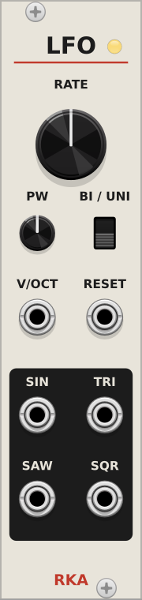

# RKA

VCV Rack 2 modules.

| Module | HP | Description |
|---|---|---|
| **LFO** | 6 | Polyphonic LFO: sine, triangle, saw and pulse-width square |

## LFO



- **RATE**: 0.008 Hz to 128 Hz, exponential. Default 2 Hz.
- **PW**: pulse width of the square, 1% to 99%.
- **BI / UNI**: outputs swing ±5 V (bipolar) or 0–10 V (unipolar).
- **V/OCT**: added to RATE; +1 V doubles the rate.
- **RESET**: a rising edge (above 1 V) restarts the cycle at phase 0.
- **SIN, TRI, SAW, SQR**: sine and triangle start at 0 V rising and stay in
  phase with each other. The saw rises and drops at the end of the cycle.
- The LED shows the sine of channel 1: green positive, red negative.
- Polyphonic: the channel count follows the widest of V/OCT and RESET. A mono
  cable drives every channel.

## Development

### Layout

```
src/LfoCore.hpp      DSP engine, no Rack dependency, unit-tested
src/LFO.cpp          Module (params, ports, polyphony) and widget
src/LFOLayout.hpp    component positions, generated, do not edit
tools/gen_panels.py  panel layout: the one source for SVGs and positions
res-src/             generated SVGs with live text (input to Inkscape)
res/                 final panels, text as paths (what Rack loads)
test/                offline unit tests
```

### Everyday commands

```
make              # build plugin.so/.dll/.dylib
make test         # unit-test the DSP core (no Rack needed)
make install      # package and install into your Rack user folder
make smoke        # load in a real headless Rack, screenshot each module
make panels       # regenerate panels after editing tools/gen_panels.py
tools/cross_build.sh   # Windows + Linux packages via Docker -> build/cross/
tools/mac_dist.sh      # (on a Mac) arm64 + x64 packages -> build/mac/
```

All of these work on Linux and macOS. On a Mac, Windows and Linux builds
come from Docker, and both Mac CPUs build natively, so one laptop produces
all four packages.

`make smoke` writes `build/screenshots/<module>.png`. It catches what unit
tests can't: a plugin that won't load, a widget that crashes, a broken panel.

### Changing a panel

Edit the layout in `tools/gen_panels.py`, then `make panels`. That rewrites
the light and dark SVGs and `src/<Module>Layout.hpp`, so positions in the
panel and the C++ can't drift apart. Rack can't draw `<text>`, so Inkscape
converts text to paths on the way to `res/`. Commit `res/` so builds don't
need Inkscape.

Each panel also carries a hidden `components` layer (red params, green
inputs, blue outputs, magenta lights), so `$RACK_DIR/helper.py createmodule`
still works on it as the official tutorial describes.

### Adding a module

1. Add its layout to `PANELS` in `tools/gen_panels.py`, run `make panels`.
2. `src/<Name>.cpp` with the module and widget; include `<Name>Layout.hpp`.
3. Declare `extern Model* model<Name>;` in `src/plugin.hpp`, register it in
   `src/plugin.cpp`.
4. Add the module to `plugin.json`, bump the minor version.
5. Keep DSP in a Rack-free header and add a test in `test/` (and to
   `TEST_BINS` in the Makefile).

## Setting up a build machine

Every platform needs the Rack SDK unzipped somewhere and `RACK_DIR` pointing
at it. SDK: `https://vcvrack.com/downloads/Rack-SDK-<version>-<platform>.zip`
with platform `lin-x64`, `win-x64`, `mac-x64` or `mac-arm64`. The version
must have the same major as the Rack you test in. Rack itself (free) is
`https://vcvrack.com/downloads/RackFree-<version>-<platform>.zip`.

### Linux (Ubuntu)

```
sudo apt install unzip git gdb curl cmake libx11-dev libglu1-mesa-dev \
  libxrandr-dev libxinerama-dev libxcursor-dev libxi-dev zlib1g-dev \
  libasound2-dev libgtk2.0-dev libgtk-3-dev libjack-jackd2-dev jq zstd \
  libpulse-dev pkg-config autoconf libtool
sudo apt install inkscape xvfb   # panels, headless smoke test
```

On this machine: SDK in `~/ws/sdk/Rack-SDK`, Rack Free in
`~/ws/sdk/rack-app/Rack2Free` (run `rack`, an alias in `~/.bashrc`; Rack
must be started from its own folder). User folder: `~/.local/share/Rack2`.

### macOS

```
brew install git wget cmake autoconf automake libtool jq python zstd pkg-config
```

Also:

- Xcode command-line tools: `xcode-select --install`
- [VCV Rack 2](https://vcvrack.com/Rack) in `/Applications`, where
  `make smoke` finds it (or set `RACK_BIN` to the `Rack` executable inside
  the `.app`)
- `brew install --cask inkscape docker` for `make panels` and
  `tools/cross_build.sh`. The Makefile finds Inkscape inside the app bundle.
  On Apple Silicon, enable **Use Rosetta for x86_64/amd64 emulation** in
  Docker Desktop settings, because the toolchain image is x86 only.

For everyday `make`, unzip the SDK for your own CPU and set `RACK_DIR` in
`~/.zshrc` (macOS uses zsh, not bash):

```
export RACK_DIR="$HOME/ws/sdk/Rack-SDK"
```

`tools/mac_dist.sh` builds release packages for both CPUs. Each CPU needs
its own SDK, so the script downloads them on first use to
`~/ws/sdk/Rack-SDK-<version>-mac-<arch>`, separate from `RACK_DIR`. Rack's
user folder on macOS is `~/Library/Application Support/Rack2`;
`make install` finds it by itself.

### Windows

Install [MSYS2](https://www.msys2.org/) and use the **MinGW 64-bit** shell
(not the default MSYS shell):

```
pacman -Syu
# restart the shell, then:
pacman -Syu git wget make tar unzip zip mingw-w64-x86_64-gcc mingw-w64-x86_64-gdb \
  mingw-w64-x86_64-cmake autoconf automake libtool jq python zstd mingw-w64-x86_64-pkgconf
```

Antivirus can slow the build badly; exclude the source folder.

### Without those machines

- `tools/cross_build.sh` builds Windows and Linux on any Docker host,
  Apple Silicon included.
- CI (`.github/workflows/build.yml`) runs the unit tests, then builds
  win-x64, lin-x64, mac-x64 and mac-arm64. Pushing a `v*` tag drafts a GitHub
  release with all four packages attached.

## Releasing

1. Bump `version` in `plugin.json` (`2.MINOR.REVISION`: minor for new modules
   or features, revision for fixes; major must stay 2 for Rack 2) and update
   `CHANGELOG.md`.
2. Commit, tag `v<version>`, push the tag. CI drafts the release.
3. To list in the VCV Library, open an issue at
   [VCVRack/library](https://github.com/VCVRack/library) with the source URL
   and the commit/tag; for updates, comment on that issue. The library builds
   from source, so a tag alone doesn't ship anything.

## License

GPL-3.0-or-later. See `LICENSE-GPLv3.txt`.
