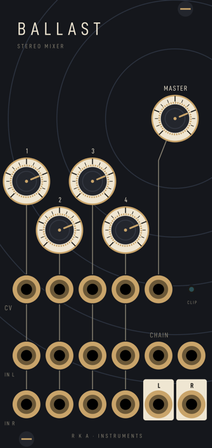

# Ballast

Four-channel stereo mixer, 12 HP: four stereo inputs, each with a Level knob
and a level CV that works like a VCA, summed to a stereo pair through
Master. CHAIN inputs join a second Ballast (or anything else) into the same
mix, and the output is DC-blocked and soft-limited so it is safe to send
straight to your audio interface, Fog or a limiter.

## The panel

Ballast is drawn as a clinometer. From the top:

- **MASTER** on its dB face, top right.
- **Levels 1 to 4** on dB faces, staggered so they fit. Each channel is one
  straight column down from its Level: the level **CV** jack, then **IN L**,
  then **IN R**.
- In the master column, beside the channels: the **Master CV** jack, traced
  up to Master, and the **CLIP** light; then **CHAIN L** and **CHAIN R**;
  then the **L** and **R** outputs on ivory tiles in the lower right corner.

The right-click menu has two items: **DC blocker** and **Add Pan expander**.

## Controls

### Level 1 to 4, and Master

Every Level and Master opens at **unity (0 dB)**, the long tick at three
quarters of the turn. Fully left is silence and fully right is +6 dB. The
curve is an audio taper: about -8.5 dB at noon and -23 dB at a quarter
turn, so most of the travel is in the useful range. Rack's tooltip shows the
level in dB.

Turning a knob is smoothed (about 10 ms), so it never clicks. Master scales
the whole mix, CHAIN included.

### Level CV and Master CV: the VCA law

Each CV opens its channel (or the whole mix, for Master CV) **from silence
at 0 V up to the knob's level at 10 V**, in a straight line: 5 V is -6 dB
under the knob. Below 0 V is silence, and above 10 V is the knob's level:
**a CV can never push a channel past where its knob is set.** With nothing
patched, the knob alone sets the level.

- Use an **envelope** to gate or swell a channel. The CV is not smoothed,
  so envelopes stay sharp, and audio-rate CV gives amplitude modulation.
- For **tremolo**, use a unipolar LFO (Sway on UNI, 0 to 10 V): the channel
  swells between silence and the knob. A bipolar LFO (±5 V) leaves the
  channel silent for the whole negative half and opens only to half level.
- A polyphonic CV uses its first channel.

## Inputs and outputs

- **IN L, IN R:** either input alone is a mono source in the centre of
  both sides (each is normalled to the other). Before 2.0.8, IN R alone
  played on the right only. A polyphonic cable is summed to one signal.
- **CHAIN L, CHAIN R:** added to the mix at unity, after the channels and
  before Master. CHAIN R is normalled to CHAIN L. A polyphonic cable is
  summed. **Eight channels from two Ballasts:** patch the first Ballast's L
  and R into the second's CHAIN, and take the mix from the second (its
  Master then sets the level of all eight).
- **L, R:** the stereo mix, one channel each.
- **L alone is a mono out.** With R unpatched, L carries the mono sum of
  both sides, (L + R) / √2. Patching or unpatching R crossfades over 10 ms.
- **No pan.** A stereo source keeps its own image; a mono source sits in the
  centre. Pan arrives with the Pan expander (below).

## The output stage

After Master, each side passes through:

- **The DC blocker** (right-click menu, on by default): a gentle 3 Hz
  high-pass that removes any DC offset. A 30 Hz drone loses well under
  0.1 dB. Turn it off to use Ballast as a CV mixer. Turning it on while an
  offset is present fades the offset away (about 50 ms) rather than
  dropping it. It is saved with the patch.
- **A soft limit:** nothing below 8 V is touched, and nothing ever leaves
  above 10 V. Four channels at unity can sum to around 20 V on peaks, more
  with CHAIN and Master turned up; the limit rounds them off instead of
  hard clipping.
- **CLIP** lights while either output is in the soft limit (above 8 V), and
  holds for 150 ms so a single peak is visible. If it lights often, turn
  Master down. It is not a level meter.

## Expanders

Ballast takes expanders: modules placed directly against its right side,
which act on its channels on the same sample.

- **[Pan](../pan/README.md)**: pan, pan CV and an attenuverter for each
  channel, with true stereo pan or balance. Add one from Ballast's
  right-click menu (**Add Pan expander**) or place it from the browser.

Mute, solo, fades, offsets and aux sends may follow.

## Bypass

Bypass silences both outputs.

## Other details

- NaN or infinite values on any input or CV read as 0.
- With neither output patched, Ballast does almost no work (the knobs'
  smoothing still runs).
- The module stores its knobs and the DC blocker setting with the patch.
