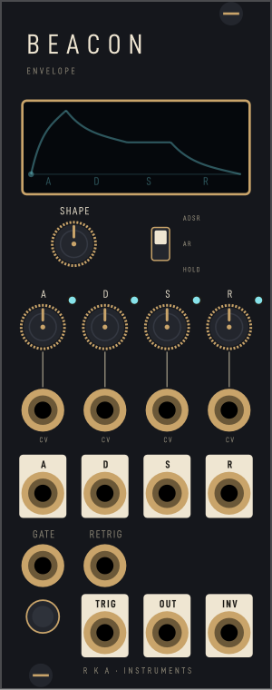

# Beacon

A polyphonic envelope, 10 HP: the light that comes up, holds and fades.
Gate, Trig and Hold on a switch (after the Instruō cèis), Attack, Decay
and Release from 1 ms to 60 s, Shape from a slow swell through linear to
the classic analog curve, a gate for every stage, a trigger at each stage
start, and a window that draws the envelope with a dot riding it.

## The panel

From the top:

- The **window**: the envelope the knobs make, lettered A D S R.
- **SHAPE**, and the **GATE / TRIG / HOLD** switch. Click its upper half
  to move it up one position, its lower half to move it down one, or drag
  it; it stops at the ends, so going from Trig to Gate never passes
  through Hold.
- **A**, **D**, **S** and **R**, each with its stage light, over its
  **CV** input and its stage **gate** output (on the ivory tiles).
- **GATE** and **RETRIG**; the push button under GATE.
- On ivory tiles: **TRIG**, **OUT** and **INV**.

## Modes

- **Gate** (switch up, the default): a rising edge starts Attack; Attack
  and Decay run while the gate is high, then Sustain holds. When the gate
  falls, Release runs from wherever the envelope is, even in the middle of
  Attack.
- **Trig**: Attack always runs to the end. If the gate is still high,
  Decay and Sustain follow; if not, Release starts from the top. A trigger
  gives an AR (AD) envelope, a long gate the full ADSR.
- **Hold**: the envelope stops and Beacon is a slew limiter. The
  **Sustain CV** input is the signal; the Sustain knob adds 0 to 10 V.
  OUT follows it, rising at Attack's rate and falling at Decay's (the knob
  sets the time for a 10 V move). Release, Shape, GATE, RETRIG and the
  button do nothing here.

  In Hold the A, D and S gates mean "rising", "falling" and "caught up";
  an input that moves slower than the slew reads as S.

### Gate or Trig with a trigger

Patch a short trigger into GATE and the two modes part. In **Gate** a
trigger shorter than Attack gives only a blip: the gate falls, and
Release starts from wherever Attack had got to. In **Trig** Attack runs
to the top, then Release. For an AR envelope from triggers, use Trig.

The gate matters in Trig too. If it is still high when Attack ends,
Decay and Sustain follow; so for an AR, the gate must fall before Attack
ends. A Sway square wave with an 11.3 s cycle holds the gate for about
5.7 s: with a 6 s Attack the gate falls during Attack, so Decay and
Sustain never run; with a 4 s Attack the gate outlasts it and they do.

In Gate and Trig, a new rising edge while the envelope runs restarts
Attack from where the envelope is, and **RETRIG** does the same without a
new gate (only while the gate is high). Every stage takes exactly its set
time, wherever it starts: an Attack begun from half way up takes as long
as one from the bottom, so it covers less level in the same time.

Moving the switch never moves the output: from Hold back to Gate or Trig,
Attack starts from the present level with the gate high, Release with it
low.

## Controls

- **A, D, R**: 1 ms to 60 s, each decade an equal share of the turn (noon
  is about 245 ms). The tooltip shows ms or s; type a time to set it
  ("250" or "250 ms", "1.5 s"). Defaults 10 ms, 300 ms, 1 s.
- **S**: the sustain level, 0 to 10 V (default 5 V). Moving it during
  Sustain moves the level smoothly, so an LFO on its CV makes a tremolo.
- **CV**: added to the knob, 10 V for the whole travel; the time is held
  between 1 ms and 60 s, the sustain level between 0 and 10 V.
- **SHAPE**: one curve for every stage. Noon is linear; right, the
  classic contour (a fast, rounded attack, decays with a long tail); left,
  the mirror (an attack that swells, decays that hold and then fall).
  Default three quarters right.
- **Push button**: a gate on every channel while held (shift-click
  latches it).
- **GATE, RETRIG**: gates at the plugin's usual thresholds (high at 1 V,
  low below 0.1 V).

### RETRIG for legato

With notes played legato (the next key down before the last is up) the
gate never falls, so there is no new rising edge and the envelope stays
in Sustain. Patch the sequencer's or MIDI-CV's trigger to **RETRIG**: each
trigger sends the envelope back up through Attack from its present level,
so it never jumps and the held notes stay connected. RETRIG does nothing
while the gate is low.

## Outputs

- **OUT**: 0 to 10 V (Hold: ±10 V). **INV**: OUT upside down.
- **A, D, S, R**: 10 V while that stage runs. In Hold: A while the slew
  is limiting upward, D while limiting downward, S when OUT has caught
  the input. With Sustain at 0, the S gate still goes high while the gate is
  high; the output sits at 0 V.
- **TRIG**: a 1 ms, 10 V trigger at the start of every stage, including
  the return to rest at the end of Release.
- The stage lights are lit while that stage runs, on channel 1; a stage
  too short to see still lights for 40 ms.

## The window

The envelope drawn from the knobs (with channel 1's CVs) and Shape. It
is a picture of the envelope, not a meter.
Each stage's width grows with the log of its time, so a 1 ms Attack stays
visible beside a 60 s Release; the window shows shape and position, not a
ruler. The knobs' shape is drawn dim. The running stage's letter is
bright, and an Attack, Decay or Release that is running is drawn bright
from the level where it really started. A gate that rises while
releasing draws Attack over its own span, from that level up to 10 V. A
stage that skipped others is drawn from the end of the last one's span:
a gate that falls mid-Attack, or just as Attack completes, draws Release
from that level at the end of the Attack span down to 0 V at the right
edge. A dot rides the
bright line where channel 1 is. Sustain is bright while it runs; with
Sustain at 0 V its span stays dim and the dot waits at the end of the
line. In Hold the window shows a scrolling line of the output.

## Patches to try

- **A plain voice.** MIDI-CV GATE into GATE and V/OCT into Fathom; OUT
  into a Sluice level CV, and again into Narrows' cutoff. Play notes,
  turn A, D, S and R in turn, then Shape fully left, at noon and fully
  right on the same times.
- **Legato.** MIDI-CV's trigger into RETRIG as well as its gate into
  GATE. Overlapping notes each climb from where the envelope is.
- **Slow swells.** Squall's GATE into GATE, Trig, A about 8 s, R 20 s,
  Shape left; OUT into Sluice's level CV on a Fathom drone, into Fog.
  Each gate swells the drone in and lets it fade. Try Shape right.
- **Events from the stage gates.** The A gate into Rigging's STRUM (a
  strike as Attack starts) and TRIG into Narrows' PING: a long gate gives
  five pings: the start of Attack, Decay, Sustain and Release, and the
  return to rest.
- **Ducking.** INV into Sluice's level CV on an open drone: the drone
  gives way while the envelope rises and comes back as it falls.
- **Glide.** A sequencer's V/OCT into the Sustain CV, Hold, S fully
  left; OUT into Fathom's V/OCT. A sets the glide up, D the glide down.
  Watch the A, D and S gates.
- **Chords.** MIDI-CV with four voices: GATE into GATE, OUT into a
  polyphonic Sluice. Each voice has its own envelope; the window and
  lights follow voice 1.
- **Pulses on a held sound.** Hold the push button (or send a long gate)
  and put Squall's GATE or a clock into RETRIG: the envelope re-swells
  from where it is. D and S set how far each pulse falls back.

## Polyphony

In Gate and Trig, one envelope for each channel of GATE (one when it is
unpatched); in Hold, one for each channel of the Sustain CV. RETRIG and
the CVs take a channel each from a polyphonic cable, or one value for all
from a mono one. Every output carries the channel count.

## Other

- Bypass: the outputs fall silent, and every envelope goes to rest at
  0 V; on un-bypass nothing resumes (a gate still high starts a new
  Attack from 0 V).
- Initialize: every envelope at rest at 0 V.
- A sample rate change keeps every envelope where it is.
- Saved with the patch: the knobs and the switch.
