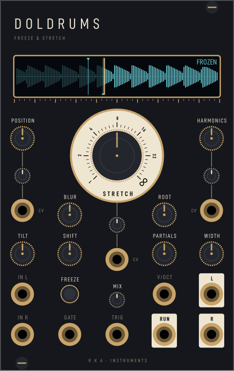

# Doldrums

A stereo freeze and stretch, 16 HP: a ship becalmed, the sound going
nowhere. Doldrums keeps the last 30 seconds of its input on a tape. It can
hold any moment of that tape for as long as you like, or creep through it
many times slower than it was played. The sound is PaulStretch's (Paul
Nasca's method, written afresh): slices of the tape are taken apart into
their frequencies, given new random phases and put back together, so what
comes out is smeared, glassy and never quite repeats. A tuned comb,
**Harmonics**, can keep only a note and its overtones, so noise comes out
as a drone in tune. A trigger can play one pass and a gate says when it
runs, so another module can record it.

## Hold what is playing

The plain use, and the one to try first:

1. Patch a sound into **IN L** (and **IN R** for stereo) and the **L** and
   **R** outputs to your mixer. Leave every knob where it starts: Position
   fully right, Stretch at 8, Mix fully wet.
2. Press **FREEZE**. Its cap lights.

The moment that was playing when you pressed it now sounds until you
change something. The window's corner says **FROZEN HELD**. Press FREEZE
again to let it go: the tape starts recording again, and the sound carries
on from the frozen moment through what follows it, coming back to the
present only when that pass ends (see Freeze, below).

Why it holds: with **Position** fully right a pass starts at the newest
moment on the tape, and with the tape frozen there is nothing after that
moment to travel through. So the read point stands still and the module
plays that one slice, with new random phases every grain, so it shimmers
and does not loop. It does this at any Stretch and with either setting of
"At the end of a pass".

## The panel

From the top:

- **The window**: the 30 s tape, oldest on the left and now on the right,
  over a ruler in tenths (3 s each).
- **POSITION** on the left and **HARMONICS** on the right, each with its
  attenuverter and CV jack beneath it. **STRETCH**, the large dial,
  lettered 1, 2, 4, 8, 16, 32 and ∞, in the middle.
- **BLUR** and **ROOT**; under Stretch, its attenuverter and CV jack.
- **TILT**, **SHIFT**, **PARTIALS**, **WIDTH**.
- **IN L**, the **FREEZE** button, **MIX** (small), **V/OCT** and, on
  ivory, the **L** output.
- **IN R**, the **GATE** for Freeze, **TRIG**, and on ivory **RUN** and the
  **R** output.

"CV" is printed beside each of the three CV jacks.

## The tape and its window

The tape is stereo and holds the last 30 seconds at Rack's sample rate. It
records the input all the time unless it is frozen. It is silent when the
module is added. While it records, the picture scrolls left; frozen, it
stands still.

What the window shows:

- **The tape** as cyan peaks of both sides together. The glass spans
  ±6 V, so a ±5 V sound fills most of it. A silent tape shows a dim line
  at 0 V.
- **Bright and dim.** The part the pass has still to play is bright; the
  rest is dim. Frozen, that is from the read point to the right end.
  Recording, it is from the read point to where the oldest sound will
  catch it up. Held, only the held slice is bright. Stopped, nothing is.
- **The anchor**, where Position says a pass starts: a cyan line with a
  small cyan flag at its top.
- **The read point**, the end of the slice being heard: an ivory line.
- **The slice** itself: a pale cyan band at its true width (a grain long:
  about 1 % of the window at the Medium grain), with a cyan bar along its
  foot.
- **The corner, top right**, says what state the module is in whenever it
  is not plainly running:
  - **FROZEN**: the tape is frozen and a pass is travelling through it.
  - **HELD**: the read point stands still (Stretch at its stop), the tape
    still recording.
  - **FROZEN HELD**: frozen and held, for either reason (Stretch at its
    stop, or nothing to travel through).
  - **STOPPED**: in the "Stop" setting, a pass has ended (or the patch
    has just opened) and the module is silent until a trigger at TRIG.
  - **FROZEN STOPPED**: the same, on a frozen tape.
  - Nothing: plainly running.
- **The corner, top left**, says if the patch's tape had trouble:
  **TAPE NOT READ** or **TAPE NOT SAVED** (see "With the patch").

Held while the tape records, the read point's line rides left with its
sound and goes off the left edge once that sound has been recorded over;
the corner still says HELD, and the sound still plays (it is kept, not
read from the tape again).

### Setting Position with the mouse

Press in the window to put the anchor under the mouse; drag to move it.
**POSITION** turns to match, and the whole gesture is one undo step. With
a CV at Position's jack, the knob is set so that knob plus CV, as the CV is
at that moment, puts the anchor under the mouse; the knob stops at its
ends, so a large CV can leave the anchor short of the mouse. The anchor
cannot go further left than a grain from the oldest end of the tape, so a
press at the very left edge sets Position fully left. The right mouse
button opens the menu, as anywhere on the panel.

## Position and Stretch

**The read point** is the end of the slice the next grain takes. It is
what you hear.

**POSITION** says where a pass starts (the anchor): fully right is now,
fully left is as far back as a whole grain can still be taken (30 s less a
grain). The tooltip says how far back: "now" or "12.3 s ago"; you can type
a number of seconds, or "now". Default: fully right.

**STRETCH** says how fast the read point moves on through the sound: at 1
it moves a second of tape each second, at 8 an eighth of a second each
second. The tooltip shows the figure ("x8.0", "x128") and "held" at the
stop; you can type a figure ("8", "x8", "128") or "held". Default: 8.

- Over the lettered travel, up to the 32, it doubles every 45 degrees: 1,
  2, 4, 8, 16, 32.
- **The last sixth of the dial**, from the 32 to the ∞ at the end, rises
  without limit: 64 about 30 % of the way along it, 128 half way, and
  at the very end the read point does not move at all. That end
  is **held**.

**Frozen**, the tape stands still and the read point travels right,
towards now. When it reaches the end of the tape the pass is over.

**Not frozen**, the read point moves through the sound at the same pace,
but new sound arrives at full pace, so the read point falls behind now
and drifts left in the window. When the oldest sound, about to be recorded
over, catches it up, the pass is over. At Stretch 1 it keeps pace and
never returns: you hear a smeared copy of the input, late by Position's
distance and about a grain. With the defaults (Position fully right, x8,
not frozen) a pass lasts about 34 seconds and then starts again from now.

**At the end of a pass** (the menu, below) the read point goes back to the
anchor and plays again, or stops and waits for TRIG.

**Turning Position** moves the read point by the same amount, at the next
grain, wherever it has got to; it does not start the pass again. If that
would take it off the tape it stops at the edge. Frozen, a turn far enough
right to push the read point to the end of the tape ends the pass at
once.

**Held** means the read point stands still and one slice sounds for as
long as it stays so, with fresh random phases every grain. It has two
causes:

- **Stretch at its stop** (the ∞ end of the dial, or a CV pushing it
  there).
- **Nothing to travel through**: the tape frozen with the anchor less than
  a grain from the end of the tape. Position fully right, frozen, is the
  usual case.

While held:

- The module keeps that slice's loudnesses and does not read the tape
  again, so when the tape is recording the held sound stays even after the
  tape under it has been recorded over.
- **Moving Position takes a new slice**: the read point moves by as much
  as the anchor does (held to the ends of the tape). With the tape frozen
  and Stretch at its stop this is a scrub through the 30 s, by hand or by
  CV. If the held place has already been recorded over, the new slice is
  taken at the anchor itself.
- A pass never ends, in either setting of "At the end of a pass", and RUN
  stays high.
- **Leaving held** (Stretch off its stop, or Position turned left so there
  is something to travel through): the read point goes on from where it
  is if that place is still on the tape, and from the anchor if not.
- **Changing Grain while held** takes the slice again at the new size if
  its place is still on the tape (while recording, with some room to
  spare); if not, the held sound keeps its size until it is let go.

**Not frozen, with Position fully left**, a pass has less than a grain to
travel before the oldest sound catches it. The module then takes its slice
at the anchor every grain: you hear the input as it was about 30 seconds
ago, at any Stretch. It is not held (the corner says nothing), it never
ends, even in the Stop setting, and RUN stays high.

**Stretch CV**: knob plus attenuverter × volts ÷ 10, so at full
attenuverter 10 V crosses the whole dial. The attenuverter starts at 0:
turn it to use the CV. A CV that pushes past the end is a stop (held).

**Position CV**: the same rule; at full attenuverter 10 V crosses the
whole tape.

With a cable in Stretch's, Position's or Harmonics' CV jack, that knob's
tooltip adds what is heard with the CV whenever the two differ, for
example "x8.0 (x16.0 with CV)".

## Freeze

**FREEZE** (the button, which latches) or a high gate at **GATE** freezes
the tape; either one is enough. The gate is high from 1 V and low again
under 0.1 V. The cap is lit while the tape is frozen, by either.

Frozen, the tape stops recording and the 30 s stay as they are. The
recording fades out over 5 ms at the freeze and back in over 5 ms when
Freeze ends, so no step is written onto the tape. Recording goes on from
the same place.

**Freeze going on starts a new pass from the anchor**, so the frozen moment
is reached at once instead of after a long creep. In the Stop setting this
holds while a pass is running; while the module is stopped, Freeze wakes
it only when there is nothing to travel through (Position within a grain
of the end, so the result is held). With a pass to travel, a stopped
module stays silent until TRIG.

**Freeze going off changes nothing**: the read point goes on from where it
is, now through a tape that records again. So after a hold at Position
fully right, letting Freeze go carries on from the frozen moment through
what followed it, falling behind, and comes back to the present only when
that pass ends: 30 / (1 − 1/Stretch) seconds later, give or take a grain
(34 s at x8, a minute at x2, never at x1).

**Freeze while held by Stretch at its stop** starts a new pass from the
anchor like any freeze, so the held sound is replaced by the slice at
Position's place. To keep a moment, freeze first, then hold.

## TRIG, RUN and the end of a pass

**TRIG** puts the read point back on the anchor and starts a new pass at
any time: in mid pass, held or stopped. It acts on a rising edge (high from
1 V, low again under 0.1 V).

**RUN** is a gate: 10 V while a pass is sounding.

- It rises when the first grain of a pass begins to sound, so it follows
  what you hear, not the moment the trigger came.
- In the **Stop** setting it falls when the pass's last grain has faded
  out, and stays low until the next pass. A recorder gated by RUN catches
  the fade in and the fade out.
- In **Go round** one pass dissolves into the next and something is always
  sounding. RUN goes low for 1 ms where each new pass's first grain
  begins, as a marker, and is otherwise high.
- A trigger at TRIG in mid pass starts a new pass and so makes the same
  1 ms dip, in either setting.
- Held, for either reason, RUN stays high.

The menu's **At the end of a pass**:

- **Go round** (the default): at the end of a pass the read point returns
  to the anchor and plays again, dissolving from the old place to the new.
- **Stop (until TRIG)**: at the end of a pass the wet sound fades out with
  its last grain and stays silent until a trigger at TRIG. The corner says
  STOPPED. While stopped, neither moving Position nor setting Stretch to
  its stop wakes it; Freeze wakes it only onto nothing to travel through
  (above). Choosing Stop does not end the pass under way: the module stops
  when it ends. Choosing Go round while stopped starts a pass at once.
  **A patch opened with Stop chosen waits for a trigger**, unless its
  tape is frozen with nothing to travel through, which is held and sounds
  at once.

## The menu

Right-click the panel:

- **Grain**: **Short (0.17 s)**, **Medium (0.34 s)** (the default) or
  **Long (0.68 s)**: how long a slice is. See Grains, below.
- **Wide (each side its own random phases)**: off by default. Off, the two
  sides share their random phases and keep the difference in phase they
  had on the tape, so a sound in the middle stays in the middle and a
  sound to one side stays there; a mono input gives two identical sides.
  On, each side gets its own random phases, so any sound, mono included,
  fills the whole width.
- **At the end of a pass**: **Go round** or **Stop (until TRIG)** (above).
- **Keep the frozen tape with the patch**: on by default. See "With the
  patch".

## Grains

A grain is the slice of tape turned into sound at one time. A new grain
starts every half grain, and each overlaps the last by half; because each
has its own random phases, the overlap is a crossfade between two
unrelated sounds, shaped so the loudness stays steady through it. So
everything that changes between one grain and the next (a jump of the read
point, a new comb, a new Tilt) comes in as a dissolve over half a grain.

| Rate | Short | Medium | Long |
|---|---|---|---|
| 44.1 kHz | 8192 samples, 0.19 s | 16384, 0.37 s | 32768, 0.74 s |
| 48 kHz | 8192, 0.17 s | 16384, 0.34 s | 32768, 0.68 s |
| 88.2 kHz | 16384, 0.19 s | 32768, 0.37 s | 65536, 0.74 s |
| 96 kHz | 16384, 0.17 s | 32768, 0.34 s | 65536, 0.68 s |
| 192 kHz | 32768, 0.17 s | 65536, 0.34 s | 131072, 0.68 s |

A grain is never longer than 131072 samples, so above 192 kHz Long is
shorter than 0.68 s (at 384 kHz it is the same size as Medium). A longer
grain smears more and resolves pitch more finely; a shorter one follows
changes sooner.

Frequencies under 16 Hz are dropped, so the random phases cannot make the
output wander. Silence in gives exact silence out once the last grain has
ended. The random numbers come from a generator seeded when the module is
added: a reopened patch has new random phases, as any noise source has.

## Blur, Tilt and Shift

Knobs only, each read once a grain. Each does nothing at all at its
default.

- **SHIFT** moves the whole spectrum up or down by up to two octaves (±24
  semitones). Noon is no shift, exactly, within a quarter of a semitone
  either way; the tooltip says "0" there and "+7.0" (semitones) elsewhere.
  What would pass the top of the band is dropped, not folded back. A tone
  shifted down stays one tone. A tone shifted up is spread over more
  frequency lines in proportion to the shift (see What to expect).
- **BLUR** smooths the spectrum along a scale of pitch, so it is as wide in
  the bass as in the treble: 0 to 1 octave (the tooltip says octaves). At
  full a chord becomes coloured noise. It keeps the sound's energy.
  Default 0.
- **TILT** is a slope across the spectrum about 1 kHz: noon is flat, left
  darker, right brighter, up to 6 dB per octave either way (the tooltip
  says dB per octave). The gain at any frequency is held within ±24 dB.

They act in that order (Shift, Blur, Tilt, then the comb), so what Shift
moves meets the others at its new frequency.

## Harmonics

A comb in the spectrum that passes only the energy near a note and its
overtones.

- **HARMONICS** is the amount: 0 % (the default) takes the comb out of the
  path altogether; 100 % passes only its teeth; between, the two are mixed.
  Its CV, at full attenuverter, crosses it with 10 V.
- **ROOT** is the comb's note, in semitones from C1 to C7, C4 at noon.
  Default C2. The tooltip names the note ("C2"); you can type a note
  ("F#3", "Bb1") or a number of semitones from C4.
- **V/OCT** moves the note from Root by a volt an octave: at 0 V the comb
  is on Root's note, as an oscillator is. It is not held to semitones.
  Voltages past ±12 V read as ±12 V.
- **A polyphonic cable at V/OCT makes a chord**: one comb for each
  channel, up to 16, all with the same Partials and Width, and a frequency
  passes if any of them passes it.
- **PARTIALS**, 1 to 32 in whole steps: the teeth stand at the note and its
  overtones (the note times 1, 2, 3 and so on), equally strong. Teeth above
  the top of the band, or under 16 Hz, are left out. Default 8.
- **WIDTH** is how wide each tooth is, from 5 cents (a clear pitch) to 300
  (the source comes back through); the tooltip says cents, and you can
  type a number of cents. Default 25 cents. A tooth has a soft, bell-shaped
  edge, and is never narrower than the transform can show: the frequency
  line that holds a tooth always passes whole, so no tooth disappears on a
  low note.
- **Loudness.** A comb passes only a small part of a noisy sound's energy,
  so the comb's output is brought up by an amount worked out from the comb
  alone (how much of a flat spectrum it would pass), never more than 8
  times (+18 dB). Turning Harmonics up therefore does not make the sound
  sink away. The gain on a frequency is (1 − h) + h × makeup × tooth, h
  being Harmonics.
- **Timing.** A change of note, Partials or Width reaches the sound at the
  next grain's start, or at the one after if the comb was being rebuilt,
  and then dissolves in over half a grain: at worst about a grain's length
  before the dissolve begins (0.34 s at Medium). The comb follows notes at
  the grain's pace and no faster. A V/OCT step never clicks.

## Mix and the latency

**MIX** is dry to the left and wet to the right, at equal power between.
Default fully wet. It moves smoothly (10 ms for its whole travel).

The dry sound is not delayed. **The wet sound is about a grain late**: a
slice is taken when it is complete, and is heard over the grain that
follows. On top of that, each grain's work is spread over the samples
after its start, so a grain starts to sound a fixed time after it was
taken: 640 samples at 44.1 and 48 kHz (14.5 and 13.3 ms), 1180 at 88.2 kHz
and 1280 at 96 kHz (13.4 and 13.3 ms): about 13 to 15 ms from 44.1 kHz
up. Below 44.1 kHz it stays 640 samples (20 ms at 32 kHz, 29 ms at
22.05 kHz, 80 ms at 8 kHz), except Short at 8 kHz, where it is 510
samples (64 ms). So mixed
dry and wet are not in time; Mix is for blending a texture under its
source, not for a tight effect.

## With the patch

Saved with the patch: the knobs, the Freeze button, and the four menu
settings. The random seed is not saved.

**A frozen tape is kept with the patch**, as `tape.wav` in the module's
folder inside the patch (32-bit float stereo, in volts, at Rack's rate:
about 11.5 MB at 48 kHz, 23 MB at 96 kHz). It is written when you save the
patch, and only when:

- the Freeze **button** is on (a tape frozen by the gate alone is not
  kept: the button is what the patch saves, and the tape follows it);
- **Keep the frozen tape with the patch** is on;
- the tape has not been written since it froze (one freeze, one write).

With the button off or Keep off, the file is removed at the next save. A
tape that is not frozen stores nothing. **A sound that is only held**
(Stretch at its stop, the tape recording) **is not kept**: to keep a
sound, freeze it with the button. Remember that Freeze while held takes
the slice at Position's place (Freeze, above).

A reopened patch has the same tape and the same Position, and starts its
pass from the anchor: in Go round at once, in Stop waiting for a trigger
unless there is nothing to travel through (then held). Until the tape has
been read (on a background thread, a moment after the patch opens) the
tape is silent and frozen, and saves leave the file alone.

**A patch saved without its tape file** opens with a silent tape and no
error (a line in Rack's log says so).

**A tape file that is there but cannot be read** (damaged, cut short, not a
WAV) leaves the tape silent; the window says **TAPE NOT READ** and the log
says why. The file is kept while Freeze stays on, so it can still be
mended; freezing a new tape and saving writes over it. The words stay
until a save writes or removes the file, or the module is initialised.

**A frozen tape that could not be written** at a save is not kept: the
window says **TAPE NOT SAVED**, the log says why, and the old file is
removed. The words stay
until a save writes the tape or removes the file as planned.

**When Rack's sample rate changes**, a frozen tape is converted to the new
rate off the audio thread; until it is ready the tape is silent and stays
frozen, and the wet sound fades with its last grains. A tape that is not
frozen starts again from silence. The file stays at its old rate until the
tape is frozen anew (it is converted again each time it is read).

## Specifications

- **IN L, IN R**: audio, ±5 V. IN R takes IN L when unpatched.
  Polyphonic cables are summed.
- **GATE** (Freeze), **TRIG**: high from 1 V, low under 0.1 V.
- **Stretch CV, Position CV, Harmonics CV**: knob plus attenuverter ×
  volts ÷ 10, held to the knob's range. These, GATE and TRIG take a
  polyphonic cable's first channel.
- **V/OCT**: 1 V an octave, up to 16 channels, each a comb; held to ±12 V.
- NaN or infinite voltages at any input read as 0 V.
- **L, R**: exact up to 8 V, then softly bounded, never past 10 V.
- **RUN**: 0 or 10 V; the dip is 1 ms (at least one sample).
- **Tape**: 30 s, stereo, at Rack's rate; 11.5 MB at 48 kHz.
- **Grain**: see the table under Grains. Overlap: half a grain.
- **Latency of the wet sound**: about one grain, plus 640 samples at 44.1
  and 48 kHz, 1180 at 88.2 kHz, 1280 at 96 kHz, 2560 at 192 kHz.
- **Sample rates**: 8 kHz to 768 kHz. Outside that the module keeps its
  old rate or is silent, and the log says so.
- **CPU**, % of one core at 48 kHz on an Apple M-series Mac (M5 Pro),
  measured 2026-11-26: 0.11 at the defaults with nothing patched (a grain
  is made every half grain even of silence), 0.11 recording a tone, 0.33
  at its busiest (the Long grain, a 16-note comb with V/OCT moving, Blur
  and Shift up). The work is spread so no one sample does more than one
  transform: the most work on any single sample measured 70 µs at 96 kHz
  with the Long grain and 33 µs at 48 kHz, with the core at its working
  clock. From a light load the first grains took up to about 1.7 times as
  long (about 110 to 120 µs at 96 kHz).

## What to expect

These are limits of the method or of this build, found while it was
built. None is a fault you can fix with a setting, unless one is named.

- **The wet sound is about a grain late** (0.17 to 0.68 s at 48 kHz) plus
  13 to 15 ms (more below 44.1 kHz: see Mix and the latency). Mixed with the dry sound it is not in time.
- **A pure tone wavers in level.** Where two grains overlap, their random
  phases may add or cancel, and a pure tone fills only a few frequency
  lines, so its level over ten seconds can wander by up to about 2 dB at
  the Long grain (about 1 dB at Short); over a minute it averages out to
  within half a dB. Noise holds steady, within a few hundredths of a dB;
  a held chord of a few notes stays within about half a dB over each ten
  seconds (measured on a held triad). This waver is part of the method's sound.
- **A frozen full-level sound peaks well above its input.** A held 5 V
  sine comes out at the same loudness but as a narrow band of noise, whose
  peaks reach 13 to 14 V. The output's soft bound (exact up to 8 V) then
  works on those peaks, adding a little roughness (its products are about
  37 dB down). Any sound comes out with the peaks of noise at its own
  loudness, so a loud pad or chord can reach the bound too. Turn the
  input down if you hear it.
- **The comb follows notes at the grain's pace.** A new note starts to
  dissolve in up to a grain after it arrives, so a quick line runs
  together. Slow chord changes work best; Short follows fastest.
- **Low roots want the Long grain.** A tooth is never narrower than about
  2.7 of the transform's frequency lines, which at a low note is wide in
  cents: about 200 cents at 65 Hz (C2) with the Medium grain at 48 kHz.
  Long halves that; Short doubles it.
- **A tone shifted up is widened** in proportion to the shift: at +24
  semitones (×4) with the Medium grain, a tone is about 47 Hz wide. Large
  upward shifts sound rough.
- **A held sound is not kept with the patch** unless the tape is frozen by
  the button (above).
- **A change of Grain bumps the level for one grain** (up to about 3 dB,
  most from Long to Short), as the two sizes overlap. It does not click.
- **Deleting the module while it reads its tape** (just after a patch
  opens, or during a rate change's conversion) holds Rack's audio until
  that read finishes.

## Patches to try

- **Hold a chord.** Rigging (or Fathom) into IN L and IN R. While a chord
  sounds, press FREEZE: FROZEN HELD, the chord left sounding
  under the piece. Turn Blur up for a softer bed; Tilt left to darken it.
  Press FREEZE again to let the music move on.
- **A tuned drone from noise.** Hadal's L and R into IN L and IN R.
  HARMONICS to 100 %, Grain Long (menu). Shoal running Harrington 1200:
  its B, C and D outputs (the chord's three notes) merged into one
  polyphonic cable (VCV's Merge, from Fundamental) into V/OCT. Shoal's
  pitch CV reads 0 V as a C, so with ROOT on any C the comb plays Shoal's
  notes; set its octave by ear to the voice it accompanies (C2, the
  default, or lower for a deeper drone). Trigger Harrington's moves slowly (a slow clock or
  Squall into its TRIG 2 to 4): each new chord dissolves in over about a
  grain. Width at its default gives a clear pitch; turn it up to let the
  noise back in. Partials sets how bright it is.
- **A slow scan.** Fill the tape with something that changes over the 30 s
  (a field recording from Eddy, a Rigging phrase), turn STRETCH to its
  stop (∞), then press FREEZE: FROZEN HELD, the slice on the anchor (a
  freeze starts its pass there). Neap's cycle 5 into Position
  CV, POSITION at noon and its attenuverter fully right, so Neap's ±5 V
  crosses the whole tape. Each grain takes the slice where Neap has put the
  anchor: the 30 s are scanned back and forth, a cycle about every half
  minute at Neap's default Rate. Neap's TIDE in its place (Weight to the
  right, so the slow cycles lead) wanders over the tape and does not
  retrace its path. Turn Stretch back off the stop for the read point to
  creep on from wherever the scan has left it.
- **Draw a clip out into a long loop** (Eddy into Doldrums into Eddy):
  1. **Eddy A**: load the clip (right-click, Load file), LOOP off. Its L
     and R outputs into Doldrums' IN L and IN R.
  2. **Doldrums**: menu, At the end of a pass: **Stop (until TRIG)**.
     Leave Freeze off. Wait for the corner to say **STOPPED**: the pass
     under way has to end first (about half a minute with the defaults).
  3. Right-click POSITION and type a little more than the clip's length,
     in seconds ("11" for a 10 s clip), so that once the clip is on the tape
     the anchor will be just before its start.
  4. Press PLAY on Eddy A. The clip goes onto Doldrums' tape (you see it
     scroll in from the right). As soon as it ends, press Doldrums'
     **FREEZE**. The corner says **FROZEN STOPPED**: nothing sounds and RUN
     is low. (If Position is fully right this would be held and sound at
     once instead.)
  5. Drag in the window to put the anchor's flag exactly at the clip's
     start. Nothing sounds while you do. The pass will run from there to
     the end of the tape, so anything recorded after the clip and before
     the freeze is stretched too: freeze promptly. The first grain is the
     slice that ends at the flag, so the clip's onset comes in over the
     first grains, as a fade in: that is the method, not a flag set late;
     leave the flag at the clip's start.
  6. Set STRETCH (at 8 a 10 s clip becomes about 80 s).
  7. **Eddy B**: Doldrums' L and R into its IN L and IN R, and Doldrums'
     **RUN** into its **REC** gate. Patch RUN while it is low (it is, while
     STOPPED), or Eddy B sees a rising edge and starts recording.
  8. A single trigger into Doldrums' **TRIG** (a button module, or Beacon:
     its push button, its A output into TRIG). RUN rises as the first grain
     sounds, so Eddy B starts recording with the fade in; it falls when the
     last grain has faded, so Eddy B stops with the fade out and plays the
     recording back as its tape. That is exactly one pass.

  Eddy B holds 5 minutes at 48 kHz (2:54 at 96 kHz): a 10 s clip at up to about x30, or the whole
  tape at up to x10. A second trigger at TRIG records a new pass over the
  first.

## Bypass

Bypassed, the inputs pass to the outputs (IN R taking IN L when
unpatched); RUN is low and the Freeze cap dark.

## Other details

- **Initialize** silences the tape, returns every knob and the Freeze
  button to its default, and the menu to its defaults (Medium, Wide off,
  Go round, Keep on).
- **Randomize** leaves Freeze, Mix and the menu alone (it would otherwise
  freeze the tape or take the effect away).
- Each Doldrums holds its tape in memory: 11.5 MB at 48 kHz. While a
  frozen tape is converted to a new rate, the old one is kept beside it
  until the new one is ready.
- The lettering in the window is D-DIN Condensed, shipped with the plugin
  under its licence (SIL Open Font License 1.1).
- The transform is PFFFT by Julien Pommier, vendored unchanged (see the
  plugin's README).
