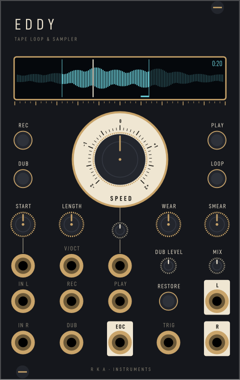

# Eddy

A stereo tape loop that also plays files, 16 HP: water that keeps coming
round. Eddy has one tape. Fill it by recording or by loading a WAV, and
from then on it is the same tape: it comes round at any speed in either
direction, through a window set by **Start** and **Length**; new sound can
be layered onto it with **Dub**; and it can **Wear** a little on every
pass. A trigger plays it from the start, once or looped. The tape can be
saved as a file, and it is kept with the patch.

## The panel

From the top:

- **The window**: the whole tape as its waveform, over a ruler in tenths
  (see "The window" below).
- **REC** and **DUB** on the left, **PLAY** and **LOOP** on the right: lit
  buttons, either side of **SPEED**, the large dial lettered -2 to +2.
- **START**, **LENGTH**, Speed's attenuverter, **WEAR**, **SMEAR**.
- The Start CV jack (joined by a line to START), **V/OCT**, the Speed CV
  jack (joined to Speed's attenuverter), **DUB LEVEL** and **MIX**.
- **IN L**, the **REC** gate, the **PLAY** trigger, the **RESTORE** button
  and, on ivory, the **L** output.
- **IN R**, the **DUB** gate, **EOC** on ivory, **TRIG** (Restore's
  trigger) and, on ivory, the **R** output.

## The tape

Stereo, up to 5 minutes. Empty when the module is added. It is held at
Rack's sample rate, and its length is also held to 2^24 frames, so above
about 56 kHz it is shorter than 5 minutes: 3:10 at 88.2 kHz, 2:54 at
96 kHz, 1:27 at 192 kHz. A tape longer than that when the rate goes up
there is cut to fit (the log says so), and stays cut if the rate comes
down again. A patch whose stored tape is longer than the tape holds at the
rate it is opened at loads it cut, but leaves the stored files as they
were until the tape is changed and the patch saved.

A file at another rate, and the tape itself when Rack's rate changes, are
converted off the audio thread, once: a file or stored tape that has not
started playing when the rate changes (as at launch, while Rack finds its
audio device) is read again at the new rate, not converted twice. A file
plays the old tape until it is ready; after a rate change the module is
silent until the converted tape is ready.

A new tape (a recording ending, a file arriving, Clear) comes in by a short
fade, never a step.

## The window

The whole tape, left to right, as its waveform (the peaks of both sides
together; the glass spans ±6 V, so a ±5 V tape fills most of it).

- The part in play is bright and the rest dim, with a thin line at each
  end of the part in play. A window that runs past the tape's end is shown
  in two pieces.
- The play head is an ivory line.
- The stretch Smear overlaps is marked along the bottom edge, back from
  the window's end.
- The tape's length, as m:ss, is in the top right corner.
- A dub shows as it lands, and wear as the waveform thins.
- Empty: a flat line.

**While recording** the window shows a span that starts at 4 seconds and
doubles each time the recording reaches its end (8, 16, 32 s and so on, up
to the tape's length), so the recording always fills half to all of the
glass. The head is at the recording's front and the corner counts the time
recorded. For the first 0.3 s of a recording a bright strip grows from the
left over the old tape's waveform, now dimmed (over an empty tape, the
flat line); then the old waveform goes. When the recording ends the window
shows the new tape edge to edge.

### Setting the window with the mouse

A drag in the window sets **START** and **LENGTH**; the knobs turn to
match.

- **Drag across the waveform** to select the part to play, either way
  round.
- **Take hold of an end line** (press within about 4 pixels of it) and drag
  to move that end alone: moving the start keeps the end where it is, and
  moving the end leaves START untouched. An end dragged past the other
  swaps roles.
- **Double-click** for the whole tape.
- A click without a drag changes nothing.
- One undo step puts both knobs back, however long the drag.
- A selection is at least 10 ms and never wraps past the tape's end.
  Dragging an end of a window that wraps keeps its other end where it is
  drawn and selects the stretch between it and the mouse, so the window
  stops wrapping.
- With the Start CV patched, the drag sets the knob so that knob plus CV,
  as the CV is at that moment, puts the start under the mouse. The knob
  stops at its ends, so a large CV can leave the start short of the mouse.
- Nothing happens with an empty tape or while recording, and a drag stops
  where it is if a recording starts or the tape is cleared or replaced
  while you drag.
- There is no fine mode: the drag follows the mouse.

## Controls

### Rec

**REC** (the button) starts a recording and, pressed again, ends it. The
**REC** jack starts one when its gate rises and ends it when the gate
falls. Either can end a recording the other started. Recording is always
at speed ×1, forwards, whatever Speed says, and takes the input as it is,
offset and all, so a plain loop is exact. **IN R** takes **IN L** when
nothing is patched into it; polyphonic cables are summed.

When a recording starts, the old tape fades out (it is kept until the
recording is long enough to stand) and Dub turns off. When it ends, the
input goes on being taken for a moment (up to 10 ms) to make the join from
real sound; the recording becomes the tape and the original, Play comes on
and the tape plays from Start (once, if Loop is off). At the tape's
length it ends by itself.

A recording too short to keep is thrown away and the tape before it stays
exactly as it was:

- Under **0.3 s** if the REC button started or ended it, so a quick double
  tap on the button does not erase the tape. The tape still pauses for the
  moment of the tap (it fades out at the first press and fades back in
  where it stopped), and Dub stays off.
- Under **50 ms** if the REC gate started it and ended it, so a patch can
  take a short slice.

A gate that is already high when a recording ends, a file arrives or the
tape is cleared does not start a recording: the gate has to fall and rise
again.

While recording, the input is heard at the outputs at full whatever Mix
says.

### Play and Loop

**PLAY** starts and stops the tape, by a short fade (10 ms). Stopped, the
head stays where it is, and Play goes on from there.

A trigger at the **PLAY** jack plays the tape from Start (from the
window's end when the speed is backwards), running or not: a retrigger
while it plays fades from the old place to the new. It is ignored while
recording.

**LOOP** on (the default): the head comes round the window for ever. Off:
it plays to the window's end, fades out through the join, and Play goes
off with its light; the next Play starts from Start.

**EOC** gives 10 V for 1 ms at every join, in either direction, and at the
end of a one-shot.

The buttons show what the tape is doing. A press the module cannot take
(Rec while the tape is being converted to a new rate, Dub on an empty
tape) leaves the button dark.

### Speed

From twice forwards to twice backwards on the knob, the pitch following as
on tape. The knob holds exactly at -1, 0 and +1, flat for 1 % of its
travel either side of each, and is straight between them. The
tooltip shows the speed (×); you can type one in.

- **Speed CV** adds 0.4 per volt at full on its attenuverter, so ±5 V is
  ±2. The knob plus the CV glides (a 60 ms lag, as a reel has weight).
- **V/OCT** multiplies the result by an octave a volt, landing within
  2 ms, so the tape can be played as a voice.
- The result is held to ±4.
- Around 0 the output fades out (fully back by 1/64 of normal speed), so a
  stopped tape is silent with no DC.
- Dub and Wear stop writing below 1/16 of normal speed, coming back in up
  to 1/8: too little tape passes the head to write on.

The tape is read through a band-limited reader at every speed but one.

- **Faster than ×1** it takes out whatever the speed would push above the
  top of the audio band, instead of letting it fold back as harsh
  inharmonic tones: from ×1.02 to ×4 anything that would fold back is at
  least 57 dB down. Between ×1 and ×1.02 only the very top of the tape's
  band can fold, and only into the top of the output's.
- **Slower than ×1** it interpolates between frames: the images it leaves
  are about 63 dB down for content up to 0.4 of the sample rate (above
  that they reach about -8 dB), and it adds no grit of its own.
- Either way the band is flat (within 0.02 dB) up to 0.8 of Nyquist
  (17.6 kHz at 44.1 kHz) and rolls off above it: faster than ×1 it is
  6 dB down at 0.9 of the output's Nyquist (19.8 kHz at 44.1 kHz) and
  gone from Nyquist up; at ×1 between frames and slower, 6 dB down at the
  tape's Nyquist.
- **At exactly ×1 on whole frames** you hear the tape's own samples,
  untouched: the knob resting at +1 or -1 since Play or a retrigger, no
  Speed CV or V/OCT moving it off ×1, the window on whole frames (the
  whole tape is) and Smear at 0 (above 0 the overlap can start a turn
  between frames). Anywhere between frames, as after a glide lands on ×1,
  the tape is interpolated as above.

### Start and Length: the window

**START** sets where the window begins, as a share of the tape (0 to
100 %); the Start CV adds the whole tape for 5 V, and knob plus CV is held
to the tape. **LENGTH** sets how long it is, from 10 ms to the whole tape,
on a logarithmic scale; its tooltip shows the time, and you can type one
("1.5" for seconds, "250 ms"). The defaults, Start 0 and Length full, are
the whole tape. A window past the tape's end wraps to its beginning.

Moving the window leaves the head alone unless it is now outside it; then
it fades to the window's start.

### Smear

The fade at the window's join. At 0, the shortest fade that does not
click: 10 ms, or a quarter of the window if that is shorter. It reads on
into the tape just past the window's end (for a recording, the moment
taken after Rec ended), so a turn is exactly Length long; only where
nothing follows the window (the very end of a loaded file) does the fade
come out of the turn. Turned up, the
next turn starts before the last has ended and the two overlap, up to
half the window at full, in equal power, so the level does not dip or rise.
Any overlap beyond the shortest fade comes out of the turn: each turn
starts that much sooner, and EOC follows the turns as heard.

### Dub and Dub Level

**DUB** (the button, or the **DUB** gate, on when it rises and off when it
falls) writes the input onto the tape at the head as the tape goes by, at
whatever speed and direction it is going. Played back at the speed it was
made at, a dub sounds as it was played. As with Rec, a gate already high
does nothing until it rises again.

**DUB LEVEL** is one knob for two things: how loud the new layer goes on,
and how much of the old is erased under it. At level d, what was there is
kept at 1 - d² and the input is added at min(1, 2d):

| Dub Level | The old tape keeps | The new layer goes on at |
|---|---|---|
| 0 | all of it (nothing is written) | 0 |
| 25 % | 94 % | 50 % |
| 50 % (default) | 75 % | 100 % |
| 75 % | 44 % | 100 % |
| 100 % | nothing (it replaces) | 100 % |

The input a dub adds passes a DC blocker (5 Hz), and what is written
passes a soft bound (exact up to 8 V, never past 10 V), so layers settle
rather than pile up, and the input's offset never reaches the tape. The
tape going round is not filtered: what it keeps each pass is exactly the
table's share, at every frequency, and an offset already on the tape (a
recording keeps one) only fades as the tape does. That holds while the
tape stays under 8 V. Dubbed past it, into the bound (a loud or repeated
dub at a low Dub Level drives the tape there), the bound takes the DC of
what it clips off before clipping, as a 5 Hz blocker would, and only then:
the tape is then shaped as build 2.0.27 shaped it, its lows thinning pass
after pass while it is held at the ceiling. What DC is left depends on the
material: lopsided material repeated in time with the loop (a pulse wave,
a strong second harmonic) keeps up to about 0.4 V for a 5 V pulse dubbed
at 50 %, and about 1.5 V at the extreme of a 10 V pulse driven into the
ceiling. The 5 V pulse not in time with the loop keeps under 20 mV, and
noise dubbed in to the ceiling up to about 60 mV. With Wear up as well,
its saturation can hold the tape under the bound, and Wear takes off the
DC its own saturation makes: on a 50 ms loop, lopsided material in time
with it then keeps about 60 mV (1 V in at Dub 5 %, Wear 30 %), and at
Wear 100 % what is left moves from pass to pass with Wear's dropouts,
between about -20 and +150 mV (a 5 V pulse dubbed at 50 %); longer loops
keep less (under 20 mV at 200 ms, under 10 mV at 1 s, the same two cases).
Played in reverse, what is left does not settle: it wanders from pass to
pass within tens of millivolts (a 1 V pulse at Dub 5 %, no Wear: between
-79 and +64 mV over 2000 passes), and with Wear at 100 % between about
-70 and +180 mV. Dub in and out are faded on the tape.

Dub does nothing on an empty tape or while recording, and turns off when a
recording starts, a file loads or Restore is pressed. While dubbing, the
input is heard at the outputs at full whatever Mix says.

With Smear, each of the two overlapping turns writes what it plays,
scaled by its fade, so a dub is heard once at its level through the join.
A dub made in the first turn after Play, a retrigger or a window move is
heard through the next join within about 2 dB of its level, and exactly
after that.

A dub made far from ×1 is not band-limited the way the read is: slower
than ×1 the input is averaged over the head's travel, and what lands above
the tape's top (above a quarter of the sample rate at half speed) folds
back; faster, faint images are left. At ×1 a dub is clean.

### Wear

Each pass costs the tape a little, written back as the head goes by, so
the loss builds pass over pass. At Wear w (0 to 1), each pass:

- sinks the level by 0.5 dB × w²;
- moves the tape 0.3 × w² of the way toward a 4 kHz low-pass, so the highs
  dull;
- drives it into the soft bound by 1 + w, so loud parts press into
  saturation (and the level is scaled back, so it never adds; the offset
  saturation puts on lopsided material is taken off);
- adds hiss, at -70 dB re 5 V RMS at full, less in proportion below;
- and, at an average 0.5 × w² a second of tape passed, drops a stretch of
  5 to 40 ms to between 30 % and 80 % of its level, with 2 ms edges.

Nothing else is lost: the lows go only as the level does (at 2 %, 300
passes cost 0.06 dB at 30 Hz as at 1 kHz). At 0 the tape is not
rewritten at all and the loop repeats exactly, for ever. Wear acts only where the head passes: the window and the moment
past its end that the join reads on into. Each Eddy wears in its own way
(its random parts are seeded per module). Wear writes nothing while the
tape is stopped or recording.

### Mix

At noon (the default) the input and the tape are both heard at full, so
what you play passes through whether or not it is being recorded. Turning
left fades the tape out, to the input alone at 0 %; turning right fades the
input out, to the tape alone at 100 %. While recording or dubbing the input
is heard at full whatever Mix says.

### Restore, and the original

When a file loads or a recording ends, an untouched copy is kept beside
the tape: the original. Dub and Wear change the tape and never the
original. **RESTORE** (the button, or a trigger at **TRIG**) puts the
original back on the tape, wear and dubs gone, with a short fade (10 ms,
equal in gain: a tape still close to the original does not swell); the
head keeps its place and the tape keeps playing. It ends a dub, and does nothing
on an empty tape or while recording. The menu's **Make this the original**
keeps the tape as it now is, worn and dubbed, as the new original.

## Inputs and outputs

- **IN L, IN R**: audio, ±5 V. IN R takes IN L when unpatched. Polyphonic
  cables are summed.
- **REC, DUB**: gates, acting on their rising and falling edges (high from
  1 V, low under 0.1 V). **PLAY, TRIG**: triggers.
- **Start CV, V/OCT, Speed CV**: a polyphonic cable's first channel.
- NaN or infinite voltages read as 0 V.
- **L, R**: the outputs pass a soft limit, exact up to 8 V and never past
  10 V, which the input and the tape together can reach.
- **EOC**: 10 V for 1 ms.

## Files

Right-click the panel:

- **Load file**: a WAV, mono (both sides), stereo or more (the first two
  channels); 8, 16, 24 or 32-bit integer or 32 or 64-bit float; any rate
  from 1 Hz to 768 kHz, converted to Rack's. A file's full scale (±1.0) is
  ±5 V. A file longer than the tape gives its first 5 minutes (less at
  high rates, above). You can also drop a WAV on the panel. Loading stops
  recording and dubbing; Play stays as it was, and if it is on the new
  tape plays from Start. The file on disk is only read, never written to.
- **Save file**: the whole tape (not the window) as it now is, worn and
  dubbed, as a 32-bit float stereo WAV at Rack's sample rate, ±5 V back to
  ±1.0, so a tape dubbed hotter than 5 V is not clipped. It writes at
  Rack's rate whatever the rate of the file that was loaded: a 96 kHz file
  loaded with Rack at 48 kHz is saved at 48 kHz. Saved and loaded again,
  the tape comes back within one rounding step of a float (the level goes
  through ÷5 and ×5), not to the bit. The file is written in the
  background; with an empty tape nothing is written and the log says so.
- **Make this the original**: see Restore.
- **Clear**: empties the tape and the original, and turns Rec, Dub and
  Play off.
- **Keep the tape with the patch** (on): see below.

A file that cannot be read (not a WAV, compressed, cut short, empty) leaves
the tape as it was and says why in Rack's log.

## With the patch

Saved: the knobs, Play, Loop and Dub, the path of the last file loaded,
and, with **Keep the tape with the patch** on, the tape itself. Rec is
never saved as on. Play and Dub as saved take effect once the patch's tape
is in.

The tape is kept as three files in the module's own folder inside the
patch: `tape.wav` and `original.wav` (32-bit float stereo, in volts, at
Rack's rate, so they load back to the bit) and `tails.wav` (a single
frame that says how much recorded sound follows each, for the join).
They are written when you save the patch (and when the module is
duplicated or deleted), and only those that have changed since they were
last written;
a tape that is wearing or being dubbed changes all the time, so it is
written at every save. Rack's autosave does not write them: after a crash
the patch reopens with the tape as of the last save.

Sizes: a full 5-minute tape at 48 kHz is about 115 MB, and the original as
much again, so such a patch is about 230 MB larger (about 106 MB each at
44.1 kHz). Saving a full tape takes about a quarter of a second on an
Apple M-series Mac (writing the files, then Rack's own packing of the
patch). An empty tape stores nothing.

With **Keep the tape with the patch** off, nothing of the tape is stored
and a reopened patch loads the last file again from its path, if it is
still there; otherwise the tape is empty.

A patch whose stored files are missing or damaged opens with what can be
read (either of the tape and the original alone serves as both), or with
an empty tape, and says so in the log. A patch saved at another sample
rate is converted as it opens.

## Patches to try

- **A worn bed.** Hadal into IN L and IN R, Mix at noon. Record 20 s, then
  Wear about 30 % and Length a few seconds. The bed comes round and
  slowly crumbles; Restore brings it back.
- **Now and then, new.** EOC into Squall's **CLOCK**, Weather a little
  right of noon (between 1 in 16 and 1 in 4 a tick: about one turn in
  ten), Gust at 0, and Squall's **GATE** into **TRIG** (any probability
  gate does the same). With Wear up, the loop decays for a while and is
  occasionally restored whole at a join.
- **Wow.** A very slow Sway into the Speed CV, the attenuverter barely
  open (a few percent). The loop wavers in pitch as a tired machine does.
- **Jumps.** Squall's Step into the Start CV, Length short (about
  200 ms), Smear up: each event sends the window somewhere else on the
  tape.
- **Below and backwards.** Speed at -0.5: a recording played an octave
  down, backwards. Dub over it at that speed, then return to +1: the dub
  comes back an octave up and backwards, under the recording as it was.
- **A played sample.** Load a file, Loop off, a pitch into V/OCT and
  Squall's Gate into PLAY: each gate plays the window once at the pitch.

## Bypass

Bypassed, the inputs pass to the outputs (IN R taking IN L when
unpatched); EOC is low.

## Other details

- **Initialize** empties the tape, turns Rec, Dub and Play off and Loop
  on, forgets the file and turns Keep the tape with the patch back on.
- **Randomize** does not touch Rec, Dub, Play or Loop.
- The tape and the original are held in memory. Each Eddy sets aside
  room for a full pair, about 230 MB at 48 kHz; the system fills it as
  the tape is filled. While a file or the stored tape loads, or the tape
  is converted to a new rate, room for a second pair is set aside for a
  moment (a third, briefly, if the rate changes again before the
  converted tape plays).
- Removing the module while a long file is loading holds Rack's audio
  until the load finishes.
- The lettering in the window is D-DIN Condensed, shipped with the
  plugin under its licence (SIL Open Font License 1.1).
- CPU, % of one core at 48 kHz on an Apple M-series Mac: 0.09 empty, 0.13
  playing a tape, 0.16 at half speed, about 1.4 at speed 2 with Dub, Wear
  and Smear up on a full tape.
