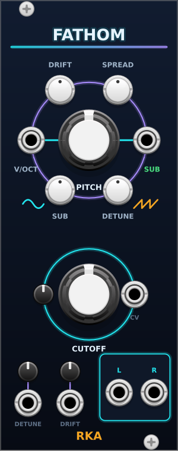

# Fathom

Deep bass drone voice, 10 HP: a sine sub under a seven-saw supersaw body,
slow drift so a held note keeps breathing, and a low-pass to close it down.
One V/Oct in, stereo out, a separate sub out. Made for dark and space
ambient, where one note is held for minutes.

## Pitch

- **PITCH**: −24 to +24 semitones, snapped, with 0 at C2 (65.4 Hz). The
  tooltip shows the note. **V/OCT** adds 1 V per octave on top.
- The pitch is clamped to 8 Hz – 4 kHz. Steps on V/OCT are smoothed over
  5 ms so they do not click.
- Right-click **Free pitch** turns the semitone snap off.

## Voice

The body is seven sawtooth oscillators around the pitch, detuned and
mixed with the Roland JP-8000's curves, band-limited, and high-passed at
the fundamental so the detuned saws do not pile up under the root. The
root itself is the sub.

- **SUB**: level of the sub sine in the L/R mix, 0–100 %. It sits one
  octave below PITCH; right-click **Sub octave** drops it two.
- **DETUNE**: spread of the seven saws, from one clean saw at 0 % to the
  JP-8000's widest at 100 %. The centre saw gets quieter as the sides
  come up.
- **SPREAD**: stereo width of the saws, 0 % mono to 100 % with the outer
  saws hard left and right. The sub stays centred.
- **DRIFT**: each saw wanders on its own slow random walk, up to ±6 cents
  in pitch and 3 dB in level at 100 %, with new targets about twice a
  second, slewed over a second. The sub drifts in level only. 0 % is
  static.

## Cutoff

- **CUTOFF**: a 12 dB/oct low-pass on the whole mix, 20 Hz – 20 kHz,
  default 1.2 kHz. No resonance in this version.

## CV

- **DETUNE** and **DRIFT** jacks with attenuverters: ±5 V at full sweeps
  the knob's whole range.
- **CUTOFF CV** with attenuverter: 1 V/oct at full clockwise.

## Outputs

- **L / R**: the mix, ±5 V, through a soft clipper and a DC blocker.
- **SUB**: the sub sine alone, ±5 V, before the SUB knob, CUTOFF and the
  clipper, so it can feed a sub bus or a side-chain however the mix is
  set.

## Credits

The supersaw's detune ratios and mix curves are adapted from Befaco's
[Oneiroi](https://github.com/Befaco/Oneiroi) firmware (GPL-3.0-or-later),
after Adam Szabo, *How to Emulate the Super Saw* (2010).
