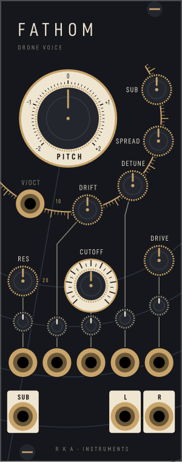

# Fathom

Deep bass drone voice, 10 HP: a sine sub under a seven-saw supersaw body,
slow drift so a held note keeps breathing, and a Moog-style ladder filter
with resonance and drive to close it down or make it growl. One V/Oct in,
stereo out, a separate sub out. Made for dark and space ambient, where one
note is held for minutes.

## The panel

Fathom is drawn as an echo sounder: **PITCH** is the transducer, and every
arc on the panel is a ping travelling out from it.

- **PITCH** is the large dial at the top left, numbered in octaves from
  −2 to +2 with a tick per semitone.
- The graduated brass arc round it carries **SUB**, **SPREAD**,
  **DETUNE** and **DRIFT**, and the **V/OCT** input on its left.
- The filter sits on the next arc out: **RES**, **CUTOFF** (on its own
  small dial) and **DRIVE**.
- Below them, five attenuverters and a row of five CV jacks, in the order
  **RES**, **DRIFT**, **CUTOFF**, **DETUNE**, **DRIVE**. A line joins
  each jack to its attenuverter and on to the knob it moves; the DRIFT and
  DETUNE lines climb up and bend across to their knobs on the arc.
- Bottom row: the **SUB** output on the left, **L** and **R** on the
  right, each on an ivory tile; inputs are bare.
- The faint line falling from PITCH is the sounding line: it marks depth
  for the pings, and there is nothing to set.

## Pitch

- **PITCH**: −24 to +24 semitones, snapped, with 0 at C2 (65.4 Hz). The
  tooltip shows the note. **V/OCT** adds 1 V per octave on top.
- The pitch is clamped to 8 Hz – 4 kHz. Steps on V/OCT are smoothed over
  5 ms so they do not click.
- Right-click **Free pitch** turns the semitone snap off; turning it back
  on rounds the knob to the nearest semitone.

## Voice

The body is seven sawtooth oscillators around the pitch, detuned and
mixed with the Roland JP-8000's curves, band-limited, and high-passed at
the fundamental so the detuned saws do not pile up under the root. The
root itself is the sub.

- **SUB**: level of the sub sine in the L/R mix, 0–100 %. It sits one
  octave below PITCH; right-click **Sub octave** drops it two.
- **DETUNE**: spread of the seven saws, from one clean saw at 0 % to the
  JP-8000's widest at 100 %. The centre saw gets quieter as the sides
  come up.
- **SPREAD**: stereo width of the saws, 0 % mono to 100 % with the outer
  saws hard left and right. The sub stays centred.
- **DRIFT**: each saw wanders on its own slow random walk, up to ±6 cents
  in pitch and 3 dB in level at 100 %, with new targets about twice a
  second, slewed over a second. The sub drifts in level only. 0 % is
  static.

## Filter

A four-pole transistor ladder in the Moog manner, run at twice the
engine rate so driving it doesn't alias. Each stage saturates, so a hot
signal compresses the filter against itself: that is the growl.

- **CUTOFF**: the ladder's pole frequency, 20 Hz – 20.48 kHz, default
  1.2 kHz. A quiet signal resonates here; a hot one pulls the peak below
  CUTOFF as the stages saturate (up to about an octave at the module's
  own levels), and it moves a little with DRIFT. That droop is the growl,
  not a fault.
- **RES**: resonance, from flat to self-oscillation at the very top. The
  low end is held steady as resonance rises in the low-pass types, so the
  drone keeps its weight while the peak moves. At the top the ladder
  sings a quiet sine that tracks CUTOFF at 1 V/oct. Its level follows
  DRIVE the other way round: loudest with DRIVE down, fading as DRIVE
  rises (0.9 V at the jack at DRIVE 25 %, 1.7 V at 0 %, 0.2 V at 100 %).
- **DRIVE**: gain into the ladder's saturators, from half to eight times.
  Unity at 25 %. The level is made up as it rises, so DRIVE changes the
  tone far more than the loudness; push it with RES up for the growl.
- Right-click **Filter type**: low-pass 24 dB (default), low-pass 12 dB,
  band-pass or high-pass, all from the same ladder.
- Right-click **Sub through filter**: off by default, so the sub joins the
  mix after the filter and CUTOFF never thins it. On, the sub goes
  through the ladder too, for closing everything down.
- CUTOFF, RES and DRIVE are smoothed over 20 ms so sweeps don't zipper,
  and SUB and Sub through filter glide over 20 ms (the sub crossfades
  between the two routes) so a mapped SUB or the toggle doesn't click.

## CV

- **DETUNE**, **DRIFT**, **RES** and **DRIVE** jacks with attenuverters:
  CV adds to the knob, then the sum is clamped to 0–100 %, so ±5 V at
  full covers the whole range only from noon. At the defaults, +5 V
  reaches 75 % (RES 70 %) and −5 V stops at 0.
- **CUTOFF CV** with attenuverter: 1 V/oct at full clockwise.

## Outputs

- **L / R**: the mix, ±5 V, through a soft clipper (mild saturation at
  the defaults, more as SUB and DETUNE go up) and a DC blocker.
- **SUB**: the sub sine alone, ±5 V, before the SUB knob, the filter and
  the clipper, so it can feed a sub bus or a side-chain however the mix
  is set.
- With L and R both unplugged the voice pauses to save CPU (SUB keeps
  running); it resumes when either is patched.

## Credits

The supersaw's detune ratios and mix curves are adapted from Befaco's
[Oneiroi](https://github.com/Befaco/Oneiroi) firmware (GPL-3.0-or-later),
after Adam Szabo, *How to Emulate the Super Saw* (2010).

The ladder's structure, its rational tan and tanh approximations and the
2x halfband pair are adapted from VCV
[Fundamental](https://github.com/VCVRack/Fundamental)'s VCF
(GPL-3.0-or-later), after Antti Huovilainen, *Non-linear digital
implementation of the Moog ladder filter* (DAFx 2004), Vadim Zavalishin,
*The Art of VA Filter Design*, and Teemu "Mystran" Voipio's per-stage
tanh linearisation. The type mixing is the Oberheim Xpander's pole-mixing
table, via Electric Druid's write-up.
