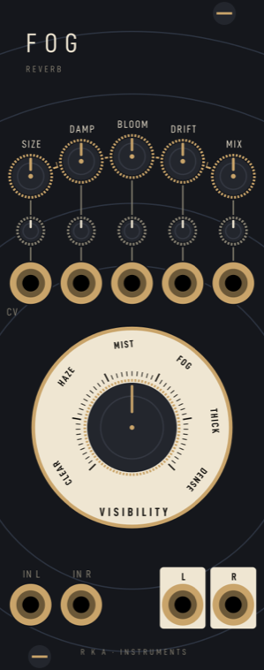

# Fog

Stereo reverb, 10 HP, for huge, dark, slowly blooming spaces: from a close
room up to a tail of more than a minute that never runs away. Four modes
(HAAR, FRET, SMOKE, ICE), a decay time set in seconds that holds at any
Size, and CV on Size, Damp, Bloom, Drift and Mix. Made for dark and space
ambient: Fathom into Fog is a held drone that its own wash swallows, with a
tail that outlasts the note by seconds or minutes.

## The panel

Fog is drawn as a visibility scale. From the top:

- **Size, Damp, Bloom, Drift and Mix** on a brass arc.
- Under each, its **attenuverter**, then its **CV** jack, in one straight
  line up to the knob.
- **Visibility**, the hero, low on the panel on a large enamel face lettered
  **CLEAR, HAZE, MIST, FOG, THICK, DENSE**.
- **IN L** and **IN R** at the bottom left, and the **L** and **R** outputs
  on ivory tiles at the bottom right.

Mode, drift rate, low cut and dry kill are in the right-click menu. There
is no CV on Visibility, and nothing on the panel or by CV switches mode.

## Controls

Every knob opens at noon.

### Visibility: decay time

The time for the tail to fall by 60 dB, `T60 = 0.4 s x 200^v`:

| Word | Decay | Knob (0 = left, 1 = right) |
|---|---|---|
| CLEAR | 0.5 s | 0.04 |
| HAZE | 2 s | 0.30 |
| MIST | 5 s | 0.48 |
| FOG | 12 s | 0.64 |
| THICK | 30 s | 0.82 |
| DENSE | 70 s | 0.98 |

Fully left is 0.4 s and fully right 80 s. Noon is about 5.7 s, just past
MIST. Rack's tooltip shows the time in seconds. The time holds at any Size.
It always decays: even fully right the tail dies away (DENSE is very long,
not infinite, and Fog has no freeze). Visibility follows the knob through a
30 ms smoother, so a jump does not step the wet.

### Size: the space

From close to vast, about 0.3x to 3x the mode's delay lengths. Fully left
is a close space whose reflections blur at once. Fully right is vast: at
long Visibility it is a wash, and at CLEAR it gives sparse, separate echoes
before anything fills in. Size does not change the decay time or the level.

Size is slewed: it settles about 100 ms after a change. **Fast CV on Size is a pitch effect**: the
lines change length, so the tail swoops like a Doppler pass. Use a slow CV
for movement, or a fast one on purpose.

### Damp: how dark the tail gets

How much faster the highs die than the lows. Fully left: none. Noon: highs
(about 4 kHz) decay about 2x faster. Fully right: about 8x faster, and the
tail turns to a low rumble within seconds. Visibility still sets the
low-frequency decay. FRET is darker than HAAR at every setting, ICE brighter.

### Bloom: how the wash arrives

How slowly the wash swells in after a sound. Bloom shapes the signal fed
into the network: under about 50 ms fully left, about 1 s at noon and
about 4 s fully right. On the whole output it measures roughly 1.2 to 1.7 s
at noon, because the network builds up as well, more so at long Visibility.
The dry sound is never delayed.

### Drift: modulation in the tail

Slow, decorrelated modulation of the lines. Fully left: still and glassy.
Noon: gentle, enough to stop long tails ringing. Fully right: heavy
smearing with pitch deviations in the tens of cents. The rate is in the
menu.

### Mix

Dry against wet. Fully left is dry only, noon is 50/50, fully right is wet
only, as an equal-power crossfade.

### CV and attenuverters

Each CV is added to its knob, and the attenuverter scales it: at full, 10 V
of CV is the knob's whole range, and the sum is clamped to the range. So
+/-5 V sweeps the whole range only with the knob at noon; from anywhere else
one end of the sweep is clipped. The
attenuverter defaults to 0, so an unpatched or unscaled CV does nothing. A
polyphonic CV uses its first channel only. (Audio inputs are summed.)

**Drift, Damp and Visibility changes are smoothed (about 30 to 40 ms)**, so
a fast CV on Drift or Damp is filtered, and a stepped one moves smoothly.

## Inputs and outputs

- **IN L, IN R**: IN R is normalled to IN L, so a mono source fills both
  sides. A polyphonic cable is summed to one signal per side.
- **L, R**: mono per side.
- Below about 300 Hz the stereo image is mono-compatible: both sides come
  from one tap, 80 degrees apart in phase, so the low end does not cancel
  when summed to mono.

## The menu

Right-click the panel.

- **Mode** (default HAAR). Switching fades the wet out over about 50 ms,
  clears the network and starts the new mode clean, with no click.
  - **HAAR**: dense, smooth, enormous wash. The default.
  - **FRET**: dark, and slow to build: the space rises behind the sound.
    Heavier built-in damping and a slower Bloom curve.
  - **SMOKE**: echo-led. Distinct repeats that blur into the wash, from
    fewer, longer lines.
  - **ICE**: sparse and glassy, with an octave-up shimmer: a small octave
    cascade in the loop, plus a fixed octave on the output, about 11 to
    13.5 dB under the note and audible at every Visibility. The loop's
    cascade costs ICE a little decay (about 13 % short) and fades as the tail
    lengthens.
- **Drift rate**: Slow (default, about 0.1 to 0.5 Hz) or Very slow (about 5x
  slower). Changing it moves the modulation smoothly.
- **Low cut**: Off, 50 Hz (default) or 100 Hz, on the network's input, so
  sub-bass does not pile up in a long tail. The dry signal is untouched.
- **Dry kill (wet only)**: forces Mix fully wet without moving the knob.

## Level

- **Wet level follows the decay time, as in ValhallaRoom.** Full wet is
  matched to the dry at noon Visibility and then follows 10 log10(T60 /
  5.66 s) dB: CLEAR is about 11.5 dB quieter than noon, and a long tail is
  louder. Size is level-neutral, and loudness does not dip as Mix goes up.
- **Short sounds** (a ping, a pluck) are louder at DENSE than at CLEAR,
  by about 11 dB: the wet level rises with the decay time, so a long tail
  is not turned down to match a short one.
- **A wet leveller** turns loud, building drones down smoothly instead of
  clipping them. At long settings, a loud drone's wet sits near the noon
  level. It acts on the wet only, never touches quiet material, and holds
  its gain once the input stops, so a tail decays as it would without it.
- **A limiter** on the wet has a 9 V knee and a 10 V ceiling, and catches
  transients. At Mix noon a spike on a hot dry can still reach about 10.6 V
  at the output. The dry signal is never touched.

## Using Fog on a send

Turn on **Dry kill** in the menu (Mix goes fully wet without moving the
knob), and mix the return in your mixer. For glue on the main signal, use
Mix, around 30 %.

## Sleep

Once the input and the wet tail have both fallen to practically nothing
(under 10 microvolts), and stayed there for about 1.4 s (at 48 kHz, in every
mode), Fog stops processing, at near-zero CPU, and wakes on the next sound.
While it sleeps the wet is silent; the dry still passes at any Mix below
full wet.

## Presets

Rack's own preset save and load covers every knob and every menu setting.
Factory presets are in the module's right-click Preset menu:

- **Becalmed**: FRET, THICK, heavy Damp, slow Bloom.
- **Nebula**: HAAR, a large Size, high Drift, near DENSE.
- **Harbour**: HAAR, HAZE, a short Size, Mix about 30 %. Glue for a send.
- **Whiteout**: ICE, wet only, with Bloom and Visibility high.

To keep your own, save from the same menu (Save preset).

## Bypass

IN L passes straight to OUT L and IN R to OUT R.

## Other details

- NaN or infinite values on an input become 0 where they enter, and the
  network can never hold a NaN.
- A new sample rate, a mode change and a reset start the network clean.
- The module stores its knobs, attenuverters and the four menu settings
  with the patch.
