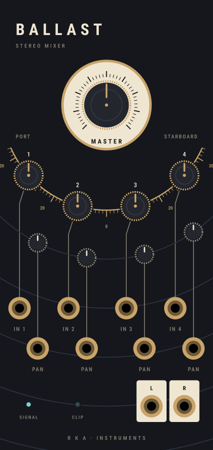

# Ballast: four-channel stereo mixer

Status: idea, 2026-11-15. Not designed.

**What it is.** Four mono inputs mixed to stereo, each with level and
pan.

**The instrument.** A clinometer, which shows how far a ship is listing.
The four channel levels sit on a limb numbered in degrees to port and
starboard. Each channel's Pan sits beneath its level on the next arc.

**Sketched controls.** Master (the hero), four Level knobs, four Pan
attenuverter-size knobs. Each channel has two jacks, staggered: its input
a little left of the channel's column, labelled IN 1 to IN 4, traced up
to its Level; and a Pan CV input a little right and lower, labelled PAN,
traced straight up to its Pan knob. Signal and Clip lights at the lower
left.

Rulings from the user: the L and R outputs are grouped together in the
lower right corner; the input jacks carry labels, because a trace alone
did not say what they were; and Pan has CV "for now", to be discussed
again when implementation is planned. The case for it is slow automatic
panning, one LFO per channel, which suits ambient work. The sketch gives
Pan CV no attenuverter: the knob sets the centre and the CV swings
around it.

**Open questions.** Whether Pan CV stays, and whether it needs depth
control; CV over level; mute or solo; whether inputs
are polyphonic; stereo inputs; whether the limb's degree numbers should
mean something real (pan law) or go.
