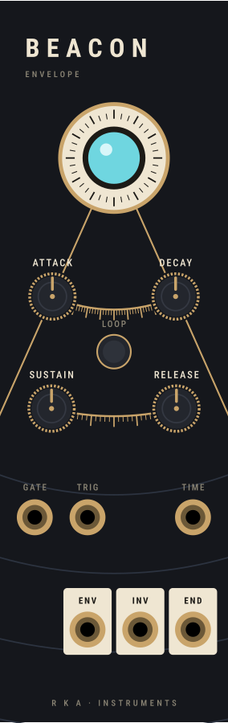

# Beacon: envelope and function generator

Status: idea, 2026-11-15. Not designed.

**What it is.** An ADSR envelope that can loop into a slow repeating
shape.

**The instrument.** A lighthouse. The lamp at the top is a light, not a
knob: it glows with the envelope's level, on an enamel face. The two
brass lines falling from it are the edges of the beam, and the stage
knobs sit on graduated arcs across it.

**Sketched controls.** Attack and Decay on the first arc, Sustain and
Release on the second, a lit Loop button between them. Gate in, Trig in
and a Time CV in. Outputs: Env, Inv (inverted) and End (end of cycle).

**Open questions.** Curve shapes; time ranges, given the user's slow
ambient use; what Time CV scales; whether Loop ignores Sustain;
polyphony. The lamp is the first hero that is not a control, which the
look's rules do not cover yet.
