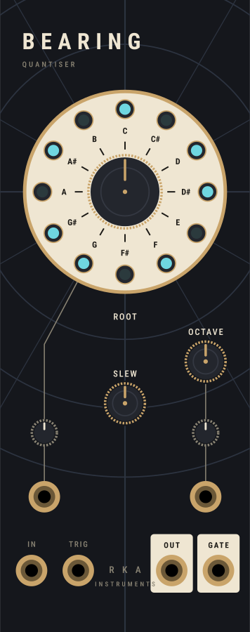

# Bearing: a quantiser

Status: idea, 2026-11-15. Not designed.

**What it is.** A pitch quantiser whose scale is set directly on the
panel.

**The instrument.** A compass rose. The rose is the circle of twelve
notes: each note has a lit key (lit means the note is in the scale), and
the knob in the middle points at the root. Twelve bearing lines run from
the rose across the panel. This is where the navigation theme the user
proposed for Shoal fits best: a bearing and a pitch class are both a
position on a circle.

**Sketched controls.** Root (the knob at the centre of the rose) with CV
and attenuverter, twelve note keys, Octave with CV and attenuverter, Slew.
CV in, Trig in; Out and a Gate that fires when the note changes.

**Open questions.** Overlap with Shoal, which already runs O&C's
quantisers; one channel or several; whether rotating Root transposes the
lit pattern or only the output; scale presets; polyphony.
