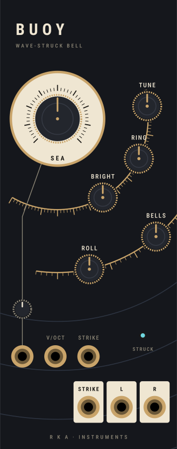

# Buoy: a wave-struck bell

Status: idea, 2026-11-15. Not designed. 10 HP in the sketch.

**What it is.** A bell voice that chimes by itself, irregularly, the way a bell buoy does: generative, and at home in ambient music.

**The instrument.** A bell buoy, whose clappers are swung by the sea. Sea, the hero, is how rough the water is: rougher means more frequent and harder strikes.

**Sketched controls.** Sea (the hero) with CV and attenuverter; Tune, Ring (decay) and Bright on the limb; Bells (how many partials ring) and Roll (how regular the strikes are) on the next arc. V/Oct in and a Strike trigger in. A light on each strike. Outputs: a Strike trigger, L and R.

**Open questions.** The bell model (modal synthesis is the obvious one); how the wave motion is simulated, and whether it can lock to a clock; several bells tuned apart; whether Sea at zero means silence, so it can be played only by trigger.
