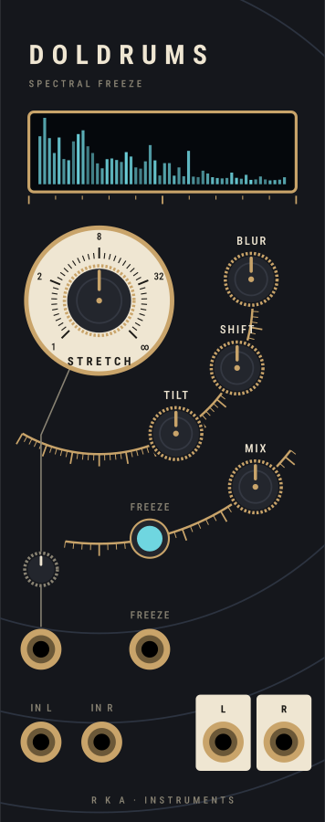

# Doldrums: spectral freeze and stretch

Status: idea, 2026-11-15. Not designed. 10 HP in the sketch. One of nine
added to fill gaps for dark, space and horror ambient. Notes from a
reading of PaulXStretch added 2026-11-23 (below); still not designed.

**What it is.** Holds a moment of sound indefinitely, or stretches it to many times its length. The collection had nothing that does this, and it is central to dark ambient.

**The instrument.** The doldrums: a ship becalmed, with no wind, going nowhere. A window at the top shows the held spectrum.

**Sketched controls.** Stretch (the hero, numbered 1, 2, 8, 32 and infinity) with CV and attenuverter; Blur, Shift (pitch) and Tilt (darker or brighter) on the limb; Mix on the next arc beside a lit Freeze button, with a Freeze gate input beneath it. Stereo in, stereo out.

**Open questions.** The method (phase vocoder, or granular with very long overlap) and its CPU cost; how long a buffer it keeps; whether Stretch at infinity and Freeze are the same thing; latency.

## Notes from PaulXStretch (2026-11-23)

PaulXStretch (Xenakios, after Paul Nasca's PaulStretch) is in
`~/ws/plugins/paulxstretch`. It answers the method question and is a good
reference for **ideas**, not for code.

**Why not its code.** The core (`Source/PS_Source/Stretch.*`,
`ProcessedStretch.*`) is **GPL-2.0-only**, which cannot be pasted into
RKA's GPL-3.0-or-later; re-derive the algorithm (it is public) instead.
Per frame it calls `sin`, `cos`, `log` and `pow` for every bin, and
resizing allocates and locks on the audio thread. It is a file player:
"capture" records the input and then stretches it, with no true
streaming path. Its FFT, pffft, is BSD-style and usable.

**The method (PaulStretch, not a phase vocoder).** A long window of 2N
samples (N from 2^7 to about 2^21; default about 2^14); keep the
magnitude spectrum only; give every bin a fresh **random phase**;
inverse FFT; overlap-add at 50 % with a raised-cosine crossfade and a
compensation curve. The input position advances N / stretch samples per
hop. The random phases are what make the smeared, glassy sound, and it is
cheap: about three FFTs per hop of N samples.

**Answers to the open questions (proposals):**
- **Method:** PaulStretch's random-phase resynthesis.
- **Stretch at infinity is Freeze.** Freeze stops the input position and
  keeps re-randomising the same window's phases each hop (PaulXStretch
  does exactly this). Stretch is continuous from 1x to infinity, the
  input step N / stretch reaching 0. Add what PaulXStretch lacks: a
  crossfade on the Freeze gate's edges.
- **Buffer:** a continuous circular buffer of the live input (no
  record-then-play); Freeze stops writing to it. How long depends on the
  question below.
- **Window:** fixed at construction (no resize on the audio thread),
  about 2^14 to 2^15 samples (0.3 to 0.7 s at 48 kHz). The FFT work runs
  on a worker thread or is spread across blocks, so CPU stays even rather
  than spiking once per hop.
- **Latency:** about one window; fine for a texture tool, and the manual
  says so.
- **No libm per sample:** random phases from a cheap generator (xorshift)
  and a sine table; per-bin tables (tilt, blur map, harmonics mask)
  rebuilt only when their controls change, off the audio thread.

**The sketched controls, mapped:**
- **Blur:** PaulXStretch's *Spread* (`ProcessedStretch.h` ~188-247):
  map the magnitudes to a log-frequency axis, smooth forward and back
  with a one-pole, map back. Precompute the index map.
- **Tilt:** the exponential per-bin damping in its *Filter*
  (`hdamp`): gain[i] = base^i, darker one way, brighter the other.
- **Shift:** its *Pitch shift* remaps bins (nearest bin up, summed bins
  down: crude, aliasing upward). Use fractional-bin interpolation.

**Harmonics (the user wants this in).** PaulXStretch's *Harmonics*
(`ProcessedStretch.h:292`, `spectrum_do_harmonics`) is a spectral comb:
it keeps only the energy near f, 2f, 3f, ... (up to N harmonics) and
silences the rest. Each tooth is a profile of a set width in cents,
either soft (Gaussian) or hard (a threshold at 1/e). Defaults: 440 Hz,
25 cents, 10 harmonics.
- **What it gives Doldrums:** any input (Hadal's noise, a field
  recording from Eddy, a chord) comes out as a pitched drone on a chosen
  note: a smeared, tuned choir from material with no pitch of its own.
  It overlaps Rigging's idea (a tuned resonator) but in the spectral
  domain, frozen or stretched.
- **Proposed controls:** a **V/OCT** input and a **Root** (the comb's
  base note); **Partials** (how many harmonics, perhaps 1 to 32);
  **Width** (each tooth's width in cents: narrow is a clear pitch, wide
  breathes back towards the source); and an amount or on/off, so it can
  be bypassed. Possibly **Odd only** (a hollow, clarinet-like comb) or a
  partial tilt as a menu item.
- **Implementation notes:** build the mask (one gain per bin) only when
  Root, V/OCT (quantised or slewed to a control rate), Partials or Width
  change, on the worker; apply it per hop as a multiply. Glide the mask
  between roots rather than switch it, or a V/OCT step will jump. Partials
  above Nyquist are dropped. At the window sizes above, bins are about
  1.5 to 3 Hz apart, so low roots with narrow widths need the larger
  window to resolve; decide the window and the lowest root together.
- **Panel cost:** two to four more controls and a V/OCT jack; with
  Stretch, Blur, Shift, Tilt, Mix and Freeze this probably pushes the
  module from 10 HP to 12-14 HP.

**The question that shapes the design most (for when it is designed):**
is Doldrums mainly a **live freeze** (hold whatever is playing now, like
a spectral sustain pedal: a short buffer, fast response) or a
**stretcher of recent material** (smear the last 10-30 s out to minutes:
a long buffer and a Position control)? Harmonics works with either.
