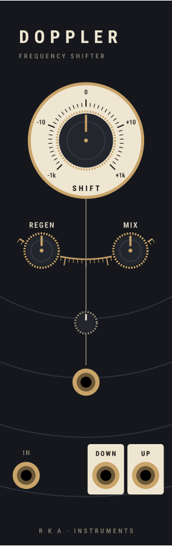

# Doppler: a frequency shifter

Status: idea, 2026-11-15. Not designed. 8 HP in the sketch. One of nine
added to fill gaps for dark, space and horror ambient.

**What it is.** Shifts every frequency by the same number of hertz, so harmonics drift apart and beat against each other: a space-ambient staple.

**The instrument.** The Doppler effect, by which a passing sound rises and falls in pitch, and which sonar uses to tell which way a contact is moving.

**Sketched controls.** Shift (the hero, centred on zero, numbered in hertz either side) with CV and attenuverter traced straight down; Regen (feedback) and Mix on the limb. One input. Separate Down and Up outputs.

**Open questions.** Range and the shape of the Shift scale near zero, where the useful slow beating is; stereo, with Up to one side and Down to the other; through-zero behaviour.
