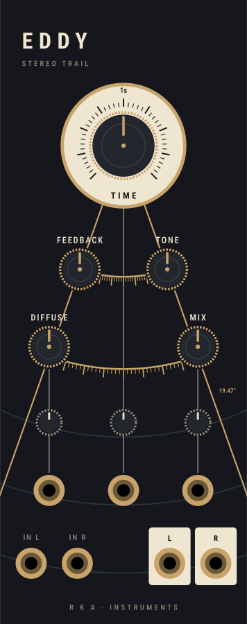

# Eddy: a tape loop

Status: idea, 2026-11-15. Not designed. 10 HP in the sketch.

**History.** Eddy began as a small stereo delay, first sketched under the
name Wake. When the comprehensive delay took that name (`wake.md`) the
small one became Eddy, and was then redundant beside it. It was reworked
into an audio looper, which the collection lacked and which suits the
name better: an eddy is water that keeps coming round.

**What it is.** A sound-on-sound looper for layered, slowly decaying
loops, with playback speed that runs backwards through zero to forwards.

**The instrument.** An eddy, drawn as a spiral: each turn of the loop
comes round a little further out. The spiral is graduated on its outer
side like any other limb, and the knobs sit on it.

**Sketched controls.** Speed (the hero, numbered -2 to +2) with CV and
attenuverter; Decay (how much each pass fades), Layer (overdub level),
Smear and Mix along the spiral; lit Record and Dub buttons; a Rec gate
input. Stereo in, stereo out.

**Open questions.** Loop length and how it is set (by recording, by a
clock, by a knob); what Smear does; whether Rust's wear belongs in the
loop; several loops of different lengths, for phasing; saving a loop with
the patch.
