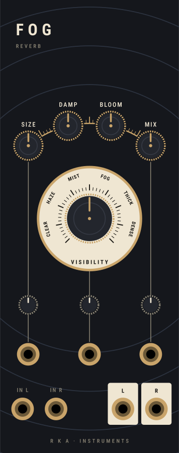

# Fog: reverb

Status: idea, 2026-11-15. Not designed.

**What it is.** A reverb for long ambient tails, the wash that Wake's
delay does not give.

**The instrument.** A visibility scale. The main dial is lettered in the
terms used for visibility at sea, running clockwise from Clear through
Haze, Mist, Fog and Thick to Dense. Clear is fully anticlockwise, at the
user's request: turning the knob up should give more reverb, as on any
other effect. It is the first panel
with the hero low down: the other knobs arch over it on a graduated arc.

**Sketched controls.** Visibility (the hero) with CV and attenuverter;
Size, Damp, Bloom and Mix on the arc above, Size and Mix with CV and
attenuverter traced straight up their columns. Stereo in, stereo out.

**Open questions.** The algorithm; what Bloom is (shimmer, build-up
time, modulation); freeze; whether Fog and Wake should be one module.
Squall also uses a dial lettered with words; if both are built, one may
want a different face.
