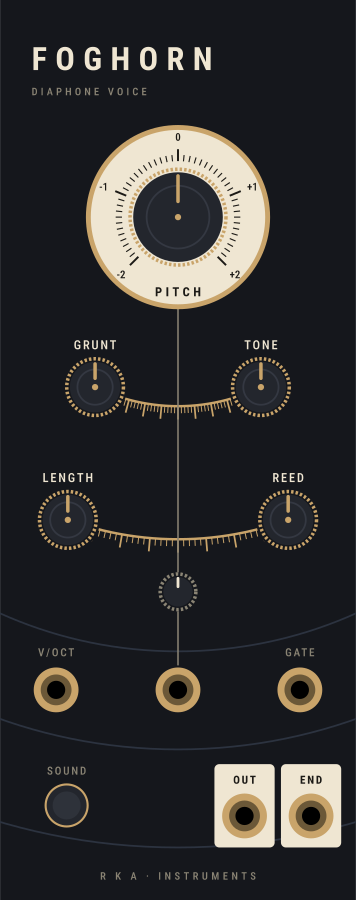

# Foghorn: a diaphone voice

Status: idea, 2026-11-15. Not designed. 10 HP in the sketch.

**What it is.** A low, two-tone drone voice with the drop in pitch at the end of each blast.

**The instrument.** The diaphone foghorn, whose blast ends in a characteristic falling 'grunt'.

**Sketched controls.** Pitch (the hero, scaled in octaves like Fathom's) with CV and attenuverter traced straight down; Grunt (the size of the drop) and Tone on the first arc; Length (of a blast) and Reed (roughness) on the second. V/Oct in and Gate in, and a lit Sound button to hold by hand. Outputs: Out, and End, a trigger when a blast finishes.

**Open questions.** How it differs enough from Fathom to be its own module, since both are low drones; whether a gate holds the note or always plays one blast of Length; stereo.
