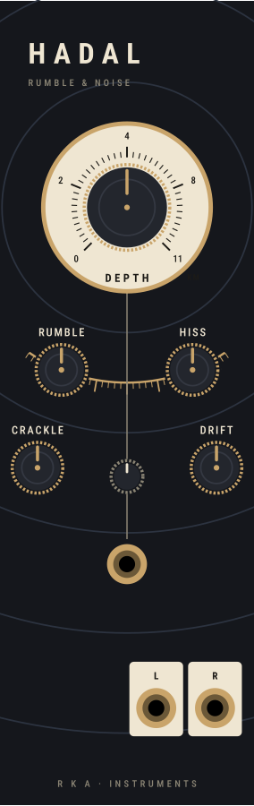

# Hadal: rumble and noise

Status: built (2026-11-16, 10 HP). Design: `docs/specs/2026-11-16-hadal-design.md`;
manual: `docs/hadal/README.md`. The text below is the original idea; the sketch was 8 HP. One of nine
added to fill gaps for dark, space and horror ambient.

**What it is.** A bed of sub rumble, hiss and crackle, as audio: the floor under a dark ambient piece.

**The instrument.** The hadal zone, the deepest part of the ocean. Depth is numbered in kilometres down to 11, about the bottom of the deepest trench. Deeper is darker.

**Sketched controls.** Depth (the hero) with CV and attenuverter traced straight down; Rumble and Hiss on the limb; Crackle and Drift (slow movement in all of it) on the next arc. Stereo out, no input.

**Open questions.** Whether Depth is one filter over everything or changes the balance; how wide the stereo image is; whether Squall's Noise output overlaps; an input, to bury another sound in it.
