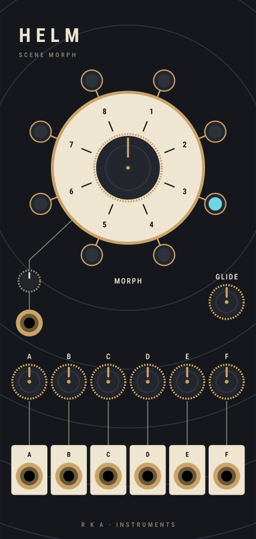

# Helm: scene morph

Status: idea, 2026-11-15. Not designed. 12 HP in the sketch. One of nine
added to fill gaps for dark, space and horror ambient.

**What it is.** Stores eight settings of six control voltages and glides between them as one knob turns: a way to perform long changes with one hand.

**The instrument.** A ship's wheel. Eight spokes run out to eight scene buttons on the rim, and the wheel's face is numbered 1 to 8.

**Sketched controls.** Morph (the hero, the wheel) with CV and attenuverter; eight lit scene buttons; six knobs A to F that set the current scene's values, each traced down to its output; Glide.

**Open questions.** How a scene is stored (hold its button); whether Morph wraps from 8 back to 1; more outputs through an expander; whether the six knobs should show the morphed value, which fixed knobs cannot; recall by CV or trigger.
