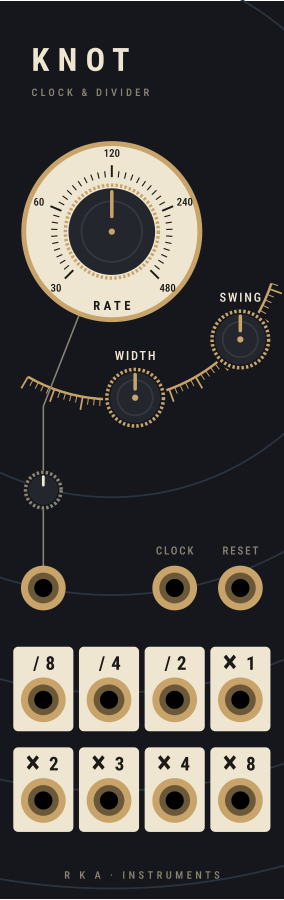

# Knot: clock, divider and multiplier

Status: idea, 2026-11-15. Not designed.

**What it is.** A clock source that also divides and multiplies, its own
clock or one patched in.

**The instrument.** The chip log. Speed at sea was once measured by
letting a knotted line run out and counting the knots that passed in a
fixed time, which is clock division.

**Sketched controls.** Rate (the hero, numbered in beats per minute) with
CV and attenuverter, Swing and Width on the limb. Clock in and Reset in.
Eight outputs: /8, /4, /2, ×1, ×2, ×3, ×4, ×8. The user asked for a plain
"/" for divide and a large "×", for legibility; keep both.

**Open questions.** Overlap with Sway's clock sync and Shoal's clock
apps; whether the ratios are fixed or selectable per output; how
multiplication tracks a changing external clock; whether Swing applies to
every output.
