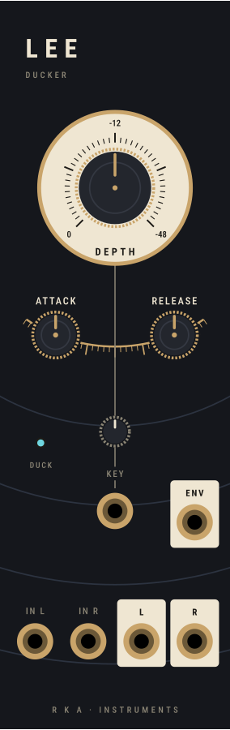

# Lee: a ducker

Status: idea, 2026-11-15. Not designed. 8 HP in the sketch. One of nine
added to fill gaps for dark, space and horror ambient.

**What it is.** Pulls a signal down while another is loud, so that an event clears space in a drone. Also puts out the envelope it follows.

**The instrument.** The lee, the sheltered side of a ship or an island.

**Sketched controls.** Depth (the hero, in decibels of reduction); Attack and Release on the limb; a Key input with a sensitivity knob above it, traced up to Depth; a Duck light; an Env output. Stereo in, stereo out.

**Open questions.** Whether the centre jack reads clearly as the Key input and not as a Depth CV; whether an unpatched Key follows the main input, making it a compressor; an inverted Env output.
