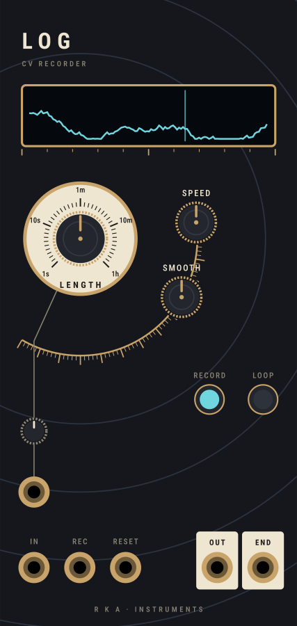

# Log: a CV recorder

Status: idea, 2026-11-15. Not designed. 12 HP in the sketch.

**What it is.** Records a control voltage over a long stretch and plays it back, looping if asked.

**The instrument.** A barograph, which draws a trace of pressure on a slowly turning drum; and the ship's log, the record of a voyage. The window shows the recorded trace and where playback has got to.

**Sketched controls.** Length (the hero, numbered from one second to one hour) with CV and attenuverter; Speed (of playback) and Smooth on the limb; lit Record and Loop buttons. In, a Rec gate in and Reset in. Outputs: Out, and End at the end of the recording.

**Open questions.** More than one channel; overdubbing; whether Speed can run backwards; resolution and memory for hour-long recordings; saving recordings with the patch.
