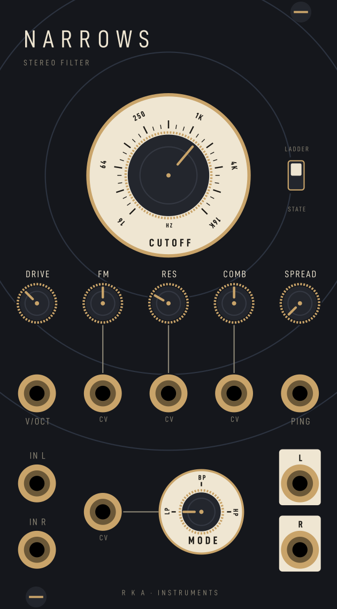

# Narrows: a stereo filter

Status: idea, 2026-11-20. Not designed. The user asked for a filter, soon:
"use Instruō I-ō47 as perhaps a starting point. It should do LP/HP and
band-pass with an optional comb if it can fit in. Stereo if possible", and
added "I do like Moog filters as well, the filter in the Fathom is pretty
good." 14 HP in the sketch.

**What it is.** One filter for a stereo signal: low-pass, band-pass or
high-pass, chosen by a Mode control, on one pair of outputs (the user,
2026-11-20: six output jacks were too many), with resonance up to
self-oscillation, a tuned comb that can be turned in, and a Ping input
that rings it. Two filters are inside, on a switch: Fathom's Moog-style
ladder and a state-variable filter (decided by the user, 2026-11-20).

**The starting point.** The I-ō47 is a mono, 14 HP filter after the ARP
2500's 1047 module: all its responses out at once (low-pass, band-pass,
high-pass and a notch with a movable offset), resonance to a stable sine,
a gain stage with a limiter, 1 V/oct tracking, and a Strike input that
pings the resonance. This sketch keeps the drive stage and the ping; it
drops the notch and the simultaneous outputs, and adds stereo and the
comb.

**The instrument.** A narrows: the strait where a channel closes between
two shores, and only part of the water gets through. The sketch draws
only the Cutoff dial and its rings; the shores are not drawn yet.

**Sketched controls.** Cutoff (the hero, lettered in hertz, 16 Hz to
16 kHz). In a row: Drive, FM (the depth of the FM input), Res, Comb and
Spread (an offset between the left and right cutoffs, for width). V/OCT,
and CV on FM, Res and Comb. Ping. Stereo in, stereo out. Mode on a small
dial lettered LP, BP, HP, with a CV on the bottom rows; a switch beside
the Cutoff dial picks the core: Ladder or State.

**Open questions.**

- How the ladder gives band-pass and high-pass (by mixing its stages, as
  Fathom's menu modes do), and how close the two cores' cutoff and
  resonance scales should sit so the switch does not jump.
- The slopes: the ladder is 24 dB per octave and the state-variable
  filter 12; whether either should offer the other.
- Whether Mode steps between the three or sweeps smoothly through them
  (which its CV would then morph).
- Whether the core switch is on the panel (as sketched) or in the menu.
- The comb: a stage before the filter that colours all three outputs (as
  sketched: off at noon, positive feedback to the right, negative to the
  left), or a fourth response with its own outputs.
- Whether Ping stays, with Ping the sonar voice also on the roadmap.
- Whether Spread earns its knob; whether Cutoff also needs a fine control.
- The name has not been checked against the VCV Library.
