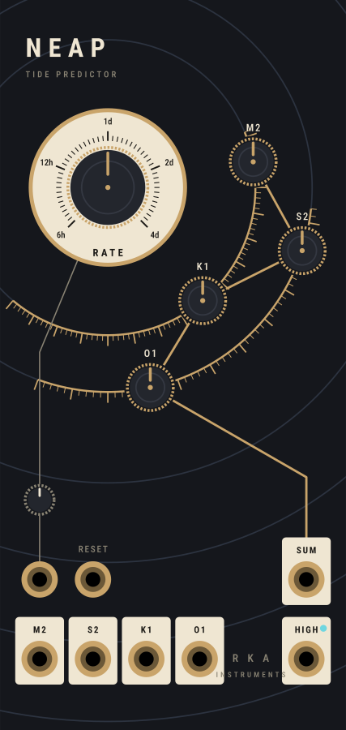

# Neap: a tide predictor

Status: idea, 2026-11-15. Not designed.

**What it is.** Very slow, layered modulation for pieces that evolve over
many minutes. Four slow cycles at fixed ratios are added together, so the
sum rises and falls in a pattern that takes a long time to repeat, the way
real tides do.

**The instrument.** Kelvin's tide-predicting machine, which summed
harmonic cycles mechanically: one wire ran over a row of pulleys, each
moving at its own rate, and the wire's free end drew the tide. The brass
wire on the panel is that sum. The four cycles carry the names of the
main real tidal constituents: M2, S2, K1 and O1.

**Sketched controls.** Rate (the hero, scaled from 6 hours to 4 days in
the sketch; the real range is open). One knob per cycle for its height,
sitting on two graduated arcs so the wire zigzags over them. Rate CV with
attenuverter, Reset. Outputs: each cycle, the Sum, and a High-water gate.

**Open questions.** The real rate range (minutes, not days, is more
useful); whether the ratios are the true tidal ones or musical ones;
whether each cycle needs phase as well as height; whether Sway already
covers enough of this. Named Neap because Mutable's Tides exists.
