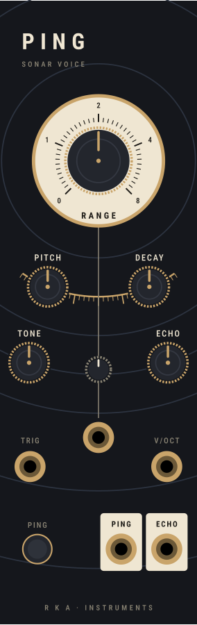

# Ping: a sonar voice

Status: idea, 2026-11-15. Not designed. 8 HP in the sketch.

**What it is.** A short resonant tone followed by its echo coming back: the sonar ping, as a playable voice.

**The instrument.** Active sonar. The time an echo takes to return is the range to whatever returned it, so Range, the hero, sets the echo's delay.

**Sketched controls.** Range (the hero) with CV and attenuverter traced straight down; Pitch and Decay on the limb; Tone and Echo (how loud the return is) on the next arc. Trig in and V/Oct in, and a lit Ping button to fire it by hand. Separate outputs for the ping and the echo.

**Open questions.** How the tone is made (a pinged filter, a sine with an envelope); whether the echo is filtered or pitch-shifted as a real return is; more than one return; overlap with Wake.
