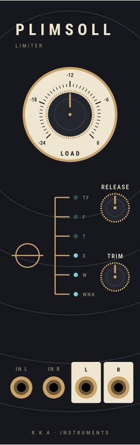

# Plimsoll: a limiter

Status: idea, 2026-11-15. Not designed. 8 HP in the sketch.

**What it is.** A stereo limiter.

**The instrument.** The Plimsoll mark painted on a ship's hull, which shows how deep it may safely be loaded. The mark is the meter: its six real load lines, TF, F, T, S, W and WNA from the top, light as the limiter works, and the Plimsoll disc is drawn level with the S line as on a real hull.

**Sketched controls.** Load (the hero, the threshold, numbered in decibels), Release and Trim. Stereo in, stereo out.

**Open questions.** Whether the six lines show gain reduction or output level; attack time; lookahead; a sidechain input; whether the load-line letters can carry real meaning or are simply the six steps of a meter.

**DC blocker.** Sluice is DC-coupled and has none; the output of this module is the place for one, once (from the Sluice spec, "For later modules").
