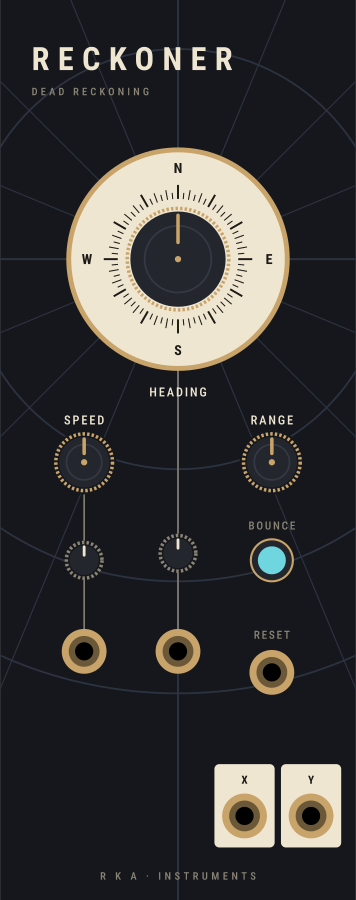

# Reckoner: a wandering X/Y

Status: idea, 2026-11-15. Not designed. 10 HP in the sketch.

**What it is.** Outputs a position, X and Y, that moves at a given speed in a given direction: a slow path for moving sounds around or for driving two parameters together.

**The instrument.** Dead reckoning: working out where you are from your heading, your speed and the time elapsed. The module does that sum continuously. Heading sits on a compass rose marked N, E, S and W, with sixteen bearing lines running out across the panel.

**Sketched controls.** Heading (the hero) and Speed, each with CV and attenuverter traced straight down; Range (how far it may go) with a lit Bounce button that turns it back at the edge; Reset in, to return to the start. Outputs: X and Y.

**Open questions.** What happens at the edge of Range without Bounce (wrap, or stop); whether Heading is endless; polar outputs (distance and bearing) as well as X and Y; a small window to show the path. The designer rates this the most original of the ideas, and it pairs with Ballast's pan inputs.
