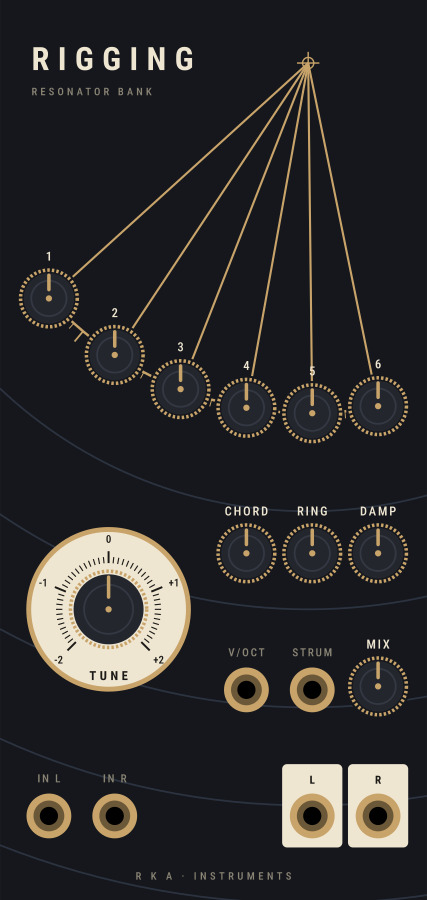

# Rigging: a resonator bank

Status: idea, 2026-11-15. Not designed. 12 HP in the sketch. One of nine
added to fill gaps for dark, space and horror ambient.

**What it is.** Six tuned resonators. Feed it noise, or any sound, and it rings at their pitches: a way to turn texture into a tuned drone.

**The instrument.** Wind singing in a ship's rigging. Six brass stays run from a masthead crosshair down to six knobs on a graduated limb; each stay is a string.

**Sketched controls.** Six string levels on the limb. Tune (the hero, in octaves) on a small enamel face lower left; Chord (how the six are spaced), Ring (how long they sound) and Damp in a row; Mix. V/Oct in and a Strum trigger in. Stereo in, stereo out.

**Open questions.** The resonator type (comb, modal, or banded waveguide); what Chord's settings are; whether Strum plucks them in turn; how the six are spread across the stereo field; self-oscillation as a drone source with nothing patched in.
