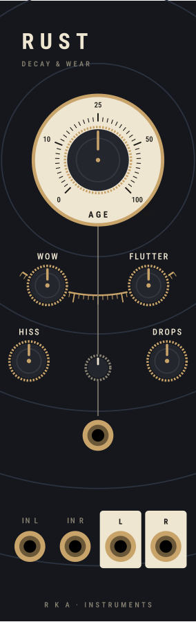

# Rust: decay and wear

Status: idea, 2026-11-15. Not designed. 8 HP in the sketch. One of nine
added to fill gaps for dark, space and horror ambient.

**What it is.** Ages a sound: unsteady pitch, noise and dropouts.

**The instrument.** Rust. Age, the hero, is numbered in years.

**Sketched controls.** Age (the hero) with CV and attenuverter traced straight down; Wow and Flutter on the limb; Hiss and Drops (dropouts) on the next arc. Stereo in, stereo out.

**Open questions.** Whether Age is a macro over the other four or its own thing (saturation, loss of highs); how dropouts sound in stereo; overlap with Eddy, which could do this to its own loop.
