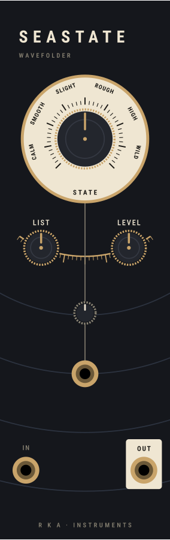

# Seastate: a wavefolder

Status: idea, 2026-11-15. Not designed. 8 HP in the sketch.

**What it is.** A wavefolder.

**The instrument.** The sea-state scale, which describes how rough the water is. The dial is lettered in words, clockwise for more: Calm, Smooth, Slight, Rough, High, Wild.

**Sketched controls.** State (the hero, the fold amount) with CV and attenuverter traced straight down; List (asymmetry) and Level on the limb. One input, one output.

**Open questions.** The designer rates this the weakest of the ideas. It is the third panel with a dial lettered in words, after Fog and Squall. Its lettering is not the true scale: the real terms run Calm, Smooth, Slight, Moderate, Rough, Very rough, High, Very high, Phenomenal, and were cut down to fit. And the fold could simply be a mode of another module.
