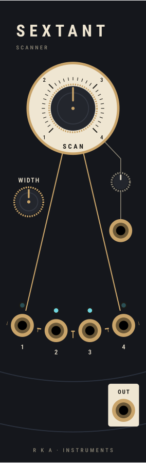

# Sextant: scanner and crossfader

Status: idea, 2026-11-15. Not designed.

**What it is.** One control that sweeps across four inputs, crossfading
from each to the next.

**The instrument.** A sextant, which measures an angle along a graduated
arc. The four inputs sit on the limb, between the two brass radii of the
frame, and Scan is the angle.

**Sketched controls.** Scan (the hero, numbered 1 to 4) with CV and
attenuverter, Width (how many inputs blend at once). Four inputs, each
with a light showing how much of it is sounding. One output.

**Open questions.** Audio, CV or both; whether Scan wraps from 4 back to
1; equal-power or linear crossfade; more inputs, or a reverse mode that
scans one input across four outputs.

**A stepped mode (2026-11-26).** The collection has no sequential
switch: nothing that moves from one source to the next on a trigger.
Rather than a module of its own, Sextant could take a **STEP** trigger
input that moves Scan on by one input each time (and a Reset), with the
crossfade time between them set by a knob, from a hard switch to a slow
dissolve. Open: whether stepping and the Scan knob add or the trigger
takes over; whether it steps in order or at random.
