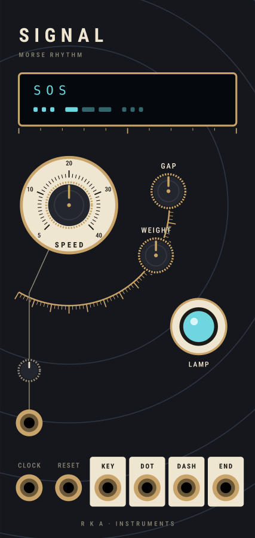

# Signal: Morse rhythm

Status: idea, 2026-11-15. Not designed. 12 HP in the sketch.

**What it is.** Turns a word into a rhythm by keying it in Morse code.

**The instrument.** A signalling lamp. The window shows the word and its dots and dashes, with a ruler beneath, and a large lamp lights while the key is down.

**Sketched controls.** Speed (the hero, numbered in words per minute) with CV and attenuverter; Gap (space between letters) and Weight (how long a dash is against a dot) on the limb. Clock in and Reset in. Outputs: Key (high while the key is down), Dot and Dash triggers, and End at the end of the word.

**Open questions.** How the word is entered (typed into the window, or a menu); whether Clock replaces Speed or each clock pulse is one Morse unit; looping; a list of words to step through.
