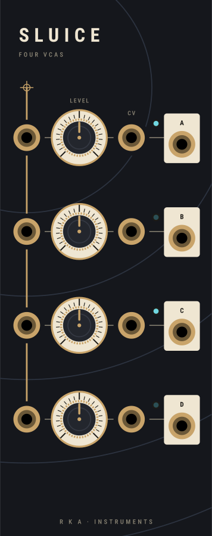

# Sluice: four VCAs

Status: idea, 2026-11-15. Not designed. 10 HP in the sketch. One of nine
added to fill gaps for dark, space and horror ambient.

**What it is.** Four voltage-controlled amplifiers. The collection had no way for a CV to control loudness, so Beacon's envelope had nothing to work on.

**The instrument.** A sluice gate, which lets water through. Laid out like Tackle: a brass rope runs down through the four inputs from an anchor point, so an unpatched input takes the signal from the one above.

**Sketched controls.** Per channel: an input, a Level dial on a small enamel face, a CV input, a light and an output, joined by one trace across the row. First drawn at 8 HP, where the CV
jacks overlapped the Level dials; the user caught it, and it was widened
to 10 HP so the four parts of each row stand clear of one another.

**Open questions.** Linear or exponential response, or a switch; whether Level is an offset or scales the CV; whether outputs mix downward; whether this should instead be Level CV on Ballast.
