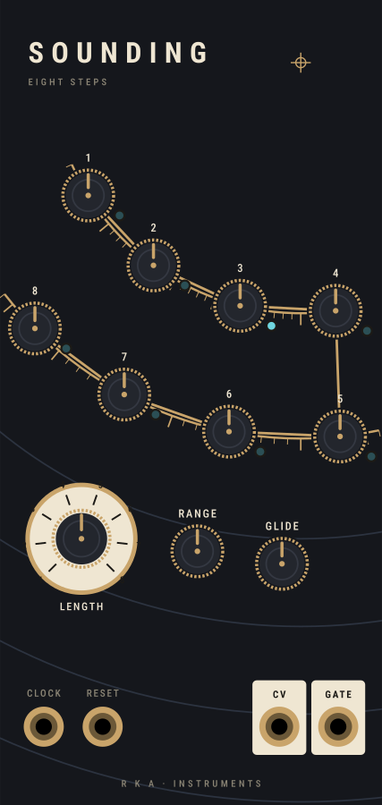

# Sounding: eight-step sequencer

Status: idea, 2026-11-15. Not designed.

**What it is.** A small step sequencer.

**The instrument.** A line of soundings. On a chart, a survey leaves a
row of depths along the course the ship took; a row of values along a
path is a step sequence. Eight step knobs sit on two graduated arcs
struck from one pivot, each with a light, and a brass course line joins
them in the order they play.

**Sketched controls.** Eight steps. Length on a small enamel face
numbered 1 to 8, Range and Glide beside it. Clock in, Reset in. Outputs:
CV and Gate.

**Open questions.** Overlap with Shoal's sequencer apps; per-step gates
or skips; direction and random modes; quantising (possibly by pairing
with Bearing); whether the course line should change when Length does,
which a printed panel cannot do.
