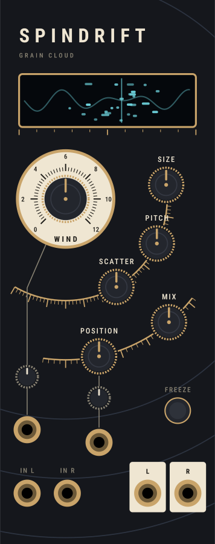

# Spindrift: granular cloud

Status: built (2026-11-22, 20 HP). Design:
`docs/specs/2026-11-22-spindrift-design.md`; manual:
`docs/spindrift/README.md`. As built it is Mutable Instruments Beads, its
own DSP vendored and run unchanged, in the Instrument look: the user chose
to mimic Beads as closely as possible rather than design a new granular
engine. Of the sketch: the Beaufort-lettered hero stayed, as Beads'
Density; the window stayed, showing the buffer, the record head and each
grain (and the delay's taps and the synth's wave); Freeze takes a gate.
Wind, Scatter, Position and Mix became Beads' Density, the attenuverters'
randomness, Time and Dry/Wet; Beads' Feedback, Reverb, Shape, Seed,
Quality, delay mode and wavetable synth came with it. The open questions
below are answered by Beads (4 to 16 s of buffer by quality; ±24
semitones catching on intervals; Beads' grain envelope). The idea as it
was first written follows.

**What it is.** A granular processor: it records what comes in and
throws it back as a cloud of grains.

**The instrument.** An anemometer. Spindrift is the spray that wind tears
off wave crests. Wind is the main dial, numbered on the Beaufort scale, 0
to 12, and sets how many grains fly.

**The window.** The user asked for a small window at the top to show the
grains, and for the main dial to shrink to make room. It is dark glass in
a brass bezel, like Shoal's screens, with a ruler beneath marking tenths
of the buffer. In the sketch it shows the buffer as a faint waveform, a
line at the current Position, and the grains as short bright dashes
around it. What it really draws is to be designed.

**Sketched controls.** Wind (the hero, smaller than other heroes) with CV
and attenuverter; Size, Pitch and Scatter on the first arc; Mix and
Position on the second, Position with CV and attenuverter. A lit Freeze
button. Stereo in, stereo out.

**Open questions.** Buffer length; pitch range and whether it quantises;
grain envelope; what the window shows and at what cost in frame time;
whether Freeze takes a gate.
