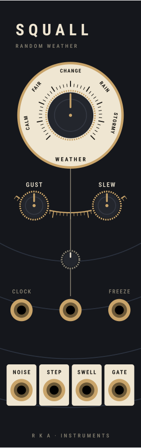

# Squall: a random source

Status: idea, 2026-11-15. Not designed.

**What it is.** A source of random voltages and gates with one control
for how much is going on.

**The instrument.** An aneroid barometer. Its dial is lettered the way
real ones are, Stormy / Rain / Change / Fair / Calm. Turn Pressure down
toward Stormy and more happens: denser noise, more steps, more gates.

**Sketched controls.** Pressure (the hero) with CV and attenuverter traced
straight down from the dial, Gust (how bursty) and Slew (how smooth) on a
graduated arc beneath it. Clock in and Freeze in. Outputs: Noise, Step
(stepped random), Swell (smooth random) and Gate.

**Open questions.** Overlap with Sway's RAND output and Shoal's random
apps; whether Clock replaces or modulates the internal rate; what
distribution each output has; whether the outputs are related to one
another or independent.
