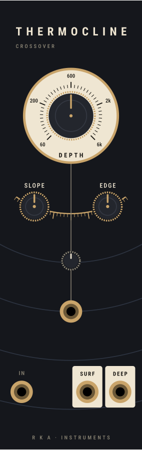

# Thermocline: a crossover

Status: idea, 2026-11-15. Not designed. 8 HP in the sketch.

**What it is.** Splits a signal into what is above a frequency and what is below it, to process the bands separately.

**The instrument.** The thermocline, the layer in the sea where warm surface water sits on cold deep water. Depth, the hero, is where the split falls.

**Sketched controls.** Depth (the hero, numbered in hertz) with CV and attenuverter traced straight down; Slope and Edge (resonance at the split) on the limb. One input. Outputs: Surf (above) and Deep (below).

**Open questions.** Whether the two bands sum back flat; stereo; a third, middle band; whether 'Surf' and 'Deep' read clearly as high and low. The name is long for an 8 HP panel and is drawn smaller than other names.
