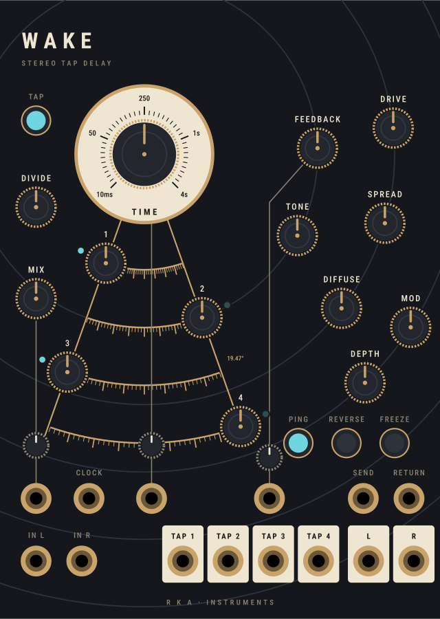

# Wake: stereo delay and diffusion

Status: idea, 2026-11-15. Not designed.

**What it is.** The trail a sound leaves: a stereo delay that can smear
into diffusion. The natural partner for Fathom, whose design
(`docs/specs/2026-10-24-fathom-design.md`) puts effects in later phases; a
drone voice wants a tail.

**The instrument.** A ship's wake. A Kelvin wake opens at 19.47° either
side of the ship's track whatever its speed, so the two arms are drawn at
exactly that angle from the origin and labelled with it. Controls sit on
the arms; graduated arcs between the arms are the wave crests.

**Sketched controls.** Time (the hero, on an enamel face), Feedback and
Tone on the first crest, Diffuse and Mix on the second. CV inputs with
attenuverters for Diffuse, Time and Mix, each traced straight up its
column. Stereo in, stereo out.

**Open questions.** Whether it is a separate module or Fathom's effects
phase; delay ranges and whether Time syncs to a clock; what Diffuse does
(allpass smear, reverb, or both); freeze or hold; mono-in behaviour.
