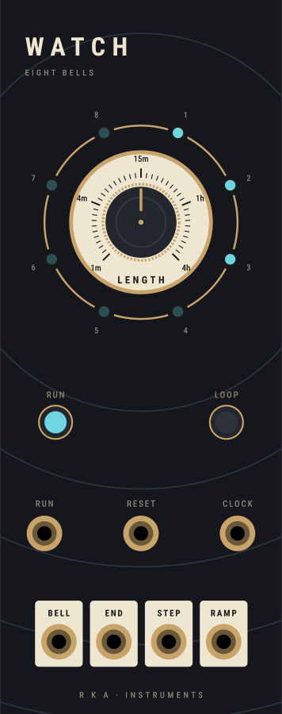

# Watch: a long-form timer

Status: idea, 2026-11-15. Not designed. 10 HP in the sketch.

**What it is.** Steps a piece through its sections over minutes or hours.

**The instrument.** The ship's watch, a four-hour spell of duty marked by a bell every half hour, eight in all. Eight lights ring the main dial, one per bell, and each stays lit once struck.

**Sketched controls.** Length (the hero, the whole watch, numbered from one minute to four hours); lit Run and Loop buttons; Run, Reset and Clock inputs. Outputs: Bell (a trigger at each bell), End (end of the watch), Step (a voltage that climbs one step per bell) and Ramp (one slow rise across the whole watch).

**Open questions.** Whether the eight bells can be unevenly spaced; whether real bells are struck in pairs, and whether that pattern should be heard on the Bell output; CV over Length; what Clock does to Length.
