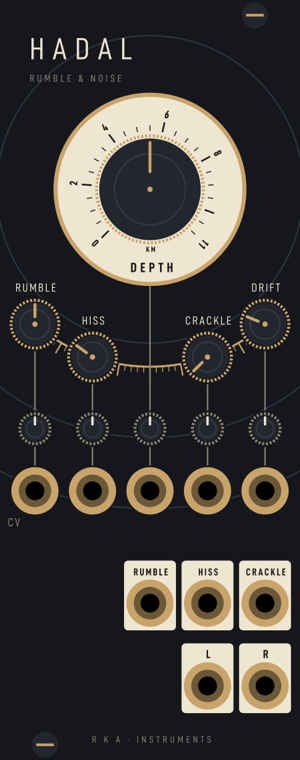

# Hadal

Rumble and noise bed, 10 HP: low rumble, hiss and crackle, darkened together
by one Depth dial and kept slowly moving by Drift. Hadal has no input. It is a
sound source that sits under a track and feeds other modules: into Fog for a
space that is never empty, or a layer at a time into filters, delays and VCAs.

## The panel

Hadal is drawn as a depth gauge. From the top:

- **Depth**, the hero, on a large enamel face numbered in kilometres, 0 to 11.
- **Rumble, Hiss, Crackle and Drift** on a brass limb under it.
- A row of five **attenuverters**, then five **CV** jacks, each in a straight
  line up to its control (Depth's runs up the middle).
- On ivory tiles at the bottom right: the **RUMBLE, HISS and CRACKLE** layer
  outputs, and below them the **L** and **R** mix outputs.

There is no right-click menu beyond Rack's own.

## Controls

### Depth: how dark

Depth runs from 0 km (fully left) to 11 km (fully right). Noon is 5.5 km, the
default. Going deeper darkens every layer at once, each within its own range:

| Layer | 0 km | 11 km |
|---|---|---|
| Rumble | a low roar, energy up to about 120 Hz | near-subsonic pressure, mostly 20 to 40 Hz |
| Hiss | bright air, up to about 12 kHz | a dull, muffled roar, up to about 1.5 kHz |
| Crackle | sharp, bright, very short ticks | soft, darker, longer thuds |

The corners move on a log scale, so equal turns give equal steps in octaves.
**Depth does not change the level:** Rumble and Hiss each keep the same RMS
level across the whole range, and Crackle stays within about 2 dB of its
noon level (slightly quieter at 0 km, slightly louder at 11 km). Rumble
never goes below 20 Hz, and Hiss never goes below about 250 Hz.

### Rumble, Hiss, Crackle: levels

Each knob is its layer's level, from silent (fully left) to full. The law is
audio taper (the square of the knob position), so most of the travel is in
the useful range. The knob sets the layer's level at its own output and in
the L/R mix alike.

- **Rumble and Hiss at full:** about 1.6 V RMS at their own outputs. Noise
  has high peaks, so these reach around the ±5 V audio standard.
- **Crackle at full:** about 0.1 V RMS long-term, at Drift 0 and noon Depth.
  It is sparse, so its average is low while its ticks are loud. Each tick is
  soft-clipped, which brings the small and mid ticks up and rounds the
  biggest, and no tick peaks above ±5 V.
- **Defaults:** Rumble 50 %, Hiss 30 %, Crackle 0 %, so a freshly placed
  Hadal gives a usable bed at once.

### Crackle: what it is

Short, decaying clicks at random times, about 10 a second on average. They
arrive in loose clusters, never evenly spaced, so no rhythm forms. Most are
small and the occasional one is large, like a fire or a settling hull. Each
lands at a random place across the stereo field. The Crackle knob sets their
level, not how many there are; Drift moves their density.

### Drift: slow movement

How much the bed wanders on its own, over tens of seconds. Everything moves
independently, as a smooth random wander, never an LFO, so it does not
pulse, cycle or repeat:

- each layer's level, separately on each side;
- each layer's colour (its corners, around where Depth puts them);
- crackle's density.

Fully left, nothing moves: the bed is perfectly steady. At full, levels
wander within about ±4 dB, colour within about ±⅓ octave, and crackle's
average density between about 5 and 22 ticks a second (with its usual
clustering on top). The default is 25 %. The pace is fixed: a new destination
every 8 to 30 seconds, reached by a slow glide.

### CV and attenuverters

All five controls have a CV input and an attenuverter. Each CV is added to
its knob, scaled by the attenuverter: control = knob + CV / 10 V x
attenuverter, clamped to the control's range. With the attenuverter fully
clockwise, ±5 V from noon sweeps the whole range; fully anticlockwise
inverts it. The attenuverters default to 0, so a newly patched CV does
nothing until you turn its attenuverter up.

Hadal is monophonic: a polyphonic CV uses its first channel. Every control
is smoothed (about 30 ms), so fast or stepped CV moves the sound without
zipper noise or clicks.

## Outputs

- **RUMBLE, HISS, CRACKLE:** each layer alone, mono, at its knob's level.
- **Patching a layer output takes that layer out of the L/R mix**, so a
  layer sent elsewhere isn't doubled in the mix. Unplug it and it comes back.
  The change fades over about 10 ms, so it doesn't click. Nothing on the
  panel shows this; the jacks' hover text says so.
- **L and R:** the layers still in the mix, at half their own outputs'
  level (one fixed mix gain for all three):
  - Rumble is near the centre and mono-safe: its two sides are almost the
    same (correlation about 0.9), so the low end doesn't cancel in mono.
  - Hiss is wide: independent noise on each side.
  - Crackle's ticks are panned at random.
- **L alone is a mono out.** With R unpatched, L carries the mono sum of
  both sides, (L + R) / √2. Hiss and crackle come out at about one side's
  loudness; rumble, whose sides are nearly the same, about 3 dB louder.
  Patching or unpatching R crossfades over 10 ms.
- **Headroom:** every output has a soft limit that starts at 8 V and never
  passes 10 V. At default settings it never acts. With a layer at full it
  catches only occasional noise peaks, a few more when Drift pushes the
  level up.
- With nothing patched, Hadal does no work. A layer that isn't patched
  and isn't needed for the mix isn't computed.

## Suggested patches

- **Hadal into Fog.** L and R into Fog's inputs, Fog on a long Visibility
  with some Bloom: a deep, moving space under the whole track. Turn Depth
  down for something heavier, up for air.
- **Hiss into a filter.** Patch HISS into a resonant band-pass or low-pass
  and sweep it slowly with Sway: wind, surf, a breath through a hull. Hiss
  leaves the L/R mix while it's patched, so the rest of the bed is untouched.
- **Crackle into a delay.** CRACKLE into a dark delay with feedback, or into
  Fog in SMOKE mode, so every tick leaves a trail. Turn Crackle up: on its
  own output it is sparse and fairly quiet.
- **Depth from a slow LFO.** A slow Sway into Depth CV, with a small
  attenuverter amount: the bed sinks and rises over minutes.

## Bypass

Bypass silences every output: Hadal has no input to pass through.

## Other details

- NaN or infinite values on a CV read as 0.
- Every Hadal has its own random seed, so two Hadals in a patch never sound
  alike, and it doesn't repeat over a session. A reset (Initialize) restarts
  it from its seed.
- Changing the sample rate restarts the filters cleanly; Depth's ranges and
  levels are the same at any rate.
- The module stores its knobs and attenuverters with the patch.
