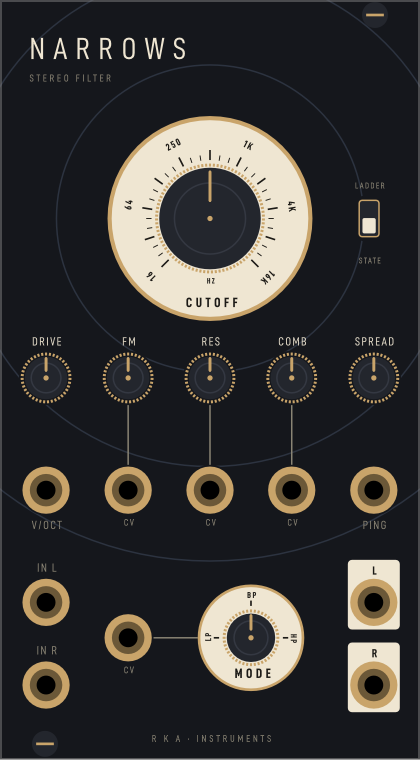

# Narrows

A polyphonic stereo filter, 14 HP: the strait where a channel closes
between two shores, and only part of the water gets through. Narrows goes
after anything (Hadal's noise, Rigging's strings, Wake's echoes) and can
also be played on its own, struck with a trigger or as a sine voice.

## The panel

From the top:

- **CUTOFF**, on the enamel dial, lettered in hertz.
- The **core** switch to the right of the dial: **LADDER** (up) or
  **STATE** (down).
- **DRIVE**, **FM**, **RES**, **COMB** and **SPREAD**. FM, Res and Comb
  each have a **CV** input under them, joined by a line.
- **V/OCT** on the left of the jack row and **PING** on the right.
- **IN L** and **IN R**; **MODE** on its small dial, lettered LP, BP, HP,
  with its **CV** input to the left; and on ivory tiles the **L** and
  **R** outputs.

## Controls

### Cutoff

Cutoff runs from **16 Hz to 16.4 kHz**, an octave for every tenth of the
travel. It opens at 1 kHz. The tooltip shows the frequency; you can type
one in ("440", "440 Hz", "2.5 k").

- **V/OCT** adds 1 V per octave. 0 V is the dial's frequency.
- **FM** is an attenuverter on the FM input: fully right, 1 V at the jack
  raises the cutoff an octave; fully left, it lowers it. It opens at 0, so
  a newly patched cable does nothing until you turn it up.
- Both jacks work at audio rate.
- The result is held between 8 Hz and 20 kHz.

### Core: two filters

| | Slope | Character |
|---|---|---|
| **Ladder** | 24 dB per octave | Fathom's filter: a four-pole transistor ladder. Rounder, and it saturates when driven |
| **State** | 12 dB per octave | A state-variable filter. Gentler slope, more open, a sharper resonant peak |

The two are matched: at the same settings they sit at the same pitch,
begin to self-oscillate at the same place on Res, and ring at about the
same level. Flipping the switch crossfades over a few hundredths of a
second, with no click, and a self-oscillating tone carries across.

### Mode: low-pass, band-pass, high-pass

The Mode dial sweeps over a half turn:

- **LP** (left end): low-pass. It opens here.
- **BP** (middle): band-pass.
- **HP** (right end): high-pass.

At the three lettered points you get that response exactly. Between them
the output is a blend of the two neighbours, so the dial (or a slow CV)
turns the sound from dark to hollow to thin without a step. The tooltip
names the place ("LP 60 % / BP 40 %").

The in-between sounds are not the same in the two cores. Each blends its
own responses.

The **CV** adds to the dial: 10 V is its full travel.

### Res: resonance

Res raises a peak at the cutoff. The low-pass keeps its level below the
peak as Res rises.

- **Up to 95 %** the peak sharpens.
- **From 95 % up** the filter self-oscillates: it sings a sine at the
  cutoff with nothing patched in. The sine grows from nothing at 95 % to
  about 4 to 5 V at 100 %.
- The sine follows V/OCT, so the filter can be played as a voice. It is
  within 1 cent of pitch as it begins to sing and within 7 cents at
  100 %, from 55 Hz to 3.5 kHz.
- From silence the sine takes a moment to start, longer at low pitches. A
  trigger at PING starts it at once.

The **CV** adds to the knob: 10 V is its full travel.

### Drive

At 0 the filter is clean for ordinary signals (±5 V). Turning up pushes
the signal into the core's saturation, by up to 24 dB at full, and the
output is turned back down to match, so the sound gets dirtier but not
much louder.

### Comb

A comb is a very short delay fed back on itself. It puts a row of evenly
spaced peaks on the sound, like a tuned pipe, before the filter shapes it.

- **Noon:** off. The signal is untouched.
- **Right:** peaks at the cutoff frequency and its harmonics.
- **Left:** peaks halfway between those: hollower, and an octave lower.

The comb is tuned to the cutoff, so the Cutoff dial, V/OCT and FM move
both together and they stay in tune. Low-pass keeps the comb's lower
peaks; band-pass picks out the ones near the cutoff.

The **CV** adds to the knob: 5 V is the full travel either way.

### Spread

Spread moves the left cutoff down and the right cutoff up by the same
amount: half an octave each way at full. With a mono input this gives a
stereo output. At 0 the two sides are identical.

The comb follows each side's cutoff.

### Ping

A trigger at **PING** knocks the filter with one short pulse (1 ms,
5 V), on both sides.

- With Res up, the filter rings at the cutoff and dies away: a tuned
  ping. Higher Res rings longer.
- With Comb up, it sounds plucked.
- It needs no audio patched.

## Polyphony

Narrows has a filter pair for every channel of a polyphonic cable, up to
16.

- **The number of voices** is the most channels on IN L, IN R, V/OCT or
  PING.
- **A one-channel cable feeds every voice.** One sound into IN L and a
  chord into V/OCT gives a chord of filters on that sound.
- **CVs** (FM, Res, Comb, Mode): a one-channel cable applies to every
  voice; a polyphonic one sets each voice from its own channel.
- **A polyphonic cable with fewer channels than there are voices** gives
  0 V (or silence) to the voices past its last channel.
- **The outputs** carry one channel per voice.

Channel 3 of IN L pairs with channel 3 of IN R, of V/OCT and of every
CV.

## Inputs and outputs

- **IN L, IN R:** either one alone feeds both sides.
- **L and R:** every output has a soft limit that starts at 8 V and never
  passes 10 V.
- **L alone is a mono out:** with nothing in R, L carries the average of
  the two sides of each voice.

## Patches to try

- **Dark water.** Hadal into Narrows, Ladder, LP, Cutoff around 300 Hz,
  Res 40 %. A slow Sway into FM with the knob a little open.
- **Dark to thin.** A slow Sway into Mode's CV. The sound turns from
  low-pass through band-pass to high-pass and back.
- **A tuned ping.** Nothing in. Res 90 %, Squall's Gate into PING, a
  pitch into V/OCT. Follow it with Wake.
- **A pluck.** The same, with Comb to the right and Res lower.
- **A sine voice.** Res 100 %, a pitch into V/OCT, Sluice after it for
  loudness.
- **A chord of filters.** Hadal into IN L, a polyphonic chord into
  V/OCT, Res 85 %, band-pass. The noise is tuned to the chord.
- **Width from mono.** Any mono sound in, Spread 30 %.
- **After Rigging.** Rigging into Narrows, State, band-pass, Drive 40 %.

## Bypass

Bypassed, the inputs pass straight to the outputs with all their
channels: either input alone goes to both.

## Other details

- What goes into the filter is limited to ±24 V.
- A change of sample rate, and Initialize, bring every voice to rest.
- Saved with the patch: the knobs and the core switch.
- CPU at 48 kHz: about 0.35 % of a core for one or two voices with the
  ladder (0.25 % with the state core), and about 2.5 % for 16 voices with
  everything engaged.
