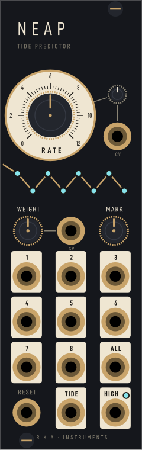
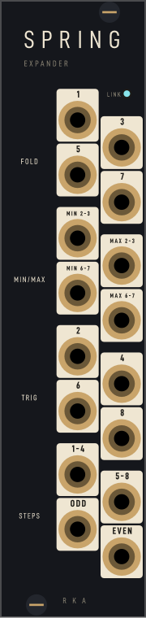

# Neap and Spring

Neap is eight slow cycles, 8 HP: each cycle about an octave slower than the
one before, in uneven steps so that no two ever settle into a repeating
pattern (after the Instruō øchd). It adds **TIDE**, the weighted sum of the
eight; **HIGH**, a gate while the tide is above a mark you set; and a
**Weight** knob that decides whether the fast cycles or the slow ones lead
the tide. **Spring** is its expander, 6 HP: sixteen more outputs made from
the same eight cycles (folds, minimums and maximums, triggers and steps).

The name is Kelvin's tide-predicting machine: a row of pulleys, each turning
at its own rate, and one wire running over them whose free end draws the
tide. The eight cycles are the pulleys; TIDE is the wire. A spring tide is
the opposite of a neap tide: the big one, when everything pulls together.

## The Neap panel

From the top:

- **RATE**, the big dial on an ivory face, with its **attenuverter** and
  the **RATE CV** jack beside it.
- The **wire**: a brass rope zigzagging over eight pulley lights. Each
  light shows its cycle's level: dark at the bottom of the cycle, full at
  the top.
- **WEIGHT** with its **WEIGHT CV** jack, and **MARK**.
- On ivory tiles, in three columns: outputs **1 2 3**, **4 5 6** and
  **7 8 ALL**; then **TIDE** and **HIGH** (with its light). **RESET** is
  a bare input at the bottom left.

The right-click menu has four items: **Drift**, **Wave**, **Level** and
**Add Spring expander**.

## The cycles

Cycle 1 runs at the Rate's frequency. Each next cycle is slower by a fixed
step, 2.16, 1.93, 2.25, 1.93, 1.93, 2.23 and 2.17 times, so cycle 8 is about
169 times slower than cycle 1. The steps are uneven on purpose: every pair of
cycles up to 16:1 apart stays at least 3 % away from a whole-number ratio
(and pairs up to 6:1 from a half), at every Rate setting, so the eight never
lock into a pattern and the combined shape takes a very long time to repeat.

- **RATE** spans 12 octaves. Fully right, cycle 1 runs at 40 Hz and cycle 8
  repeats every 4.2 s; at noon (the default), cycle 1 every 1.6 s and
  cycle 8 every 4.5 minutes; fully left, cycle 1 every 1.7 minutes and
  cycle 8 every 4.8 hours. The tooltip shows the periods of cycle 1 and
  cycle 8 as they are now, with the attenuverter and the RATE CV included
  ("1: 1.6 s · 8: 4.5 min").
- **RATE CV** (1 V/oct) goes through the attenuverter (full right is
  +1 V/oct, full left is -1 V/oct) and is added to the knob. The total is
  held within two octaves beyond each end of the knob, so cycle 1 reaches
  160 Hz at most and 2.4 mHz (a 6.8-minute period) at least. Rate never
  stalls and never runs backwards, whatever the CV does.
- **Tracking spread.** Each cycle follows the Rate with a very slightly
  different slope (cycle 1 exactly, the others by 0.15 % per octave or
  less), so the cycles line up a little differently at each knob position.
  The spread is zero at noon.
- **Drift** (menu, on by default): a slow random wander of each cycle's
  rate, at most ±0.5 % and changing over minutes, a different one for each
  cycle. With Drift off and the same Rate, Neap is repeatable from a Reset.
- **Wave** (menu): Triangle (the default) or Sine, for all eight. Changing it
  mid-cycle keeps every cycle's phase and crossfades over about 10 ms, so
  there is no click.
- **Level** (menu): **±5 V** (the default) or **0-10 V**, for all the
  outputs including TIDE.
- Moving Rate, Weight, either CV or the Wave setting never makes an output
  jump. Reset is the only jump.

## Reset

A rising edge on **RESET** (above 1 V; it re-arms below 0.1 V) puts all
eight cycles at the start of their cycle, at the middle of the swing (0 V, or 5 V in 0-10 V Level), rising. After a Reset
the cycles start together (a spring tide) and then part. A held gate does not
keep resetting. A reloaded patch also starts from Reset: the cycles' phases
are not saved.

## TIDE and Weight

**TIDE** is the weighted sum of the eight cycles, scaled and soft-limited so
it stays within ±5 V and never clips flat.

- **WEIGHT**: at noon the eight count equally. Turned left, the fast cycles
  lead the tide (fully left, cycle 1 is weighted most); turned right, the
  slow ones lead (fully right, cycle 8). The weights fall off by a factor
  of two per cycle at the extremes.
- **WEIGHT CV** adds 0.2 per volt to the knob: ±5 V covers the whole range
  from noon. Changes in Weight glide over about 50 ms, so TIDE does not
  jump.
- With Weight at noon the tide spends about 18.8 % of its time beyond
  ±2.5 V; it uses the full ±5 V rarely and the middle often, as eight
  summed cycles do.

## HIGH and Mark

**HIGH** is 10 V while TIDE is above **MARK**, otherwise 0 V, with 0.1 V of
hysteresis so a slow crossing never chatters. Its light is lit while HIGH is
high.

- **MARK** runs from -5 V to +5 V (default +2 V). At the default and Weight
  at noon, HIGH is on about 15.6 % of the time.
- TIDE peaks at about 4.9 V, so **MARK near +5 V never fires**.
- **With Level at 0-10 V, MARK still compares against the ±5 V tide**: the
  Level setting changes the voltage that comes out of the jacks, not what
  MARK is measured against. In 0-10 V Level, HIGH goes high when the TIDE
  jack reads above MARK + 5 V, which is the same moments as in ±5 V mode.

## Outputs

- **1 to 8**: the cycles, ±5 V (0-10 V with Level 0-10 V), triangle or sine.
- **ALL**: the same eight as a polyphonic cable, cycle 1 on channel 1 to
  cycle 8 on channel 8, for polyphonic modules (a Sluice bank, Pan's CV).
- **TIDE**: the weighted sum, as above.
- **HIGH**: the gate, as above.

## Spring

Spring is Neap's expander, 6 HP, with sixteen outputs and one LINK light.

### Adding Spring

- **From Neap's menu:** right-click Neap and choose **Add Spring expander**.
  Rack places a Spring directly at Neap's right, pushing any neighbours along.
  The item is greyed out while a Spring is already there.
- **From the module browser:** place **Spring** so it touches Neap's right
  edge.

**LINK** (top right) is lit while Spring is connected to a working Neap. When
Neap is missing, not touching, or bypassed, LINK is dark and every Spring
output is 0 V. One Spring works with one Neap.

### What Spring reads

Spring reads **only the eight shaped ±5 V cycles**: the cycles after Wave
(so it follows the sine when Sine is chosen) and before Level. So **TIDE,
HIGH, WEIGHT, MARK and Level do not affect Spring**; RATE, RATE CV, Drift,
Wave and RESET do, since they change the cycles. Its outputs have their own
fixed voltages, stated below. There may be one sample of delay between Neap's
output and Spring's, which is not audible in CV.

### The outputs

The panel is staggered, in four groups of four (FOLD, MIN/MAX, TRIG,
STEPS), each name in the left margin.

- **FOLD 1, 3, 5, 7**: the cycle full-wave rectified, 2·|x|: 0 to 10 V, at
  twice the cycle's rate.
- **MIN 2-3, MAX 2-3, MIN 6-7, MAX 6-7**: the lower and the higher of each
  pair of cycles, ±5 V, so they weave about each other and meet where the
  two cycles cross.
- **TRIG 2, 4, 6, 8**: a 10 ms, 10 V trigger each time cycle 2, 4, 6 or 8
  crosses 0 V going up. At noon, trigger 2 fires every 3.5 s and trigger 8
  every 4.5 minutes.
- **STEPS 1-4, 5-8, ODD, EVEN**: a 4-bit count from whether each of four
  cycles is above 0 V, out as sixteen even steps from 0 V (code 0) to 10 V
  (code 15), so 2/3 V apart. The first named cycle is the most significant
  bit: STEPS 1-4 is 8 for cycle 1, 4 for 2, 2 for 3 and 1 for 4. **ODD** is
  cycles 1, 3, 5, 7 and **EVEN** is 2, 4, 6, 8. The steps do not fall on
  semitones: put them through a quantiser to choose the notes.

### Triggers cascade

An unpatched T jack passes its triggers to the next patched one, in the
order **T2 → T4 → T6 → T8 → T2**, merged with that one's own. Patch only T8
and it fires on every even cycle's rising crossing; patch T2 and T6 and T6
also carries the triggers of T4, and T2 those of T8.

### Reset can fire triggers

A RESET puts every cycle at 0 V rising. A trigger sees that as a rising zero
crossing, so a Reset **can fire Spring's triggers** on every even cycle
that was below 0 V at the time. Neap's own outputs are unaffected.

## Patches to try

- **Slow shimmer.** Cycle 1 into Narrows' cutoff CV, cycle 4 into Fog's
  Visibility CV, cycle 7 into Sluice's level CV on a Fathom drone. The
  three never line up twice.
- **Weather.** HIGH into Beacon's GATE (Trig mode, long Attack and
  Release): a swell each time the tide rises past the mark. Lower MARK for
  more swells; at +4 V it only fires on the tallest tides.
- **Walking notes.** STEPS 1-4 through a quantiser into Fathom's V/OCT, and
  TRIG 2 into a quantiser's sample input: a melody that wanders without ever
  repeating.
- **Triggered strikes.** TRIG 4 into Rigging's STRUM and TRIG 8 into
  Narrows' PING: T2 passes its triggers on to T4, and T6 its to T8.
- **A spring tide.** A slow clock (Squall's gate) into RESET: all eight
  cycles start together and drift apart again, over and over.
- **Chords of CV.** ALL into a polyphonic Sluice: eight gains moving at
  eight speeds.

## Other

- Bypass: Rack's default; Spring sees a bypassed Neap as
  unlinked and goes silent too.
- Initialize: Drift on, Triangle, ±5 V, and every cycle at its start.
- Saved with the patch: the knobs and the three menu settings (Drift,
  Wave, Level). Spring has nothing of its own to save.
