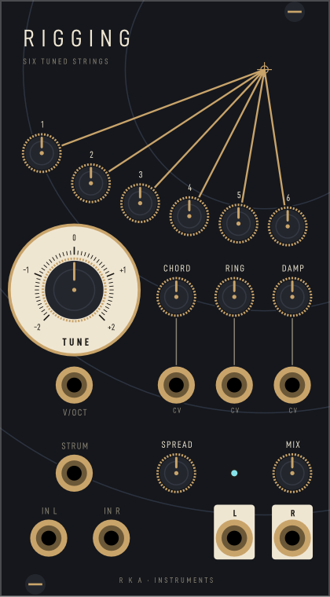

# Rigging

Six tuned strings, 14 HP: wind singing in a ship's rigging. Whatever sound
you feed Rigging keeps its strings ringing at their pitches, so noise
becomes a **tuned drone**. A trigger **strikes** the strings by itself, for
hits, stabs and slow rakes that ring away. Both happen at once on the same
strings: a drone underneath and strikes on top, always in the same tuning.

## The panel

Rigging is drawn as its name: six brass stays run from the masthead to six
knobs. From the top:

- The six **string levels**, numbered **1** (the lowest string) to **6**.
- **TUNE**, on the enamel dial, with **V/OCT** under it.
- **CHORD**, **RING** and **DAMP**, each with its **CV** input under it,
  joined by a line.
- **STRUM** (a trigger input), **SPREAD**, the **strike light** and
  **MIX**.
- **IN L**, **IN R**, and on ivory tiles the **L** and **R** outputs.

The right-click menu has **Free pitch** (below).

## Two ways to play it

- **A drone.** Patch a sound into IN L: Hadal's Hiss is the natural one.
  The strings ring for as long as the sound lasts and die away after it,
  over as long as Ring says. Noise gives the evenest drone; any sound
  works, and one with a pitch of its own makes the strings near that pitch
  sing loudest.
- **Struck.** Patch a trigger into STRUM (Squall's Gate, a clock, Shoal).
  Each trigger strikes the strings, with nothing needed in the audio
  inputs.
- **Played from one cable.** With nothing in STRUM, a **new note at
  V/OCT strikes the strings**: a sequencer's pitch output alone plays
  Rigging. A new note is a jump of more than about a third of a semitone;
  a note that slides to its pitch is still one strike. A slow glide or a
  gentle LFO on V/OCT only bends the pitch, the same note repeated does
  not strike again (use STRUM for that), and plugging a cable carrying a
  voltage into V/OCT, or pulling it out, is a jump like any other.

With nothing patched in and no strikes, Rigging is silent: it has no sound
of its own.

## Controls

### Tune and V/OCT: the lowest string

- **TUNE** sets string 1, from two octaves below **C2** (65.4 Hz, at
  noon) to two octaves above, in semitones; the dial is lettered in
  octaves and the tooltip shows the note.
- **V/OCT** adds 1 V per octave to all six strings.
- **Free pitch** in the menu turns the semitone steps off; turning it back
  on rounds the knob to the nearest semitone.
- A change of pitch bends the strings to the new note over a few
  hundredths of a second, so a ringing string never clicks.
- No string goes below 8 Hz or above 12 kHz.

### Chord: the other five strings

Seven tunings, a click each; the tooltip shows the name. The default is
Fifths.

| Chord | The strings above string 1 | Sound |
|---|---|---|
| Unison | All the same note, a few cents apart | A thick single-pitch drone |
| Octaves | The note over three octaves, the doubled ones slightly apart | Open and hollow |
| Fifths | Fifth, octave, fifth, octave, fifth | Dark, neither major nor minor |
| Minor | Fifth, octave, minor third, fifth, octave | Sad, settled |
| Sus | Fourth, fifth, octave, fourth, fifth | Unresolved, spacious |
| Cluster | Each a semitone above the last | Dissonant, for horror |
| Bell | Spaced as a bell's overtones (1, 2, 2.4, 3, 4, 6 times string 1) | Metallic, for strikes |

Changing chord bends the ringing strings to their new notes.

### String levels

Each knob is how loud its string is in the mix, 0 to 100 %. A string keeps
ringing with its level down, so bringing a level up in the middle of a
drone fades in a string that is already sounding. Turn a string out to
change the chord: Minor without string 4 (its third) is neither major nor
minor.

### Ring: how long the strings sound

The time a string takes to fall silent after its sound or strike stops:
**0.1 s** fully left to **60 s** fully right; the tooltip shows it, and
the default is 4 s. Every string rings for the same time, low or high.

- As a drone, Ring is how smooth and sustained the drone is, and how long
  it hangs on. Rigging keeps the drone about as loud whatever Ring is, so
  turning it up makes the drone longer, not louder.
- Struck, Ring is the length of the note: a thud at the left, a toll of a
  minute at the right.
- The time shown is with Damp fully left: Damp shortens it (below).
- Two limits. A very low string cannot ring for less than a few of its
  own cycles, so at the shortest settings the lowest strings give a thud
  with no clear pitch. And very high strings, far above where the knobs
  reach but within V/OCT's, cannot ring long: the full 60 s holds up to
  about 1 kHz, 10 s at 2 kHz, and about a second above 3.5 kHz.

### Damp: how the brightness dies

Fully left, a string stays bright for as long as it rings, short of its
very top: as on a real string, the air takes the highest shimmer (around
10 kHz) within half a second or so, so a long ring never turns into a
metallic sizzle. Turned up, its
upper overtones die sooner than its fundamental: a struck string starts
bright and mellows, and a drone gets darker and purer. Fully right, a
string settles within a moment to a soft, almost pure tone.

Damp also shortens the ring, as it does on a real string: at the default
(a third) a 60 s Ring is still over 30 s, but fully right no string rings
for more than about two seconds.

### Strum and Spread: the strike

- A trigger at **STRUM** strikes all six strings, string 1 first.
- **SPREAD** is the time from string 1's strike to string 6's, with the
  others evenly between: **0** fully left (all at once: a stab) to
  **1.5 s** fully right (a slow rake up the strings). The default is
  60 ms, a quick strum; the tooltip shows the time.
- A new trigger during a rake starts a new one from string 1; the strings
  the old rake had not reached are not struck by it.
- A strike is as loud at Ring 60 s as at Ring 1 s, and no two strikes are
  quite the same.
- The **light** flashes on every strike.

### CV

**Chord**, **Ring** and **Damp** each take a CV that adds to the knob,
10 V across the knob's whole travel (so ±5 V from the middle reaches both
ends). There are no attenuverters: scale a CV before it arrives (Squall
has ranges of ±1 V and ±2 V; Sluice attenuates). Chord's CV steps through
the seven tunings, one about every 1.4 V, and does not chatter when a CV
rests between two.

## Inputs and outputs

- **IN L, IN R:** audio in. One cable in either jack feeds all six
  strings. With both patched, strings 1, 3 and 5 hear the left input and
  2, 4 and 6 the right.
- **L, R:** the strings in stereo: string 1 in the middle and the others
  further out as they go up, on alternate sides. In mono (L + R) every
  string is there.
- **MIX:** the dry input fully left, the strings alone fully right (the
  default: a drone from noise wants no noise in it).
- **Level.** Noise at ±5 V in gives a drone of about ±3 V; a single struck
  string peaks at 1.5 to 4 V and all six at once at about 6 V. The strings
  are soft-limited below ±10 V, with nothing changed under 8 V.
- A polyphonic cable into an audio input is summed; into V/OCT, a CV or
  STRUM, its first channel is used. The outputs are mono cables.

## Patches to try

- **A tuned drone:** Hadal's Hiss into IN L, Rigging into Fog. Chord at
  Fifths or Unison, Ring long, Damp about half. Tune it under Fathom.
- **Distant bells:** Squall's Gate into STRUM, Chord at Bell, Ring 20 s,
  Spread about a third, into Fog. Weather near Fair.
- **Drone and strikes together:** both of the above at once.
- **A plucked line from one cable:** Shoal's Quantermain (output A) into
  V/OCT, nothing in STRUM, Ring 1 to 2 s, Spread at 0.
- **Breathing brightness:** Sway into Damp CV, slow.
- **Harmony that moves:** Squall's Step (±2 V) into Chord CV: the tuning
  changes with the weather.
- **A drone that swells in parts:** bring strings 4, 5 and 6 up by hand
  over a minute.

## Bypass

A bypassed Rigging passes the dry input: IN L to L and IN R to R, one
cable alone to both.

## Other details

- NaN or infinite values on any input read as 0 V; the strings hear an
  input only up to ±24 V.
- Typing into a tooltip: Ring takes seconds, Spread milliseconds (or
  "0.5 s"), Chord a name or a number from 1 to 7.
- A change of sample rate retunes the strings and silences them.
- Two Riggings never strike identically.
- Rigging stores its knobs and the Free pitch setting; the strings'
  ringing is not saved.
- Rigging uses about 0.15 % of a CPU core as a drone, 0.3 % with every
  CV moving.
