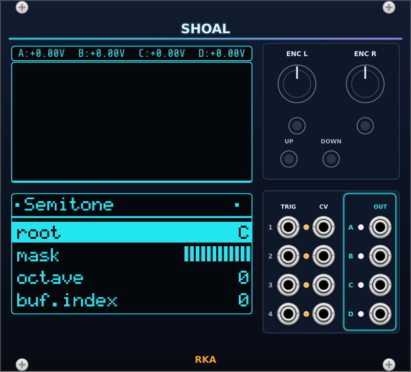

# Shoal

The Ornament & Crime firmware in a 28 HP module. Shoal runs the real
o_C v1.3.6 firmware, all thirteen apps (CopierMaschine, Harrington 1200,
Automatonnetz, Quantermain, Meta-Q, Quadraturia, Low-rents, Piqued,
Sequins, Dialectic Ping Pong, Viznutcracker sweet, Acid Curds and
References), on a stand-in for the module's hardware, so the apps behave
as on the hardware and the o_C manual applies as written.

Ornament & Crime is by Patrick Dowling, Max Stadler and Tim Churches
(github.com/mxmxmx/O_C), under the GPL. Shoal is not affiliated with
them. The changes Shoal makes to the firmware are listed in
`src/shoal/firmware/CHANGES.md`.

This is a short page for the first, hardware-only version; a full manual
comes later.

## Using the apps

For what each app does and how to drive it, read the o_C user manual for
v1.3: <http://ornament-and-cri.me/user-manual-v1_3/>. Everything it says
about the encoders, buttons and screens holds here, including the app
menu (long-press the right encoder's button), the settings menus and the
sub-editors.

## Screens

- The **upper screen** is the o_C screen the hardware shows when idle:
  the current app's scope or status view.
- The **lower screen** is the o_C menu screen, where the app's settings
  are edited.
- The strip above them shows the four output voltages.

## Controls

- **ENC L / ENC R**: endless encoders. Drag up to turn clockwise, down
  to turn anticlockwise: 8 px of mouse travel per detent, or 32 px with
  Ctrl (Cmd on a Mac) held for fine steps. The scroll wheel turns them,
  one detent per notch, only when Rack's "scroll wheel knob control"
  setting is on; with it off the wheel scrolls the rack as usual.
  Encoder acceleration starts on, as on the hardware.
- The round button under each encoder is that encoder's push; **UP** and
  **DOWN** are the o_C's two buttons. Click to press: the button is down
  for as long as the mouse is held, so a long press is a long click.
  **Shift-click** latches a button down, for the gestures that hold a
  button while turning an encoder (for example, the user-scale editor's
  hold-L-and-turn); click it again to release it.

## Inputs and outputs

- **TRIG 1–4**: trigger and gate inputs. A rising edge counts when the
  voltage passes 1 V; the input reads low again below 0.1 V. The amber
  light beside each jack shows its state.
- **CV 1–4**: CV inputs, clamped to −3.33 V to +6.67 V, the hardware's
  input range.
- **A–D**: outputs, −3.75 V to +6.25 V, the hardware's DAC range. The
  light beside each is cyan for positive voltages and magenta for
  negative ones, full at 5 V.
- A polyphonic cable into an input uses its first channel; the outputs
  are monophonic.
- The outputs start at 0 V when the module is added, initialized or
  loaded with a patch, until the app writes them. The hardware starts
  them near its top voltage instead; this difference is deliberate.

## Saving, initialize, randomize

- The firmware's settings (its EEPROM: the current app and every app's
  settings) are saved with the patch, captured about twice a second, so
  reopening a patch brings back the app and its settings. A duplicated
  module starts with the same settings and then runs on its own, with its
  own random values.
- A button latched with shift-click is released when the patch is loaded.
- **Initialize** (right-click) returns the firmware to a new module's
  defaults: CopierMaschine, outputs at 0 V.
- **Randomize** does nothing.

## Not there yet

- A friendly mode that lists the current app's settings in plain words.
- Right-click options: the ±5 V input range, encoder acceleration on/off
  and a direct app choice. The input range is already saved with the
  patch, so patches keep it when the option arrives.
