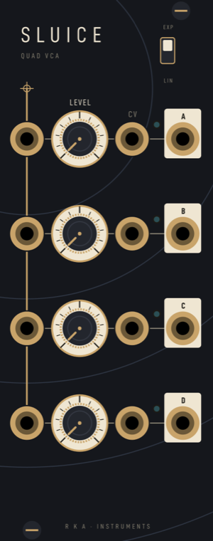

# Sluice

Quad VCA, 10 HP: four voltage-controlled amplifiers in one module, each
with a Level dial and a CV input. Unpatched inputs take the signal from the
row above, and unpatched outputs mix into the row below, so one module can
be four separate VCAs, one signal split four ways, or a four-channel
mixer. It is DC-coupled, so it works on audio and on CV alike, and it is
polyphonic throughout. Made for dark and space ambient: an LFO that
breathes a drone in and out, a modulation that fades in over minutes.

## The panel

Sluice is drawn as a sluice gate: a brass rope runs down from an anchor at
the top left through the four inputs. Each row is one straight line from
left to right, joined by a trace:

- the **input** jack on the rope;
- the **Level** dial, on a small enamel face with 10 divisions and no
  numerals; the ticks at 0, 5 and 10 are heavier, so closed, noon and
  fully open read at a glance;
- the **CV** jack;
- a light, showing how open the row is;
- the **output** on an ivory tile lettered **A** to **D**.

Rows are A, B, C and D from the top. The **Lin/Exp** switch beside the
title sets the response for all four rows.

## Level and CV

- **Level**: 0–100 %, default **0 %, fully closed**. A new Sluice is
  silent until a Level is turned up.
- **CV** adds to Level, 10 V across the whole travel. One division on the
  dial face is 1 V. So with Level at noon, a ±5 V LFO sweeps the row from
  closed to fully open; with Level at 0, a 0–10 V envelope works like a
  classic VCA. Where Level plus CV leaves the range, the swing flattens at
  the end it passes.
- An unpatched CV is 0 V, and CV never follows the rope: only Level sets
  an unpatched row.
- Turning Level is smoothed (about 10 ms) so it never clicks. CV is not
  smoothed, so an envelope on the CV passes through at its own speed.
- The light shows how open the row is, its Level plus CV before the
  response curve, so it means the same in Lin and Exp. On a polyphonic
  row it follows the most open voice.

## Response: Lin / Exp

One switch for all four rows.

- **EXP** (default): a decibel taper, linear in dB over 60 dB, so a fade
  sounds even. Level at 50 % is about −30 dB. It reaches true silence at 0
  and unity at 100 %.
- **LIN**: gain equals Level plus CV, exactly. Use it when the CV is
  itself a modulation, so that a half-open row passes exactly half of it.

If a patch needs both, use two Sluices. Flicking the switch changes the
level at once, with no fade.

## Coupling

Nothing filters the signal: Sluice is DC-coupled, and a CV comes through
exactly. That gives three uses besides audio:

- **Modulation depth under CV.** Put a slow LFO or envelope through a row,
  and control that row's CV with something slower. A wobble on Fathom's
  filter can fade in and out over minutes.
- **Gating an LFO.** An envelope on the CV lets an LFO through only
  during a section.
- **Staggered layers.** One LFO fed down the rope to all four rows, each
  row opened by its own CV at a different time.

The cost of DC coupling is that an offset in the input stays an offset in
the output. Nothing in Sluice removes it.

## The rope

An unpatched input takes the input of the row above, before that row's
gain, including its channel count. Plug one cable into A and the same
signal reaches all four rows, each with its own Level and CV. A patched
input breaks the rope: the rows below take that input instead. Row A with
nothing patched is silence.

## The mix downward

An unpatched output is added into the row below's output. A patched output
stops the carry: it carries its own row and whatever was carried down into
it, and nothing goes past it.

- With only D patched, D carries all four rows: a four-channel mixer.
- With every output patched, the four rows are separate.
- With A and C patched, A carries A; C carries B and C; D carries D.

### Warning: copies add up

The rope and the mix together sum four copies of one signal. One signal
into A, only D patched, every Level fully open, comes out **4× as loud
(+12 dB)**. Nothing scales the mix down. Turn Levels down, or follow
Sluice with a limiter, before it reaches your speakers.

## Polyphony

- A row has as many voices as its input (after the rope), up to 16.
- A mono CV moves every voice together. A polyphonic CV moves voice by
  voice. A CV with fewer channels than the input gives 0 V to the extra
  voices.
- Mixing: the mixed signal has as many voices as the widest row in it. A
  **mono row is copied into every voice** of a wider row, so a mono drone
  mixed into a two-voice (stereo) row sits in the centre. **Polyphonic rows
  mix voice by voice**: a 2-voice row mixed into a 4-voice row adds into
  voices 1 and 2 only.
- The cost of copying: a mono row mixed into a 4-voice chord is in every
  voice, so if that chord is later summed to mono, the mono row comes out
  4× louder.
- A row with no signal still outputs one channel at 0 V.

## Stereo

Sluice has no stereo features: no left/right pairs and no link between
rows. For a stereo source with separate L and R jacks, such as Fathom,
there are two patches.

1. **Recommended: VCV Merge, one row, VCV Split.** Merge L and R into a
   two-voice cable, patch it into one row, and Split the output. One
   Level and one CV, so the two sides cannot drift apart and the image
   cannot lean.
2. **Quick: L into A, R into B**, one LFO cabled to both CV inputs, and
   both outputs patched so A does not mix into B. The two Level dials
   must match; right-click a dial to type an exact value.

## Other details

- **Bypass** passes each input straight to its output, with no rope and no
  mixing.
- NaN and infinite values on any input are replaced with 0 where they
  come in, so they cannot spread to other rows.
- The module stores its knobs and the switch with the patch, nothing else.
