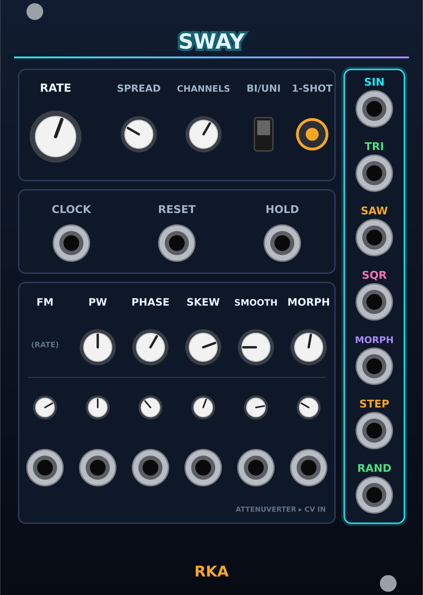

# Sway expansion: design

Date: 2026-10-23. Status: approved in conversation, pending written review.

Fixes Sway's slow-rate phase bug and adds features 1–6 and 8 from
`~/ws/plugins/IDEAS.md` ("Sway (LFO): next steps"). Feature 7 (on-panel
display) is dropped: users patch VCV's Scope instead.

Sway is unreleased (plugin 2.0.0, no tag), so param/port IDs and the panel
are redefined freely. The version stays 2.0.0; `CHANGELOG.md` describes the
final module.

## Directory layout (first step)

All code moves under `src/`; assets stay at the top level, per module:

```
src/plugin.cpp, plugin.hpp, widgets.hpp, RkaTheme.hpp
src/sway/       Sway.cpp, SwayLayout.hpp, *.hpp DSP units, test_*.cpp
res/sway/       Sway.svg, Sway-dark.svg        (what Rack loads)
res-src/sway/   Sway.svg, Sway-dark.svg        (generated, live text)
docs/sway/      README.md (the manual), Sway.png
docs/specs/     design docs
```

- Makefile: `MODULES = sway` still lists modules; sources are
  `src/*.cpp` + `src/<m>/*.cpp` minus `test_*.cpp`; tests are
  `src/<m>/test_*.cpp` → `build/test/<m>/…`; `DISTRIBUTABLES += res`.
  Module code includes shared headers via `-Isrc`.
- Panels load from `"res/<m>/<Name>.svg"`; packages ship
  `rka/res/sway/*.svg`.
- `gen_panels.py` writes `res-src/<dir>/`, `src/<dir>/<Name>Layout.hpp`;
  `make panels` writes `res/<dir>/`.
- CI test loop becomes `src/*/test_*.cpp`.
- README module table links `docs/sway/README.md`; README layout section,
  "Adding a module" and CLAUDE.md are updated to match.

## Bug: phase stalls at slow rates

`LfoCore::phase` is a `float`. At 48 kHz the per-sample step `f / fs` drops
below the float's resolution near phase 1:

| Rate | Expected cycle | Measured |
|---|---|---|
| 2⁻⁷ Hz (knob minimum) | 128 s | 125 s (2.3% fast) |
| 2⁻⁹ Hz | 512 s | 474 s (7% fast) |
| ≤ 2⁻¹⁰ Hz (V/OCT below about −2.5 V) | ≥ 1024 s | phase freezes, LFO stops |

Fix: keep the phase accumulator in `double`. Regression tests in
`test_phasor.cpp` (see Testing).

## Panel (18 HP)



Layout B from the mockup: no display, outputs in a column on the right.
Positions in mm (centres), to go into `PANELS["Sway"]` in
`tools/gen_panels.py`:

| Group | Component | x | y |
|---|---|---|---|
| Card 1 (4, 15, 68.44 × 24) | RATE (big knob) | 12.0 | 29.5 |
| | SPREAD (knob) | 30.0 | 29.0 |
| | CHANNELS (knob, 1–16 snap) | 44.0 | 29.0 |
| | BI/UNI (switch) | 57.0 | 29.0 |
| | 1-SHOT (latch button + amber LED) | 67.5 | 29.0 |
| Card 2 (4, 41, 68.44 × 18) | CLOCK, RESET, HOLD inputs | 15.41, 38.22, 61.03 | 52.5 |
| Card 3 (4, 61, 68.44 × 52) | Columns FM, PW, PHASE, SKEW, SMOOTH, MORPH | 9.70, 21.11, 32.52, 43.92, 55.33, 66.74 | |
| | knob (none for FM; RATE is FM's knob) | | 75.0 |
| | attenuverter (trimpot) | | 88.0 |
| | CV input | | 101.0 |
| Output card (74.44, 15, 13 × 98, cyan) | SIN, TRI, SAW, SQR, MORPH, STEP, RAND | 80.94 | 23.5 + 13.9·i |

Output label accents: SIN cyan, TRI green, SAW amber, SQR magenta,
MORPH violet, STEP amber, RAND green. Card 3 carries small notes:
"(RATE)" in the FM knob slot and "ATTENUVERTER ▸ CV IN" bottom right.
Long labels (CHANNELS, SMOOTH) use a smaller font.

`gen_panels.py` gains: a per-component label size override and a `notes`
list (x, y, text, size) for hint text. Everything else (cards,
`label_accents`, themes) already exists.

## Controls

| Param | Range | Default | Notes |
|---|---|---|---|
| RATE | −7 … 7 | 1 | Meaning depends on range and clock (below) |
| PW | 0.01 … 0.99 | 0.5 | SQR, and the square in MORPH |
| PHASE | 0 … 1 | 0 | 0–360°, wraps |
| SKEW | 0 … 1 | 0.5 | MORPH output only |
| SMOOTH | −1 … 1 | 0 | MORPH output only |
| MORPH | 0 … 1 | 0 | MORPH output only |
| SPREAD | 0 … 1 | 0 | Phase offset between channels |
| CHANNELS | 1 … 16 | 1 | Snapped |
| 6 attenuverters | −1 … 1 | 0 | FM, PW, PHASE, SKEW, SMOOTH, MORPH |
| BI/UNI | switch | bipolar | ±5 V or 0–10 V for every output |
| 1-SHOT | latch | off | Saved with the patch as a param |

CV: `value = knob + atten · (cv / 10 V) · (max − min)`, so ±5 V at full
attenuverter sweeps the whole range. PW, SKEW, SMOOTH, MORPH clamp; PHASE
wraps. FM: `exponent = knob + atten · cv`, i.e. 1 V/oct at full.

### Range (right-click menu, saved in `dataToJson`)

| Range | Frequency |
|---|---|
| Slow | 2^(RATE − 7) Hz: 2⁻¹⁴ … 1 Hz, ~4.5 h … 1 s per cycle |
| Normal (default) | 2^RATE Hz: 0.008 … 128 Hz (as today) |
| Audio | C4 · 2^(RATE · 5/7): ~8 Hz … 8.4 kHz; FM still 1 V/oct |

The total exponent clamps to [−24, 14] and the frequency to at most
0.45 · sample rate.

### Clock sync

With CLOCK patched and two rising edges seen, RATE becomes a ratio
selector: `index = round(RATE + FM atten · cv)` clamped to −7 … 7, into
÷16 ÷12 ÷8 ÷6 ÷4 ÷3 ÷2 ×1 ×2 ×3 ×4 ×6 ×8 ×12 ×16. Tooltip shows the ratio.

- Frequency = ratio / measured clock period (time between the last two
  rising edges).
- ×N: on every clock edge the phase resyncs to 0. ÷N: on every Nth edge.
  RESET also clears the ÷N edge count.
- Before two edges, or after the cable is removed, Sway runs free from RATE.
- Clock is polyphonic via `getPolyVoltage(c)`: a mono clock drives every
  channel.

## Outputs and behaviour

Per channel c of N channels (N = max(CHANNELS, widest input)):

1. Frequency from range/RATE/FM or from ClockSync.
2. Phasor advances unless HOLD is high (> 1 V) or a one-shot has finished.
3. Read phase `p = phasor + PHASE + SPREAD · c / N`, wrapped to [0, 1).
4. Outputs from `p`, then scaled by BI/UNI:
   - SIN, TRI, SAW, SQR(PW): the same pure waves as today (sine and
     triangle start at 0 rising; saw rises). In Audio range SAW and SQR use
     polyBLEP.
   - MORPH: Shaper(p) (below).
   - STEP / RAND: RandomGen, advanced on the Phasor's wrap (not the read
     phase), so SPREAD and PHASE don't change when values are drawn.

**Shaper** (MORPH output):
- SKEW warps the phase so the rise (trough → peak) spans SKEW of the
  cycle and the fall the rest, measured from the trough so MORPH stays in
  phase with SIN/TRI. 0.5 = no warp; 0 and 1 give falling / rising ramps
  (from the sine and triangle).
- MORPH crossfades sin → tri → saw → square across equal thirds of the
  knob (0, ⅓, ⅔, 1 = the four pure shapes).
- SMOOTH < 0 blends toward a smoothed (sine-rounded) version of the wave;
  SMOOTH > 0 wavefolds, up to 3 folds at +1. 0 = unchanged.
- Square part polyBLEP'd in Audio range; the rest isn't band-limited.

**RandomGen:** on each wrap, `prev = next; next = uniform(−1, 1)`. STEP
outputs `next`. RAND outputs a cosine glide from `prev` to `next` over the
cycle. Each channel has its own generator (seeded per channel).

**HOLD and 1-SHOT:**
- HOLD high freezes the phase (and suppresses clock resyncs).
- 1-SHOT on: RESET starts one cycle; at the wrap the phase parks at the end
  of the cycle. Before the first RESET the LFO is parked. Clock edges still
  set the frequency but don't restart a parked one-shot.
- RESET (rising edge, 0.1 V / 1 V Schmitt) restarts the phase at 0, always.

## Code structure

Rack-free headers in `src/sway/`, each with a `test_*.cpp`:

| File | Responsibility |
|---|---|
| `Phasor.hpp` | `double` phase; `step(freq, dt)` returns whether it wrapped; reset, hold, one-shot park |
| `ClockSync.hpp` | Edge timing, ratio table, resync decisions |
| `Waves.hpp` | sin, tri, saw, sqr(pw), polyBLEP helper |
| `Shaper.hpp` | SKEW / MORPH / SMOOTH |
| `RandomGen.hpp` | STEP / RAND state |

`LfoCore.hpp` and `test_lfo_core.cpp` are replaced (`lfoFrequency` and
`lfoVolts` move into these headers with the new clamp). `Sway.cpp` maps
params, ports, polyphony and the range menu onto them. Shared widgets go in
`src/widgets.hpp`: trimpot (`rka::Trim`) and the 1-SHOT latch with an amber
light (`rka::AmberLatch`), using `RkaTheme::AMBER`.

## Testing

Offline (`make test`, CI):
- Phasor: period within 0.1% at 2⁻⁷ and 2⁻¹⁴ Hz; at 2⁻²⁴ Hz the phase keeps
  advancing; hold freezes; one-shot parks after one cycle.
- ClockSync: ×4 and ÷4 against a synthetic 120 BPM clock lock within one
  clock period; free-runs before two edges; ratio index clamps.
- Shaper: MORPH 0/⅓/⅔/1 equal the pure waves; SKEW 0.5 and SMOOTH 0 are
  identity; output stays continuous (no jumps > a small bound) except the
  saw/square edges.
- RandomGen: new value each wrap; RAND continuous across wraps.
- Waves: polyBLEP saw at 5 kHz has less energy above Nyquist/2 than the
  naive saw.

Then `make`, `make smoke` (panel screenshot reviewed), all four platform
packages, and `make install`.

## Out of scope

On-panel display, end-of-cycle output, SPREAD/ratio CV, an expander.
