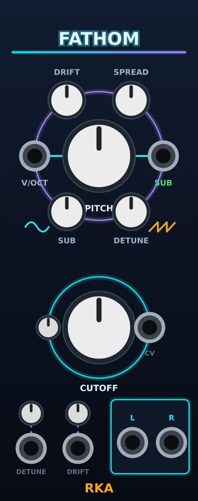

# Fathom: design (phase 1, the voice)

Date: 2026-10-24. Status: approved in conversation, pending written review.

Fathom is a deep bass drone voice for dark and space ambient: a sub sine
under a detuned supersaw body, a low-pass to close it down, and slow drift
so a held note never sits still. It is the second `rka` module, beside
Sway. This document covers phase 1 only: the voice, on a 10 HP panel. The
effects, modulation bus and randomizer from
`~/ws/reference/Drone_Module_Specification.md` come in later phases, each
widening the panel; they get their own design documents.



## Intent

The user makes dark and space ambient and wants a bass drone they can hold
on one note for minutes while it breathes. The reference spec described a
26 HP module with eight DSP blocks; the user cut it down so the oscillator
section gets built and tuned first, on its own, because a drone that sounds
good with nothing but the voice is the module's reason to exist.

References, in the order they shaped this:

- **Befaco Oneiroi** (`~/ws/reference/Oneiroi-1.2.2`, GPL-3-or-later): the
  macro approach (few knobs, recipe inside), and the supersaw's detune and
  mix curves (`StereoSuperSaw.h`, adapted from Szabo, *How to Emulate the
  Super Saw*, 2010).
- **AmbientModules Lunar50Drone**: the alternative, per-oscillator knobs;
  rejected in favour of macros.
- **forsitan Draen** (`~/ws/plugins/forsitan-modulare/src/draen_alt_engines.hpp`):
  the "root" (sub-octave sines through tanh with a breathing level),
  "wall" (eleven detuned saws into a ladder) and "drift" (sines re-tuning on
  random walks) engines, for the sound.
- **Instruō** panels (installed plugin, `cruïnn`, `Tš-L`): tight layouts
  that draw the signal as a picture rather than a grid.

## Goals, non-goals, anti-goals

Goals:

- A sub you feel and a body you can thicken or thin, from one V/Oct.
- Evolving by itself: drift on by default, nothing to patch.
- Tight: 10 HP, six knobs, one idea per knob; depth in the menu.
- DSP in Rack-free headers with offline tests, as Sway does.
- Under 1% of a core at 48 kHz on this laptop (Apple Silicon).

Non-goals for phase 1: filter modes other than low-pass, resonator, echo,
reverb, modulation bus, randomizer, external audio in, wavetable,
polyphony, an expander. The panel is designed so these arrive without
moving anything built now.

Anti-goals: a panel that reads as a grid of knobs; aliasing grit at bass
pitches (Lunar50's naive saws are not the sound); a module that needs
patching to move.

## Names

The module is **Fathom** (slug `Fathom`, folder `src/fathom/`). RKA module
names are the sea family, plain English words that are also verbs; see
`CLAUDE.md`.

## Panel (10 HP, "Orbit")

Nightglow look, generated by `tools/gen_panels.py`. The organising idea is
two orbits: PITCH is a sun with the four voice knobs on a ring around it,
V/OCT in on the ring's left and SUB out on its right; CUTOFF is a second
sun with its attenuverter and CV on a smaller ring. The cutoff ring is
half empty on purpose: the full filter (resonance, drive, type, position)
fills it in phase 2.

Positions in mm (centres), 50.8 × 128.5 panel. Title "FATHOM" and the rule
as on Sway.

| Element | Widget | x | y | Label |
|---|---|---|---|---|
| Pitch ring | violet ring, r 16.5 | 25.4 | 40.0 | |
| PITCH | `rka::BigKnob` | 25.4 | 40.0 | below, y 54.2, ink |
| V/OCT in | jack, on the ring | 8.9 | 40.0 | below, y 47.6 |
| SUB out | jack, on the ring | 41.9 | 40.0 | below, y 47.6, green |
| DRIFT | `rka::SmallKnob` | 17.15 | 25.7 | above, y 19.2 |
| SPREAD | `rka::SmallKnob` | 33.65 | 25.7 | above, y 19.2 |
| SUB | `rka::SmallKnob` | 17.15 | 54.3 | below, y 62.4 |
| DETUNE | `rka::SmallKnob` | 33.65 | 54.3 | below, y 62.4 |
| Cutoff ring | cyan ring, r 13 | 25.4 | 84.0 | |
| CUTOFF | `rka::BigKnob` | 25.4 | 84.0 | below, y 100.3, ink |
| CUTOFF att | `rka::Trim`, on the ring | 12.4 | 84.0 | |
| CUTOFF CV | jack, on the ring | 38.4 | 84.0 | "CV" below, y 91.2, hint |
| DETUNE att | `rka::Trim` | 8.0 | 106.0 | |
| DRIFT att | `rka::Trim` | 20.0 | 106.0 | |
| DETUNE CV | jack | 8.0 | 115.0 | below, y 121.6, hint |
| DRIFT CV | jack | 20.0 | 115.0 | below, y 121.6, hint |
| Output card | 28.5, 102.5, 20 × 19, cyan | | | |
| OUT L | jack | 34.0 | 113.5 | above, y 107.8, cyan |
| OUT R | jack | 44.0 | 113.5 | above, y 107.8, cyan |

Also on the panel: a cyan line across the pitch ring from V/OCT through
PITCH to SUB OUT (the signal: pitch in, sub out); a small sine glyph by
SUB and a stacked-saw glyph by DETUNE (as `notes`-style decorations);
dotted violet ticks between each attenuverter and its jack. "RKA" at the
bottom as on Sway; the builder may nudge the output card up a millimetre
so the logo clears it.

`gen_panels.py` needs two small additions, drawn the way cards are (a wide
faint halo under a thin bright stroke): `rings=[(cx, cy, r, accent)]` and
`lines=[(x1, y1, x2, y2, accent, dotted)]`. Glyphs can be `notes` entries
using path strings; the builder chooses the simplest form that renders in
Rack (nanosvg: no text, no blur, paths and gradients fine).

Rack's dark-panels variant comes for free from the existing `THEMES`.

## Controls

| Param | Range | Default | Notes |
|---|---|---|---|
| PITCH | −24 … +24 semitones, snapped | 0 | 0 = C2 (65.41 Hz) at 0 V. Tooltip shows the note name. |
| SUB | 0 … 100 % | 50 % | Level of the sub sine in the L/R mix. |
| DETUNE | 0 … 100 % | 25 % | Supersaw detune, Oneiroi/Szabo curve. |
| SPREAD | 0 … 100 % | 60 % | Stereo width of the seven saws. |
| DRIFT | 0 … 100 % | 25 % | Slow random walk on each saw's pitch and level. |
| CUTOFF | 20 Hz … 20 kHz, exponential | 1.2 kHz | 12 dB/oct low-pass on the whole mix. |
| 3 attenuverters | −100 … +100 % | 0 | DETUNE, DRIFT, CUTOFF |

CV, as Sway: `value = knob + atten · (cv / 10 V) · (max − min)` for DETUNE
and DRIFT, clamped. CUTOFF: `octaves = knob + atten · cv`, i.e. 1 V/oct at
full. V/OCT is 1 V/oct, no attenuverter, summed with PITCH; `f0` (the
body's pitch, before the sub's octave drop) clamps to 8 Hz … 4 kHz, so the
sub bottoms out at 4 Hz (2 Hz with the two-octave sub). Inputs read
channel 0 only.

Context menu, saved in `dataToJson`:

- **Sub octave**: one octave below (default) or two.
- **Free pitch**: turns PITCH snapping off.

## Signal

Per sample, mono pitch → stereo out:

1. **Pitch.** `f0 = C2 · 2^((PITCH + V/OCT·12) / 12)`, computed every
   16 samples (`dsp::ClockDivider`-style counter in the module) and slewed
   with a ~5 ms one-pole so V/Oct steps don't click. Phase accumulators are
   `double`, reusing `rka::Phasor` or its idea.
2. **Sub.** One sine at `f0 / 2` (or `/ 4`), `rka::waveSin`. Fixed level
   internally; the SUB knob scales it into the mix. Its pitch does not
   drift; its level drifts a little (below). The sub anchors the drone.
3. **Supersaw body.** Seven polyBLEP saws (`rka::sawBlep`) at
   `f0 · ratio[i]`, with the detune ratios and the centre/side volume
   curves from Oneiroi's `SuperSaw::SetDetune` (the `minor = false`
   table), scaled by `0.3 · (1.4 − 0.4 · detune)` as there. Oneiroi's
   `RampOscillator` is not in the tarball and is not needed: the saw is
   ours. The header credits Oneiroi (GPL-3-or-later, compatible with this
   plugin's GPL-3.0-or-later) and Szabo.
4. **Drift.** Each saw owns a random walk (splitmix64, as
   `rka::RandomGen`, seeded per saw) with two outputs: pitch, up to
   ±6 cents at DRIFT 100 %, and level, 0 to −3 dB. New targets about every
   0.5 s with per-saw timing jitter, slewed with a ~1 s one-pole so nothing
   steps. The sub's level walk is the same shape but no pitch. DRIFT 0
   freezes everything at zero offset.
5. **High-pass at the fundamental.** The seven saws, summed per side, go
   through a 2nd-order Butterworth high-pass at `f0` so the detuned saws
   don't pile up below the root; the sub carries the root. This is the
   SVF in HP mode (below).
6. **Spread.** Saw `i` of 7 is panned to `spread · (i − 3) / 3` with
   equal-power panning; the sub is centred.
7. **Mix and cutoff.** `L/R = body + SUB · sub`, into the cutoff SVF in LP
   mode, one instance per side sharing coefficients.
8. **Output.** `tanh` soft clip, a one-pole DC blocker at ~2 Hz, scaled so
   the mix at default settings peaks near ±5 V. OUT L/R are ±5 V audio.
   SUB OUT is the sub sine alone at ±5 V, before SUB, cutoff and clip, so
   it can feed a sub bus however the L/R mix is set.

**SVF.** TPT state-variable filter after Zavalishin (ch. 4) / Cytomic:
`g = tan(π·fc/fs)`, damping `k = 1/Q`, one state per integrator; outputs
LP, BP, HP from the same pass. The header takes `k` directly. In phase 1
both uses run Butterworth, `k = √2` (Q 0.707): the cutoff low-pass is
−3 dB at `fc` and −0.3 dB an octave below, and the body high-pass is
−3 dB at `f0`. Phase 2's RES knob maps 0 → `k = √2` down to near 0, so
RES at zero sounds exactly like phase 1. Coefficients once per 16-sample
block from a smoothed cutoff, `fc` clamped below `0.45·fs`. No
nonlinearity in phase 1 (the input `tanh` and the feedback soft clip come
with Drive and Resonance in phase 2). It lives in `Svf.hpp` with no Rack
includes so the full filter can grow from it.

Not used: `dsp::TBiquadFilter` (unstable under modulation),
`dsp::MinBlepGenerator` (Rack dependency in a DSP header; Sway's polyBLEP
is already there).

## Code structure

```
src/fathom/
  Fathom.cpp          module (params, ports, menu) and widget
  FathomLayout.hpp    generated by tools/gen_panels.py
  SuperSaw.hpp        7 saws, detune/mix tables, spread -> L/R
  Drift.hpp           per-voice random walks (pitch cents, level dB)
  Svf.hpp             TPT state-variable filter, LP/BP/HP
  Voice.hpp           pitch slew, sub, SuperSaw, Drift, HP, mix -> L/R + sub
  test_supersaw.cpp, test_drift.cpp, test_svf.cpp, test_voice.cpp
res/fathom/, res-src/fathom/   panels (generated)
docs/fathom/README.md, Fathom.png   manual, screenshot
```

Each header is Rack-free and C++17, like `src/sway/*.hpp`. `Fathom.cpp`
only maps params, CV and the menu onto `Voice` and the output SVF.

Plugin wiring, per README "Adding a module": `MODULES += fathom`,
`PANELS["Fathom"]`, `extern Model* modelFathom`, `addModel`, a
`plugin.json` entry (tags `Synth voice`, `Oscillator`), README table row,
`CHANGELOG.md` entry under 2.0.0 (the plugin is unreleased; the version
stays 2.0.0, as decided for Sway).

## Testing

Offline (`make test`, CI):

- SuperSaw: at DETUNE 0 the seven saws are one saw (output equals a single
  `sawBlep` times the mix gain); at DETUNE 1 the per-saw frequencies match
  the table ratios; the output has less energy above Nyquist/2 than a naive
  saw at 1 kHz; the centre/side mix follows the curve.
- Drift: at 0 the offsets are exactly 0; at 100 % over 60 s the pitch
  offset stays within ±6 cents and the level within 0 … −3 dB; no
  per-sample step larger than a small bound (slewed); two saws' walks are
  not identical.
- Svf: at `k = √2` a sine an octave below `fc` passes within 0.5 dB, `fc`
  itself is −3 dB ± 0.5, two octaves above is down more than 20 dB
  (12 dB/oct); HP mode mirrors it; output stays bounded with the cutoff
  swept by a 1 kHz sine across its whole range.
- Voice: the sub tracks 1 V/oct within 1 cent over the whole range the
  clamp allows (at PITCH 0 that is −3 V … +5 V, 8 Hz … 2 kHz) (period of
  the sub out); SPREAD 0 gives L == R; SPREAD 1 keeps the mono sum within
  1 dB of SPREAD 0 (no cancellation); a 1 V step on V/Oct produces no
  sample-to-sample jump beyond what the 5 ms slew allows; output peak at
  default settings is within 0.5 … 1.0 of full scale before the clip.

Then `make`, `make smoke` (panel screenshot reviewed, in both themes),
`make install` and an ear check in Rack: hold C1, raise DRIFT, sweep
CUTOFF, compare SPREAD 0 and 100 % on headphones. CPU in Rack's meter
under 1 %.

## Phases after this one

Each is its own design document when its turn comes; listed so phase 1
leaves room for them.

1. **Filter** (fills the cutoff ring): RES and DRIVE satellites, TYPE
   (LP/BP/HP/comb) and position switches, the nonlinearities, oversampling
   when Drive is up, comb mode.
2. **Resonator**, **Echo**, **Reverb**: one ring each, about 5 HP each.
3. **Mod bus and randomizer**: two more rings, and the shared jack band
   (clock, random trigger, audio in, LFO/chaos/env outs).

## Left to the builder

- Exact drift timing, slew constants and seeds; the clamp values on
  ratios; the gain constant that lands defaults near ±5 V.
- Whether `Voice` owns the output SVF or `Fathom.cpp` does.
- How glyphs and rings are expressed in `gen_panels.py`, as long as the
  SVG stays nanosvg-safe and `make panels` remains the single source.
- Tooltip formats, menu wording, the manual's prose.
- Whether to reuse `rka::Phasor` directly or a lighter float_4-free
  accumulator; either is fine, `double` phase is not required at audio
  rates but costs nothing.
