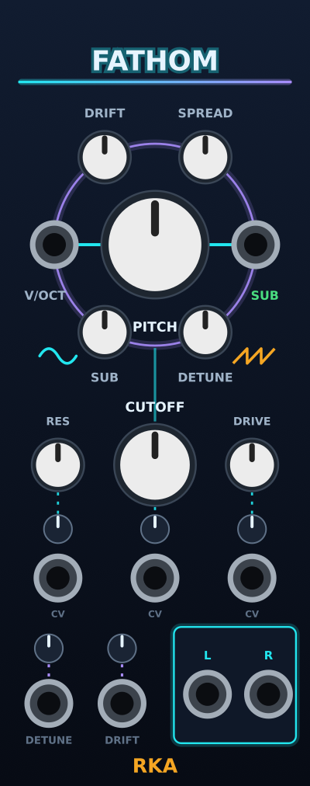

# Fathom phase 2: the filter

Design for the second phase of Fathom, the bass drone voice in `src/fathom/`.
Phase 1 (`2026-10-24-fathom-design.md`) built the voice with a clean 12 dB
low-pass as a placeholder. This phase replaces it with a Moog-style
transistor ladder with resonance and drive, lays the filter section out
flat under the voice orbit, and shrinks the attenuverters plugin-wide.
Still 10 HP. Decided 2026-10-24.



## Intent

The user wants the filter to growl: a held low note, resonance up, drive
up, the filter compressing against itself rather than whistling. A Moog
ladder is the sound in their head. They also want the low end to stay
put: a real ladder loses up to 14 dB of passband as resonance rises, and
on a bass drone that thins the one thing the module is for. So the ladder
is compensated. Sometimes they want the peak swept, or a band-pass or
high-pass colour, so the ladder's stage outputs are mixable into those.

References, in the order they shaped this:

- **VCV Fundamental VCF** (`~/ws/plugins/Fundamental/src/VCF.cpp`,
  GPL-3.0-or-later, same licence as this plugin): the structure to copy.
  A four-pole ladder with Zavalishin's trapezoidal (TPT) integrators and
  Mystran's cheap tanh linearisation, so the feedback loop is solved in one
  pass with no Newton iteration; 2x oversampled through its own polyphase
  halfband pair; self-oscillates exactly at `k = 4` with no detuning. The
  same lineage as Surge XT's Vintage Ladder.
- **Huovilainen 2004**, *Non-linear digital implementation of the Moog
  ladder filter*: the tanh-per-stage model everyone descends from.
- **Zavalishin**, *The Art of VA Filter Design* §5–6: the TPT ladder, the
  `1/(1+k)` passband loss and the input-boost compensation.
- **Oberheim Xpander** pole-mixing table (Electric Druid's write-up of the
  service manual): LP12, BP and HP from the ladder's stage outputs.
- **Instruō** panels, as in phase 1, for the flat section.

Rejected: Vult's ladders (closed source); kocmoc's Newton-iterated ladder
and Squinky's Stairway (heavier than this needs); keeping the SVF and
adding feedback saturation (not a ladder, not the sound).

## Goals, non-goals, anti-goals

Goals:

- A ladder that growls when RES and DRIVE are both up, and is clean and
  Moog-smooth when they are down.
- Low end steady as resonance rises, in low-pass modes.
- RES, DRIVE and CUTOFF each with CV and an attenuverter, all on 10 HP.
- Self-oscillation reachable at the top of RES, in tune.
- Still under 1 % of a core at 48 kHz on Apple Silicon (phase 1 measured
  0.42 %).

Non-goals for this phase: comb mode, nonlinearity choices ("voicings"),
variable oversampling, a filter position switch beyond the sub routing
below, external audio in, stereo-separate filter settings.

Anti-goals: aliasing grit when driven (hence oversampling); a resonance
knob whose useful range is the last 10 % of travel; a layout that reads
as a grid of knobs.

## Panel

The voice orbit (PITCH ring, V/OCT, SUB out, DRIFT, SPREAD, SUB, DETUNE,
glyphs) is unchanged. The cutoff ring goes. Under the orbit the filter is
three columns on a grid, each column dial over attenuverter over CV jack,
with a dotted tick from attenuverter up to dial and a thin cyan line from
the bottom of the pitch orbit down into CUTOFF (the signal: voice into
filter). The bottom band (DETUNE and DRIFT CV, output card) stays.

Positions in mm (centres), 50.8 × 128.5 panel.

| Element | Widget | x | y | Label |
|---|---|---|---|---|
| Voice line | cyan line | 25.4, 56.9 | 25.4, 68.9 | |
| RES | `rka::SmallKnob` | 9.5 | 76.0 | above, y 69.5, size 1.8 |
| CUTOFF | `rka::MidKnob` | 25.4 | 76.0 | above, y 67.3, size 2.2, ink |
| DRIVE | `rka::SmallKnob` | 41.3 | 76.0 | above, y 69.5, size 1.8 |
| RES att | `rka::Trim` | 9.5 | 86.5 | |
| CUTOFF att | `rka::Trim` | 25.4 | 86.5 | |
| DRIVE att | `rka::Trim` | 41.3 | 86.5 | |
| RES CV | jack | 9.5 | 94.0 | "CV" below, y 100.2, hint |
| CUTOFF CV | jack | 25.4 | 94.0 | "CV" below, y 100.2, hint |
| DRIVE CV | jack | 41.3 | 94.0 | "CV" below, y 100.2, hint |
| Ticks | cyan, dotted | from dial bottom + 0.3 | to trim top − 0.3 | |
| Bottom band | as phase 1 | | | |

The ticks run from the dial's edge to the trim's edge, computed from the
widget radii in `gen_panels.py` (small knob r 4.32, mid knob r 6.7, trim
r 2.3), so they stay right if a size changes. The existing violet ticks in
Fathom's band (trim to jack) are computed the same way, which also fixes
them for the smaller trim. Sway has no ticks; only its trims shrink. The
builder may move the output card down to y 102 if the "CV" hints crowd
it; the logo clears it either way.

Two widget changes in `src/widgets.hpp`, shared by all modules:

- `rka::MidKnob`: `componentlibrary::Rogan1PSWhite` (13.4 mm), between
  `BigKnob` (Rogan 3PS, 17.6 mm) and `SmallKnob` (Befaco tiny, 8.6 mm).
- `rka::Trim` becomes our own 4.6 mm knob: an `app::SvgKnob` with
  `minAngle = −0.75π`, `maxAngle = 0.75π`, foreground
  `res/components/Trim.svg` (a bright 0.5 mm pointer from r 0.4 to r 1.95,
  ink colour) over `res/components/Trim_bg.svg` (a disc, r 2.3, card
  colour, with a 0.25 mm rim in hint colour). Both SVGs are generated by
  `gen_panels.py` from the Nightglow palette so `res/` stays
  generated-only. The user asked for the smallest attenuverter that is
  still usable; nothing in the reference repos goes below Venom's 5.8 mm,
  so this is ours. Sway and Fathom's band use the same widget, so all
  attenuverters in the plugin shrink together. Sway's panel SVG does not
  change (its trims have no ticks); only the widget does.

## Controls

| Param | Range | Default | Notes |
|---|---|---|---|
| CUTOFF | 20 Hz … 20 kHz, exponential | 1.2 kHz | The ladder's pole frequency; the resonant peak sits here. |
| RES | 0 … 100 % | 20 % | `k = 4.1 · res²`. Self-oscillation from about 99 %. |
| DRIVE | 0 … 100 % | 25 % | Gain into the ladder's input tanh, `g = 2^(4·drive − 1)`: 0.5× at 0, 1× at 25 %, 8× at 100 %. |
| 3 attenuverters | −100 … +100 % | 0 | RES, CUTOFF, DRIVE |

CV: RES and DRIVE as Sway, `value = knob + atten · (cv / 10 V) · (max −
min)`, clamped. CUTOFF unchanged from phase 1, 1 V/oct at full. All three
smoothed in the DSP (below) so CV steps don't zipper. Inputs read channel
0 only.

Context menu, saved in `dataToJson`, with the phase 1 items kept:

- **Filter type**: Low-pass 24 dB (default), Low-pass 12 dB, Band-pass,
  High-pass.
- **Sub through filter**: off (default, the sub joins after the ladder)
  or on (the sub goes through it). Off keeps the drone's weight
  independent of CUTOFF; on is for closing everything down.

Two phase 1 params change meaning slightly and keep their ids: CUTOFF
(now the ladder pole) and its attenuverter. The DETUNE, DRIFT, PITCH, SUB,
SPREAD params and all inputs keep their ids and order; new params and
inputs are appended at the end of their enums so phase 1 patches load.

## Signal

Per sample, after the voice (unchanged: sub, supersaw, drift, body HP,
spread, giving `left`, `right`, `sub`):

1. **Mix in, per side.** `x = body`, plus `SUB · subGain · sub` if "Sub
   through filter" is on.
2. **Ladder**, one instance per side, same coefficients. 2x oversampled:
   upsample `x` with the halfband pair, run the core twice, decimate.
   The core, per oversampled sample, in the Fundamental style:
   - `u = comp · g_drive · x − k · y4_prev` (feedback from the previous
     oversampled sample's last stage, as Fundamental), clamped to ±4,
     then `u_sat = tanh(u)`. Here `comp = 1 + k` in the two low-pass
     modes and `1` in band-pass and high-pass (the boost compensates the
     ladder's `1/(1+k)` passband loss, which only matters when the
     passband is below the cutoff). This is the "steady low end": the
     loop's DC gain is `1/(1 + k)`, so boosting the input by `1 + k`
     returns the passband to unity for signals the tanh passes linearly.
     A reviewer's simulation of this core confirmed it: a 40 Hz sine at
     RES 90 % sits within 0.05 dB of RES 0 at input amplitudes 0.1 to 1.
   - Four TPT one-poles with Mystran's linearisation: stage `i` has
     slope `t_i = max(tanhXdX(y_i_prev), 0.01)` and
     `y_i = (G · in_i + s_i) / (1 + G · t_i)`, `s_i = 2·y_i − s_i`, where
     `in_0 = u_sat` and `in_i = t_{i−1} · y_{i−1}`;
     `G = tan(π · fc / fs_os)` via the (3,4) rational `tan` approximation
     Fundamental uses, `fc` clamped to `0.45 · fs` (not `fs_os`: four
     poles that high are no longer a filter).
   - Output per type, mixing the post-feedback node and the four stages,
     `[A·u_clamped, B·y1, C·y2, D·y3, E·y4]` (Xpander; the node is the
     feedback sum, not the raw input, or HP breaks under resonance):

     | Type | A | B | C | D | E |
     |---|---|---|---|---|---|
     | LP 24 | 0 | 0 | 0 | 0 | 1 |
     | LP 12 | 0 | 0 | 1 | 0 | 0 |
     | BP (4-pole) | 0 | 0 | 4 | −8 | 4 |
     | HP | 1 | −4 | 6 | −4 | 1 |

     then the per-output soft limit Fundamental applies,
     `v · tanhXdX(v / 2)`.
   - `tanhXdX` is Fundamental's (4,6) rational approximation of
     `tanh(x)/x`; the plain `tanh` on `u` is `u · tanhXdX(u)`.
   **Character, decided:** the per-stage saturation is the point, not a
   side effect. With it, hot signals shift the stages' slopes, the cutoff
   droops and the resonant peak compresses: the ladder "compressing
   against itself" that the user described as growl. A simpler core with
   linear stages and only the input tanh would clip cleanly and hold its
   peak in tune under a loud input, and was rejected for that reason. Two
   consequences the builder must plan for: the ladder's output is not
   bounded at 1 (the stages settle toward the ±4-clamped node, and the
   per-output limit caps it near 1.9), and a loud input at high RES
   lowers the resonant peak well below the cutoff (the reviewer measured
   −26 % at amplitude 0.2, −4 % at 0.002). Both are the sound, not bugs.
3. **Makeup.** Multiply by `1 / g_drive` below unity drive (DRIVE under
   25 % loses no level) and by `g_drive^−0.25` above it, which brings the
   3–4 dB that full DRIVE adds back to within about a dB of the default.
   The exponent is tunable by ear.
4. **Mix out.** Add `SUB · subGain · sub` if "Sub through filter" is off.
5. **Output stage** as phase 1: `tanh(CLIP_DRIVE · v)`, DC block at 2 Hz,
   × 5 V. `CLIP_DRIVE` is retuned so the defaults still peak near 4 V
   (the ladder's 24 dB slope takes more of the saws' harmonics than the
   12 dB SVF did). SUB OUT is unchanged: the raw sub before everything.

Self-oscillation: `k` can reach 4.1, past the TPT structure's exact
self-oscillation point at 4; the tanh on `u` bounds the amplitude. A
`1e-6` white-noise term is added to `u` so oscillation starts from
silence, as Fundamental does. **Decided:** the self-oscillation is a
quiet sine by design, about 0.1 at the ladder's output at `k = 4.1`
(roughly 1 V at the jack after the output stage, 10–12 dB under the
drone). The loop is bounded by the input tanh, so it cannot be loud
without raising `k` further, and a higher ceiling detunes the sine in
this per-stage model (the reviewer measured −4.8 % at `k = 5`, −6.4 % at
6). Its pitch sits a near-constant number of cents below the pole
frequency, so it tracks CUTOFF CV at 1 V/oct even though it is not
exactly at the cutoff. If the user wants it louder after the ear check,
the ceiling constant is the one knob to turn, and the cost is tuning.

Parameter smoothing, once per 16-sample block at the base rate: cutoff in
octaves with a 20 ms one-pole (as now), `k` and `g_drive` with a 20 ms
one-pole each. `G` is computed once per block from the smoothed cutoff.

Oversampling: copy Fundamental's `Upsampler2x` / `Downsampler2x` (three
allpass sections per branch, 78 dB stopband, flat passband) into a
Rack-free header, credited. One upsampler and one downsampler per side.
Always on: the cost is small and switching it with DRIVE would click.

Phase 1's `rka::Svf` stays for the body high-pass. Its LP mode and the
`OutputStage`'s low-pass go away.

## Code structure

```
src/fathom/
  Ladder.hpp          the ladder core: LadderCoefficients, Ladder (per side), Type enum,
                      the Xpander table, tanhXdX, tan_3_4; Rack-free
  Halfband.hpp        Upsampler2x / Downsampler2x from Fundamental, Rack-free
  DroneVoice.hpp      OutputStage replaced: per-side Ladder + halfband, sub insert,
                      makeup, clip, DC block
  Fathom.cpp          new params/inputs, Filter type and Sub through filter menu
  test_ladder.cpp     new
  test_voice.cpp      OutputStage tests updated
src/widgets.hpp       MidKnob, the new Trim
tools/gen_panels.py   Fathom layout, tick generation from radii, Trim SVGs
res/components/       Trim.svg, Trim_bg.svg (generated)
```

Headers stay C++17 and Rack-free, tested offline. The ladder header
credits VCV Fundamental (GPL-3.0-or-later) for the structure, the halfband
coefficients and the rational approximations, and Mystran for the
linearisation.

## Testing

Offline (`make test`, CI), with `test_ladder.cpp` measuring with sines at
48 kHz unless stated:

- **Slope and passband, LP 24, k = 0, drive 25 %:** a sine two octaves
  above the cutoff is down more than 40 dB; one at a tenth of the cutoff
  passes within 0.5 dB.
- **LP 12:** two octaves above is down between 20 and 30 dB.
- **Steady low end:** with cutoff 1 kHz, a 40 Hz sine's level at RES 90 %
  is within 1.5 dB of its level at RES 0 (LP 24 and LP 12). In HP mode
  with cutoff 100 Hz, a 5 kHz sine's level at RES 90 % is within 1.5 dB
  of RES 0 (the compensation is off there).
- **HP and BP:** HP with cutoff 100 Hz passes 5 kHz within 1 dB and cuts
  20 Hz by more than 40 dB. BP with cutoff 1 kHz is louder at 1 kHz than
  at 100 Hz and at 10 kHz by more than 20 dB each.
- **Self-oscillation:** with no input, RES 100 %, cutoff 220 Hz, the output
  settles to a bounded tone (peak between 0.05 and 0.5 after 1 s) whose
  frequency, from zero crossings, is within 5 % of 220 Hz; at 96 kHz the
  frequency matches the 48 kHz one within 0.5 %. With the cutoff an
  octave up, the frequency doubles within 0.5 % (1 V/oct tracking).
- **Resonance tuning, small signal:** with RES 95 %, a 1 kHz cutoff and a
  swept sine at amplitude 0.001, the response peaks within 5 % of 1 kHz.
  (A loud input pulls the peak down; that is the character, not tested.)
- **Drive:** a 100 Hz sine at DRIVE 100 % has at least 20 dB more energy
  in the 300 Hz bin (relative to the fundamental) than at DRIVE 0; the
  ladder's output peak never exceeds 2.0 at any DRIVE with a ±1 input,
  and after makeup full DRIVE is within 2 dB of the default's level.
- **Stability:** cutoff stepped between 20 Hz and 20 kHz every 100 ms with
  RES 100 % and DRIVE 100 % for 5 s, input a ±1 square: output finite and
  below 2.5 throughout. Same with RES stepped 0 ↔ 100 %.
- **Smoothing:** a cutoff step, a RES step and a DRIVE step each produce
  no sample-to-sample jump larger than 1.5× the steady-state maximum
  (the `testCutoffIsSmoothed` pattern).
- **Voice:** `testModuleLevelAtDefaults` keeps its 3.5 … 5.0 V bound with
  the new stage; the sub routing test checks that with "Sub through
  filter" off and cutoff at 20 Hz, a 65 Hz sub still reaches the output
  within 1 dB of its level with the cutoff open, and with it on, it does
  not.

Then `make`, `make smoke` (both themes; look at the trim size on Sway and
Fathom, the ticks, and the "CV" hints against the card), `make install`
and an ear check: C1, RES at 70 %, sweep CUTOFF; add DRIVE until it
growls; RES to the top for the sine; switch types; toggle the sub
routing with the cutoff closed. CPU under 1 %.

## Left to the builder

- The exact `CLIP_DRIVE` retune and whether `comp` wants a factor below 1
  if full compensation over-saturates at the top of RES (by ear; the test
  bound of 1.5 dB allows `comp = 1 + 0.85·k`).
- The exact tick geometry and label nudges in `gen_panels.py`, as long as
  nothing touches.
- Tooltip formats (RES and DRIVE in %, CUTOFF in Hz as now), menu wording,
  manual prose, changelog entry, README layout block, docs screenshot.
- Whether `Ladder` runs the two sides as a `float_4`-free pair of scalars
  or one struct with two states; both are fine at this CPU budget.

## Phases after this one

Unchanged from phase 1: resonator, echo and reverb next (one ring each,
widening the panel), then the mod bus and randomizer. The filter's
"voicings" and comb mode, if they ever come, belong with the resonator.
