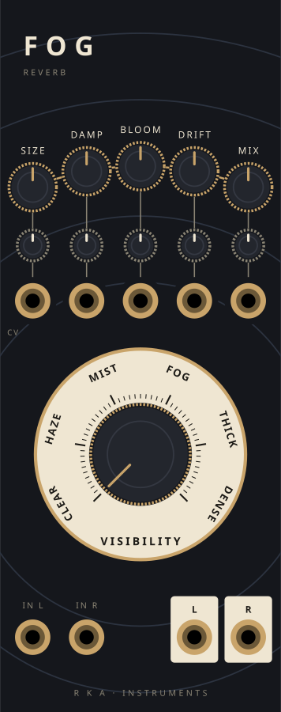

# Fog: design

Date: 2026-11-15. Status: approved by the user, after a
reviewer's check.

Fog is a stereo reverb, 10 HP, in the Instrument look: enormous, dark,
slowly blooming spaces in the style of Valhalla Supermassive and the
LV-426 mode of Valhalla Room. It is the fifth `rka` module and the second
from `docs/future/ROADMAP.md`.

This is the panel sketch the user agreed (layout A). It moves the CV jacks
into a band between the arc and the hero. It supersedes the older
`docs/future/fog-mockup.svg`, which has CV on three controls only.

## Intent

The user makes dark, space and horror ambient in VCV Rack. Their reverbs
are Valhalla Supermassive and Valhalla Room (its LV-426 mode especially),
Eventide Blackhole, some FabFilter Pro-R2, and Valley Plateau on a send
in Rack. They want "a dedicated reverb in the style of Valhalla
Supermassive and/or Room, but not have to rely on a VST in VCV Rack".

The test of success is Fathom into Fog: a held drone that its own wash
swallows, with a tail that outlasts the note by seconds or minutes.
Valhalla's algorithms are not published, so Fog aims at the character,
built from published reverb designs, and copies nothing.

How the user will play it: most controls are set once and left, but CV on
most of them is wanted for slow automatic change.

## Goals, non-goals, anti-goals

Goals:

- Huge, dense, dark spaces, from a short space up to a tail of more than
  a minute, that never run away.
- Four modes (voicings of one engine) that sound clearly different, with
  room to add more later.
- The decay time is set in seconds and holds at any Size, so the words
  on the hero dial always mean the same thing.
- Stereo throughout, and a mono source fills both sides.
- Saved presets and factory presets.
- All of `TESTING.md` from the start (the lesson from Sluice: fuzz, edge
  sample rates, sanitizers, allocation, and mutation-checked tests).

Non-goals:

- Realistic rooms and halls. A Room-style module could come later.
- A plate. Plateau already gives the user that.
- Freeze, or infinite sustain. DENSE is very long but always decays (the
  user's ruling).
- A Fathom reverb. Fog is the plugin's reverb, and Fathom's planned
  effects phase will not include one.
- Switching modes or presets from the panel or by CV. Helm, on the
  roadmap, is the module for performing changes.
- CV on Visibility (the user's ruling: "not needed").

Anti-goals, which would make it a failure even if it works:

- A metallic ring or flutter on long tails.
- Level that builds without limit under a sustained drone at THICK or
  DENSE.
- A click or burst when switching modes, when patching, or when the
  sample rate changes.
- "Mostly Plateau with a new face": if HAAR at noon sounds like a plate,
  the voicing is wrong.

## Approaches

1. **A large feedback delay network** *(picked)*. The input passes
   through a few stages of multichannel diffusion into 8–16 long delay
   lines. The lines feed back through a mixing matrix, and each has its
   own damping and slowly modulated read.
   - It is the closest published relative of Supermassive and scales to
     enormous, dense spaces.
   - Its per-line gains can be computed exactly from a decay time, so
     the time-based Visibility holds at any Size.
   - Modes become parameter sets.

   References to study: Geraint Luff, "Let's Write a Reverb" (Signalsmith
   Audio, ADC 2021, MIT code); Tom Erbe, "Building the Erbe-Verb" (ICMC
   2015); forsitan Antrum (`~/ws/plugins/forsitan-modulare/src/antrum_dsp.hpp`,
   GPL-3).
2. **Greyhole** (forsitan Caligo, `caligo_dsp.hpp`). The most
   characterful for an echo-led sound, but it is one fixed structure, and
   its decay does not map neatly to seconds. Used only as the inspiration
   for the SMOKE voicing.
3. **Mutable's compact plate tank** (Clouds and Elements `reverb.h`, MIT).
   It is proven and cheap, but small and plate-like by design, which is
   too close to Plateau.

## Panel (10 HP, layout A)

From top to bottom:
- FOG, with the subtitle REVERB.
- Size, Damp, Bloom, Drift and Mix on a graduated brass limb, an arc
  struck from the hero's centre.
- Under each, its attenuverter, then its CV jack, each column traced
  straight up to its knob.
- Visibility, the hero, low and centred on a large enamel face.
- The bottom row: IN L and IN R on the left, and the L and R outputs on
  ivory tiles on the right.

The middle of the bottom row stays empty. The space beside the title is
also empty, now that mode selection lives in the menu.

The Visibility face carries the words **CLEAR, HAZE, MIST, FOG, THICK,
DENSE**, clockwise, with CLEAR fully anticlockwise (the user's request:
more knob gives more reverb). Each word sits at the knob position whose
decay time it names (see Visibility), so the spacing follows the curve,
not equal angles. The face has graduations and no numerals.

Positions from the mockup are a starting point. The generator's checks
decide the final layout, and the user approves the generated preview
before code depends on the ids, as with Sluice.

## Controls and behaviour

Every knob defaults to noon (the user's ruling for Mix: "like the other
knobs"). CV: at full attenuverter 10 V of CV spans the knob's whole range,
added to the knob and clamped, as on Fathom (so ±5 V sweeps the whole range
only from noon). Attenuverters default to 0.

### Visibility: decay time (the hero)

The time for the tail to fall by 60 dB:

`T60 = 0.4 s × 200^v`, for v in [0, 1].

| Word | T60 | v |
|---|---|---|
| CLEAR | 0.5 s | 0.042 |
| HAZE | 2 s | 0.304 |
| MIST | 5 s | 0.477 |
| FOG | 12 s | 0.642 |
| THICK | 30 s | 0.815 |
| DENSE | 70 s | 0.975 |

- **Range:** fully left is 0.4 s and fully right 80 s. Noon is about
  5.7 s, just past MIST (*designer's call*: the curve is evenly spaced
  on a log scale, which puts noon there).
- **Holds at any Size:** each line's feedback gain comes from the T60
  and that line's current length.
- **Always decays:** the per-line gain is always below 1, so even fully
  right the tail dies away. The user's ruling for DENSE: very long, not
  infinite.
- **Tooltip:** Rack shows the time in seconds.
- **Changes:** the decay follows Visibility through a 30 ms smoother, so a
  jump (a mapping module, a typed value, a preset load during play) does
  not step the wet; the new T60 holds within about 100 ms.

### Size: the space

The character of the space, from close to vast.
- **Mechanism:** Size scales every delay length in the network together,
  on a log scale, by roughly 0.3× to 3× of the mode's base lengths
  (*designer's call*; the builder tunes the range).
- **Fully left:** a close space whose reflections blur together quickly.
- **Fully right:** vast, with distinct slow echoes before the wash fills
  in.
- **Changes:** Size is slewed (a 30 ms one-pole, settling in about
  100 ms), so that moving it gives the gentle pitch swoop of a delay
  changing length, as Supermassive's Delay does, rather than clicks. Fast CV on Size is therefore a pitch
  effect, and the manual says so.
- **Decay:** Size does not change the decay time; Visibility sets that.
  Ruled acceptable: CLEAR at Size fully right measures about 24 % short
  of its T60, because its echoes are so sparse.

### Damp: how dark the tail gets

How much faster the highs die than the lows:
- **Fully left:** none; highs last as long as lows.
- **Noon:** highs (about 4 kHz) decay about 2× faster.
- **Fully right:** about 8× faster, so the tail turns to a low rumble
  within seconds.

It is done with a damping filter in each line's feedback, whose gains are
derived from the T60 so that Visibility still means the low-frequency
decay (*designer's call*).

Changes do not click: Damp reaches the filters through the same 30 ms
smoother as Visibility (a jump used to step every line's filter at once,
and the step came back a line length later as lone 0.3–0.4 V spikes on a
1 V tone).

### Bloom: how the wash arrives

How slowly the wash swells in after a sound arrives. Bloom shapes the
signal *fed into* the network: it adds its swell on top of the network's
own build-up, which grows with Visibility (*designer's call*, after a
review noted that a long tail needs time to fill whatever Bloom does).

The targets are for the fed signal, measured as the time it takes to
reach within 3 dB of its steady level under a held input:
- **Fully left:** under 50 ms, so a long Visibility still builds only at
  the network's own rate.
- **Noon:** about 1 s.
- **Fully right:** about 4 s.

Bloom acts on the wet path only; the dry sound is never delayed. The
mechanism is left to the builder: for example, long, diffuse allpass
stages before the network, or a slow envelope on the feed.

### Drift: modulation in the tail

The depth of slow, decorrelated modulation of the lines' read positions:
- **Fully left:** none, still and glassy.
- **Noon:** gentle, enough to stop long tails ringing.
- **Fully right:** heavy smearing, with pitch deviations in the tens of
  cents.

The rate is a menu setting.

Changes do not click: the depth follows the knob, its CV and the rate
menu through a 40 ms smoother, so a stepped CV on Drift or a rate switch
during play moves the reads smoothly (a step from noon to 0 used to jump
them at once, a 2 V step on a 1 V sine). The rate itself changes at once:
the modulation's phase is continuous, so only the speed of the swing
changes, never its position.

### Mix: dry against wet

Fully left is dry only, noon is 50/50, and fully right is wet only. It
uses an equal-power crossfade (*designer's call*).

### Inputs and outputs

- **Stereo in and out.** IN R normals to IN L, so a mono source fills
  both sides.
- **Polyphony:** inputs are summed to mono per side if a polyphonic cable
  arrives (*designer's call*: a reverb per voice would cost 16× the CPU).
- **Outputs:** mono per side.

### The right-click menu

- **Mode:** HAAR (default), FRET, SMOKE, ICE. The menu is the only place
  to choose it (the user's ruling: a panel selector would get cluttered
  as modes are added).
- **Drift rate:** Slow (default, about 0.1–0.5 Hz, with the lines
  decorrelated) or Very slow (about 5× slower).
- **Low cut on the tail:** Off, 50 Hz (default) or 100 Hz. It is applied
  to the network's input, so sub-bass does not pile up in a long tail.
  The dry signal is untouched.
- **Dry kill:** forces Mix fully wet without moving the knob, for use on
  a send.

### Modes: voicings of one engine

Each mode is a set of parameters for the same engine: line count and base
lengths, diffusion stages, damping voicing, modulation shape, and whether
there is an echo stage or a pitch shifter in the loop. All the knobs keep
their meaning in every mode: the direction of each knob, and what it
does.

The numeric targets for Damp and Bloom above are exact in HAAR. Each
other mode starts from its own baseline, set in its voicing: FRET is
darker and slower to build, and ICE is brighter. Each knob then moves the
sound from that baseline by the same law. So FRET with Damp fully left is
still darker than HAAR with Damp fully left (*designer's call*). The
Damp and Bloom tests run in HAAR, and in each other mode check only that
each knob moves its quantity the right way, by at least a stated amount.

| Mode | Character | Reference | Voicing (starting point for the builder) |
|---|---|---|---|
| **HAAR** | dense, smooth, enormous wash; the default | Supermassive's darker modes | the most lines, deep diffusion, long base lengths |
| **FRET** | dark and slow-building; the space rises behind the sound | Valhalla Room LV-426 | heavier built-in damping, a slower Bloom curve, low-mid emphasis |
| **SMOKE** | echo-led: distinct repeats that blur into the wash | Supermassive's echo modes, Greyhole | fewer, longer lines, with diffusion inside the loop after each repeat (as Greyhole puts it) |
| **ICE** | sparse and glassy, with a quiet octave-up shimmer in the tail (about 11 to 13.5 dB under the note) | shimmer reverbs | brighter damping, and a +12-semitone shimmer in two parts: a small cascade in the feedback, and a fixed feed-forward octave on the wet that is audible at every Visibility |

- **Names:** the modes are named for kinds of sea fog (haar, sea fret,
  sea smoke, ice fog). ADVECTION was renamed ICE to keep it short.
- **ICE's shimmer:** two parts, the user's choice (design A).
  - **In the feedback, a small cascade** (octaves of octaves): a crossfade
    into the loop that can never add energy, however the octave lines up
    with a held note's harmonics, so no tail outlasts the T60 law. Its
    amount follows the loop's loss per pass, so it costs ICE's decay a
    fixed share (ICE's T60 runs about 13 % short) and fades as the tail
    lengthens.
  - **On the wet, a fixed octave:** each wet side is shifted up an octave
    once, after the loop, and added at a fixed level. It is never fed back,
    so it follows the tail's envelope, and it keeps the octave about
    11-14 dB under a held note from noon to DENSE (it must not fall more
    than 4 dB between them).
- **Switching modes while running:** the wet signal fades out over about
  50 ms, the network is cleared and the new mode starts clean, with no
  click (*designer's call*).

### Wet level

The user's ruling (2026-11-16, "go with scaling", like ValhallaRoom): the
wet level scales with the decay time, as a room's does, and full wet is
level-matched to dry at noon. (Until 2.0.1 the level was evened out across
Visibility: full wet matched dry at every Visibility and Size.)
- **The energy law:** at full Mix, steady noise gives an output whose level
  against the input is 10 log10(T60 / 5.66 s) dB: 0 dB at noon Visibility
  (MIST, 5.66 s), −11.5 dB fully left (0.4 s), −5.8 dB at 0.25, +5.8 dB at
  0.75 and +11.5 dB fully right (80 s), within ±1.5 dB in every mode
  (measured with ±1 V noise, which the leveller leaves alone: worst 0.53 dB
  off the law over every mode, Visibility 0, 0.25, 0.5, 0.75 and 1 at Size
  noon, Size 0 and 1 at noon Visibility, and the four corners).
- **Against the testbed:** ValhallaRoom LV-426 drops 4.8 dB from a 6.32 s
  decay to 2.15 s; the law gives 4.7 dB, and Fog drops 4.2–4.6 dB between
  those Visibility values (0.521 and 0.317), depending on the mode.
- **Size is level-neutral:** Size 1 against Size 0 within 0.75 dB in HAAR
  (within 0.9 dB in the other modes) at Visibility 0, noon and 1.
- **Loud settings are levelled:** from Visibility 0.75 up the leveller
  (below) holds loud material down: ±5 V noise comes out at about 0 dB
  against the input at 0.75 and 1, not +5.8 and +11.5. That is expected.
- Loudness does not dip as Mix goes up (within ±2 dB across Mix, at noon
  Visibility). A make-up gain on the wet, a smooth function of Visibility
  and Size (the matched level times the square root of T60 / 5.66 s), does
  this. It takes Visibility from the network's own 30 ms smoother, in step
  with the network's gains and with no smoothing of its own, so the total
  wet gain follows one smooth Visibility and a jump never swells the wet
  (a second smoother here once lagged the network and swelled a 1 → 0 jump
  5–8 dB for 50–70 ms); Size goes through a 30 ms smoother. Moving
  Visibility or Size does not step the level. The earlier −6 dB trim is
  gone. The total wet gain is split between the network's input and its
  output (the same in steady state): a fall goes on the output, so the
  echoes in the network fall with it; a rise goes on the input, so it
  reaches new sound only and a ringing tail is not lifted (all on the
  output, Visibility 0 → 1 within 150 ms of a note's end lifted the tail
  4–13 dB on noise; issue #22). The input's share is capped at 18 dB.
- **Loud drones are levelled:** a held tonal drone (a saw, a sine) builds
  up in the network to 4–8 dB over noise, with peaks to 20–50 V at Damp 0.
  The user's ruling: these are turned down, not clipped. A wet leveller, a
  slow automatic gain after the make-up and before the limiter, rides the
  wet down. It is stereo-linked (one gain for L and R, from the louder
  side): a peak follower (5 ms attack, 300 ms release) feeds a slower
  follower (10 ms attack, 3 s release), and while that is over 6.5 V the
  gain is 6.5 V divided by it; otherwise exactly 1. The dry signal is never
  touched.
  - Drones (±5 V saw, square and sine at 55–220 Hz, every mode, Visibility
    0.75 and 1, Size 0.5 and 1, Damp 0, Mix 1) put at most 0.2 % of samples
    over the limiter's 9 V knee, where without it up to 51 % were; at Mix
    noon, at most 0.8 % of the output is over 9 V (without it, up to 40 %);
    with the energy law the wet arrives hotter at 0.75 and 1, so the slow
    follower's attack is 10 ms (it was 50 ms, which let up to 1.25 % over
    9 V at Mix noon, all in a drone's first seconds); now at most 0.2 % at
    Mix 1 and 0.63 % at Mix noon. At the levels
    measured with noon Damp, a drone at full wet now comes out 0.4–2.9 dB
    under its input instead of 2–8 dB over it.
  - Noise at noon keeps the matched level: its peaks are lone samples, which barely
    move the 5 ms follower, so ±5 V noise at the matched level sits at the
    threshold. The points that read up to +0.5 dB come out at about 0 dB;
    the rest are untouched (worst −0.7 dB, as before). Anything quiet (±1 V
    at Visibility noon) passes at a gain of exactly 1.
  - It does not pump: on a steady drone (Drift 0, after the network's
    build-up) the gain moves under 0.4 dB in any second. With Drift up the
    drone's wet itself wanders by several dB a second, as the moving lines
    sweep the network's resonances across its harmonics, and the gain
    follows that wander (up to about 5 dB in a second at Visibility 1);
    the output's short-term level varies as much without the leveller.
  - It holds its gain while the input is absent: while a follower on the
    feed (5 ms attack, 50 ms release) is under 10 mV, the slow follower
    does not release. So when a loud drone stops, its tail decays as it
    would without the leveller (within 1.5 dB of it for 13 s, in every
    mode), instead of the gain lifting it back up as fast as it falls. A
    new note releases the gain again at the normal 3 s; sleep ends the
    hold.
  - Its state starts clean whenever the engine starts clean: on reset, a
    new sample rate, a mode change and a wake from sleep. The sleep test
    reads the wet before it.
- **Short sounds:** a short sound (a ping, a pluck) is about 11 dB louder
  at DENSE than at CLEAR. (Under the old matched level it was quieter at
  DENSE, its energy spread over a much longer tail; scaling with the decay
  time reverses that.)
- **If revisited:** this could later become a menu choice.

### Safety

- **Limiter:** a gentle limiter on the wet signal only, after the
  leveller (Wet level): the wet is soft-limited from the 9 V knee to a
  10 V ceiling. Drones are levelled before it, so it only catches
  transients: the spikes a bright drone's edges make in the tail, which
  the leveller's 5 ms follower is too slow for (up to about 12.5 V before
  the limiter, on under 0.2 % of samples), noise's rare peaks, and a hot
  input's onset. It keeps the wet signal within ±10 V even when the input
  is hot (*designer's call*). At Mix noon a spike on top of a ±5 V dry can
  still reach about 10.6 V at the output. The dry signal is never
  touched.
- **Bad values:** NaN or infinity on an input becomes 0 where it enters,
  and the network can never hold a NaN.
- **Denormals:** handled so that a decaying tail never slows the CPU.

### Sleep

Once the input and the wet tail have both stayed under 10 µV (the engine's
QUIET threshold) for a hold of twice the longest delay ring (at least
0.25 s; about 1.4 s in every mode), Fog stops processing the network and
wakes on the next sound. The wet is
silent while it sleeps; the dry still passes at any Mix below full wet. The
leveller's state starts clean on waking.

### Bypass

IN L passes to OUT L and IN R to OUT R, every channel. IN R normals to IN
L, as when running, so a mono source on IN L alone reaches both outputs
(a `processBypass` override: `configBypass` cannot express a normal).

### Presets

- **Saving:** Rack's own preset save and load covers every knob and
  every menu setting. The menu settings go through `dataToJson`.
- **Factory presets** go in `presets/Fog/` (*designer's call* on the
  exact values, tuned by ear):
  - **Becalmed:** FRET, THICK, heavy Damp, slow Bloom.
  - **Nebula:** HAAR, Size high, Drift high, near DENSE.
  - **Harbour:** HAAR, HAZE, short Size, Mix about 30 %, for glue on a
    send.
  - **Whiteout:** ICE, wet only, Bloom and Visibility high.

## Code and files

This follows `README.md` "Adding a module" and `TESTING.md` "Adding a
module", as Sluice did:
- **Engine:** `src/fog/FogEngine.hpp` (`rka::FogEngine`, fed a
  `FogFrame`), with its parts in Rack-free headers (delay line, diffuser,
  network, modes).
- **Module:** `src/fog/Fog.cpp`.
- **Tests:** `test_*.cpp`.
- **Bench:** `bench.inc`.
- **Panel:** an entry in `tools/gen_panels.py`.
- **Manual:** `docs/fog/README.md`.
- **Registration:** `plugin.json` (slug `Fog`), `CHANGELOG.md`.
- **Factory presets:** `presets/Fog/*.vcvm`.

Memory and sample rate:
- **Internal rate capped at 96 kHz** (*designer's call*). The network
  runs at the host rate up to 96 kHz. Above that, it runs at the host
  rate halved, once or more, until the rate is 96 kHz or lower, with
  half-band filters on the way in and out. Fathom's `Halfband.hpp` is the
  pattern. This caps memory and CPU, since a 768 kHz network would need
  hundreds of MB per instance.
- **When it is allocated:** delay buffers are sized for the largest Size
  at the internal rate, when the module is created and when the sample
  rate changes. Never in `process()`. The plan states the memory per
  instance.
- **Delay line:** written so Wake and Eddy can reuse it, since the
  roadmap has them share buffer code.

## Testing

Everything in `TESTING.md` applies from the start. Specific to Fog, with
each test shown to fail against a deliberate mutation:

- **Decay time.** Measure T60 from the energy decay of an impulse
  response (Schroeder backward integration), independently of the
  engine. Check it at each word and at three Size settings, within
  ±15 %.
- **Never runs away.** At full Visibility and every Size, Damp and Drift
  extreme, in every mode, 10 minutes of white noise followed by 3
  minutes of silence. The level stays within the limiter's bound, and
  the tail falls by at least the T60 law. This test runs as its own make
  target, not in `make test`, because of its length.
- **Even wet level.** A held ±5 V drone (pink noise or a saw) at each
  word of Visibility, in HAAR: the wet level stays within ±3 dB of the
  level at noon. (Superseded by the matched-level test, and that by the
  energy-law test: noise at Mix 1 is within ±1.5 dB of 10 log10(T60 /
  5.66 s) against the input at the listed Visibility and Size points.) No output sample exceeds 10 V.
- **Drones are levelled.** In every mode, drones put at most 1 % of samples
  over the 9 V knee at Mix 1 and at Mix noon; the leveller's gain moves
  under 1 dB in any second on a steady drone once settled; it is exactly 1
  for ±1 V signals; a drone's tail decays as it does without the leveller;
  and its state starts clean on reset, a new rate, a mode change and a
  wake (test_engine).
- **Stereo.** IN L alone fills both outputs, and the two output channels
  are decorrelated (correlation well below 1).
- **Mix and dry kill.** Fully left is bit-exact dry. Fully right and dry
  kill contain no dry. Noon gives equal power.
- **Bloom.** The wet rise time to −3 dB under a held input hits the
  targets above within a stated tolerance, and the dry path has zero
  delay.
- **Mode switch.** It is click-free: no sample-to-sample step above a
  stated bound, and the old tail is gone within 100 ms.
- **Hostile input and sample rates.** NaN and ±inf on every input;
  sample rates from 1 Hz to 768 kHz, 0 and negative. Outputs stay
  finite, and on returning to 48 kHz Fog recovers its correct decay.
- **No allocation** in `process()`; allocation only on construction and
  on a sample-rate change.
- **Seeded fuzz** of all knobs, CVs, modes and menu settings, checking
  that outputs stay finite and bounded.
- **Bench.** Idle, outputs, and busy (every mode at its heaviest, CV
  moving on all five inputs). Budgets come from measurement. Target:
  under 3 % of one Apple M-series core per instance at 48 kHz.
- **Smoke screenshot,** and the user's hands-on check in Rack against
  Fathom.

Tuning by ear is part of the work. The plan stops for the user to listen
to each mode before the voicings are fixed.

## For later modules

- **Wake and Eddy** reuse Fog's delay line.
- **A Room-style reverb** could become its own module if wanted.
- **Fathom's effects phase** has no reverb; Fog is the reverb.

## Left to the builder

- The network's size (8 or 16 lines), its matrix (Householder or
  Hadamard), the base delay lengths per mode, and the diffuser design.
- The exact Size range, the Damp filter design, and the Bloom mechanism,
  within the targets above.
- The modulation shapes and the Drift depth range.
- The pitch shifter for ICE.
- The limiter's design.
- How denormals are handled.
- Final panel positions, after the user's review of the generated
  preview.
- Bench budgets, from measurement.
