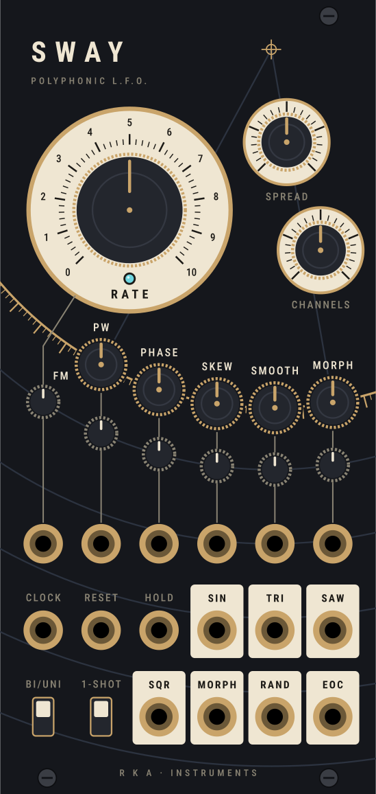
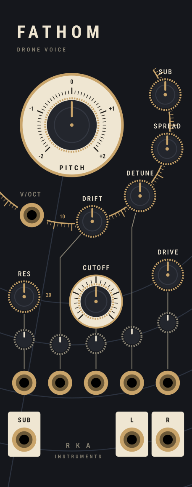
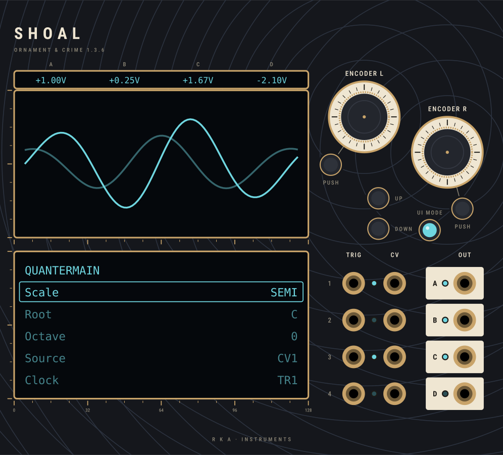

# Instrument: a new look for RKA panels

Date: 2026-11-15. Status: built (plan
`docs/plans/2026-11-15-instrument-look.md`, branch `instrument-look`).
Sway, Fathom and Shoal are drawn in this look and Nightglow is gone from
the plugin. Deferred:

- The owner's checks in a live Rack, listed at the end of the plan
  ("After the last task"): legibility at rack zoom, dark panels, knobs
  turning, CV traces, Sway's rate light, an old Sway patch, Shoal's
  widgets and lights, the smallest lettering at 100 %.
- Shoal's encoder: one detent moves its 55-tick knurl 0.23 mm, hard to
  see at 100 %. A coarser knurl (31 ticks) is proposed, not made.
- Lights (`rka::JewelLight`) keep Rack's own halo, so Rack's "light
  bloom" setting applies to them as on every other module (ruled at the
  final review, reversing an earlier "no halo"). A lit button cap has no
  halo: the cap itself is what lights.
- Below, as written before the build, the text still speaks of Nightglow
  as the current look and of Shoal as not yet designed.

RKA's panels today share one look, "Nightglow": navy gradient, slate cards
with faked neon glows, five neon accents. This document replaces it with
"Instrument": panels that read as vintage precision instruments, in brass
and ivory on near-black. It defines the shared language and applies it to
all three modules. Sway and Fathom are designed to be built from this
document. Shoal is a big-picture pass only: its features are still being
written, and its panel will be revisited when they are complete.

| Sway | Fathom |
|------|--------|
|  |  |

The mockups are sketches of the approved direction, not drawings to trace.
Their knob and jack sizes are approximate (jacks are drawn at 3.2 mm
radius; real ports are 4.0), their typeface is a stand-in, and Sway's
1-SHOT is drawn as a slide switch (see "Sway"). Where a mockup and this
text disagree, the text wins.

## Intent

The user does not like Nightglow's palette or layout and wants something
more modern and more their own. Asked what they admire, they named Instruō,
Mutable Instruments (Audible), Venom, Geodesics, Bastl and Shapetaker.
Reacting to mockups, they chose, in this order:

1. Colour from the "vintage" end (Geodesics, Shapetaker): dark ground,
   brass, ivory.
2. Less empty space. A narrower panel packed around its controls beat a
   wide one with bigger controls.
3. An Instruō-style layout: non-linear, offset in places, the artwork and
   the control positions being the same thing.
4. The feel of "a fancy precision engineering tool". They want this kept
   above everything else.
5. The "enamel gauge" finish: main controls on inset ivory dial faces.
6. From Benn Jordan's Ornament & Crime emulation (black panel, thin gold
   section outlines, cyan screen, monospace type) they liked the styling,
   but, shown its framing and monospace applied to Sway, preferred Sway
   without them. A cyan rate light, suggested by his cyan screen, stays
   "for now".
7. Knurled knobs, over a smooth gold-bezel knob (Benn's), a skirted
   pointer knob and a turned-brass knob.
8. Signal traces. With the controls on arcs, the user could not follow
   which CV jack fed which attenuverter and which knob, on Fathom most of
   all. Every CV path is now drawn.
9. For Shoal they proposed a navigation or chart theme, saw it drawn
   (compass-rose encoders, rhumb lines) beside a ripple version, and chose
   the ripples.

## Goals

- One look, shared by every RKA module, recognisably an instrument and
  recognisably RKA at rack zoom.
- Each module's geometry comes from its own idea: Sway a pendulum, Fathom
  an echo sounder, Shoal ripples from two sources.
- Tighter panels: no card of dead space, no leftover corners.
- A CV input can be followed by eye from its jack to the control it moves.
- Still generated: one description produces the panel SVGs, the C++
  layout header and the widget colours, as today.

## Non-goals

- Building Shoal's panel now. Its section below records the direction;
  positions will change with the feature work.
- Any change to DSP, parameters, ranges or patch format, other than the
  one added light on Sway.
- A light-coloured panel variant.

## Anti-goals

- Decoration. Every drawn line must be a scale, a centre mark, a
  construction line, a signal trace or a label. If a line can't say what
  it measures, marks or connects, it goes. (This is the test for
  "precision instrument" and the way to stay clear of generic steampunk.)
- Frames around groups of jacks or controls, and monospace lettering on
  the panel. Both were tried and declined.
- Neon, glow, gradients on the ground, more than one cool colour.
- Looking like a copy of any of the reference makers' panels.

## The language

Decided by the user unless marked *(proposal)*; proposals were stated in
conversation and not objected to.

**Palette.** Working values from the mockups; fine-tuning is the builder's.

| Role | Colour | Used for |
|------|--------|----------|
| Ground | `#15171c` | panel, flat, no gradient |
| Construction | `#2c3340` | faint geometry behind the controls |
| Brass | `#c9a46a` | scales on the ground, bezels, knurling, pointers, input jacks |
| Ivory | `#efe6d2` | enamel faces, output tiles, main lettering |
| Ink | `#1c1a16` | graduations and lettering on ivory |
| Dim | `#8a8474` | secondary lettering, small-knob knurling, signal traces |
| Knob body | `#23262d` | all knobs and buttons |
| Glass | `#05080c` | screens |
| Signal | `#6fd6e0` | lights and screen contents only *(proposal: cyan is reserved for things that light up)* |

**Geometry.** *(proposal)* A module has an origin (Shoal has two) and its
arcs are struck from it; controls sit on those arcs. Faint construction
circles continue the same centres across the panel.

**The limb.** *(proposal)* The arc that carries a module's main row of
knobs is drawn in brass and graduated in degrees on its outer side, like
the limb of a sextant. Other arcs are construction lines only.

**Enamel faces.** A main control sits on an ivory disc with a brass bezel.
The disc carries the control's scale in ink: fine ticks, longer majors.
The hero control's majors are numbered, in the control's real units where
it has them.

**Knobs.** Knurled, at every size: dark body, a finely dashed ring for the
knurl (brass on main and limb knobs, dim on attenuverters), a hairline
brass index, a brass centre dot on the larger sizes. These are the plugin's
own components.

**Signal traces.** Every CV input has one unbroken hairline, in dim, from
the jack through its attenuverter to the control it moves. A trace runs
straight up its column where the control is in that column. Where it is
not, the trace leaves the column with a single elbow and arrives aimed at
the centre of the control, so it meets the knob or bezel square-on; a
trace must never graze a control's edge. Traces are solid, not dotted
*(designer's recommendation; the user left it open)*, and are drawn under
the controls, which mask them. A push button that belongs to an encoder is
joined to it the same way. Layouts should be arranged so traces are short
and do not cross each other.

**Jacks.** Unframed. Inputs are bare jacks on the ground. Each output sits
on its own ivory tile with its name in ink. *(proposal)* Jacks are
brass-ringed, the plugin's own port component; if that proves poor in
Rack, the stock themed port on the same tiles is an acceptable fallback.

**Lettering.** *(proposal)* Engraved capitals: a condensed, DIN-like sans,
letterspaced. Module name large and ivory at top left with a one-line
description beneath in dim; control names ivory; secondary names dim. The
"R K A · INSTRUMENTS" mark is one small dim line centred at the foot of
the panel. The user was explicit that it must not overlap any knob,
button or jack, so it is never tucked between controls, and the bottom
row of a panel must leave it room. Pick one openly
licensed face (the panel pipeline converts text to paths, so only the
build machine needs it).

**Lights and screens.** Lights are cyan, in a dark seat, like a jewel. A
lit button lights its own cap. A screen is a window of dark glass in a
brass bezel, with pixel rulers engraved outside it.

**Direction.** A dial turns clockwise for more of what it does. The user
ruled this on two idea panels whose lettered dials first ran the other
way (`docs/future/fog.md`, `docs/future/squall.md`): no control should
surprise the hand, however true to the instrument the reverse would be.

**Narrow panels.** At 2 HP the look reduces to a small name, a crosshair
origin, one trace down the centre line and outputs on tiles, with the
mark shortened to "R K A". See `docs/future/README.md`.

**Rack's "dark panels" preference.** *(proposal)* Kept as today: the same
drawing turned down for dim rooms (deeper ground, dimmer ivory and brass),
not a different design.

## Sway: a pendulum

12 HP (60.96 mm), down from 18. Same controls, same behaviour. Working
positions, in mm, from the mockup:

- **Pivot** at (44, 8): the pendulum's pivot, marked with a small brass
  crosshair. Construction circles from it at radii 68, 80, 92, 104, 116,
  and two faint radii to the ends of the limb.
- **Limb**: radius 58 from the pivot, ticked every degree (longer every
  fifth), running off the left edge. The five shape knobs (PW, PHASE,
  SKEW, SMOOTH, MORPH) sit on it, names above.
- **Columns**: six, at x = 6.98 + 9.4·i. FM is column 0; the shape knobs
  are columns 1 to 5. A knob's y is where its column meets the limb.
- **Attenuverters**: all six, same columns, on the radius-68 arc.
- **CV jacks**: all six in a straight row at y = 88.
- **Traces**: columns 1 to 5 run straight from knob through attenuverter
  to jack. FM has no knob of its own; it modulates Rate. Its trace runs up
  column 0 from the jack through the attenuverter to y = 56, then elbows
  toward the centre of the Rate dial and stops at the bezel. The "FM"
  label sits just right of the trace, above the attenuverter.
- **Rate** at (21, 34): the hero, on an enamel face of radius about 16,
  scale numbered 0 to 10 over 270°, "RATE" in ink at the foot of the face.
- **Spread** at (46.5, 23) and **Channels** at (52, 40.5): mid knobs on
  smaller enamel faces with unnumbered scales, names beneath in dim.
- **Row at y = 102**: CLOCK, RESET, HOLD inputs in columns 0 to 2; SIN,
  TRI, SAW outputs in columns 3 to 5.
- **Row at y = 116**: BI/UNI and 1-SHOT in columns 0 and 1; SQR, MORPH,
  RAND, EOC outputs in columns 2 to 5.
- **Rate light** *(new)*: a cyan light at the foot of the Rate dial, above
  the word RATE. It shows the LFO's rate. The user's words were "keep the
  rate indicator light for now": it should be cheap to remove.

Settled here as the designer's calls:

- **1-SHOT** is a latching button with a light today, and stays one; the
  mockup's slide switch is a drawing shortcut. Its cap lights cyan.
  BI/UNI stays a two-position switch.
- **Patch compatibility.** Parameter, input, output and existing light ids
  do not change, so saved patches load. A patch that has a module hard
  against Sway's right side will simply gain a 6 HP gap.

## Fathom: an echo sounder

10 HP (50.8 mm), unchanged. Same controls, same behaviour. The Pitch dial
is the origin, the sounder's transducer; every arc is a ping travelling
out from it. Angles below are measured at the origin from straight down,
positive toward the right.

- **Origin and Pitch** at (19, 33): the hero, on an enamel face of radius
  about 13.4. Its scale has a tick per semitone over 270° and is numbered
  in octaves, −2 to +2, matching the knob's ±24 semitone range. "PITCH"
  in ink at the foot of the face.
- **Limb**: radius 26, ticked every 2° (longer every 10°), drawn from 124°
  round through the bottom to the left edge so it stays clear of the
  nameplate. On it, from the top: SUB at 108°, SPREAD at 76°, DETUNE at
  44°, DRIFT at 12°, and the V/OCT input at −24°. Names above each.
- **Columns**: five, at x = 6.4 + 9.5·i.
- **Filter**, on the radius-47 ping: RES in column 0, CUTOFF in column 2
  on a small enamel face with an unnumbered scale, DRIVE in column 4.
- **Attenuverters**, on the radius-58 ping, all five columns, in the
  order RES, DRIFT, CUTOFF, DETUNE, DRIVE.
- **CV jacks**: all five in a straight row at y = 101, same order.
- **Traces**: RES, CUTOFF and DRIVE run straight down their columns.
  DRIFT's rises up column 1 to y = 68 and elbows to the DRIFT knob;
  DETUNE's rises up column 3 to y = 60 and elbows to the DETUNE knob.
  The limb order above exists to make these two traces short and
  uncrossed; the attenuverters carry no labels because the traces name
  them.
- **Outputs** in a straight row at y = 116: SUB in column 0, L and R in
  columns 3 and 4.
- **Sounding line** *(proposal)*: a faint construction radius from the
  origin at −10°, with small brass numerals "10" and "20" where it crosses
  the limb and the filter ping. It gives the pings a depth scale. If it
  reads as clutter in Rack, drop the numerals first.
- Further construction pings at radii 72, 86 and 100.

Changes from today's layout, all the designer's calls: the DETUNE and
DRIFT CV inputs join the filter CVs in one row instead of sitting in a
band of their own; the SUB output moves from beside Pitch to the output
row; V/OCT moves from beside Pitch onto the limb. Ids do not change, so
saved patches load.

## Shoal: ripples from two sources (provisional)

28 HP, as today. The two encoders are two wave sources and their ripples
cross the whole panel, which is what a shoal does to water. This section
fixes the idea and the treatment of each kind of part. Positions are the
mockup's and are expected to move when the feature work is complete.

- **Sources**: ENCODER L at (103, 33) and ENCODER R at (126.5, 43),
  deliberately not level. Construction circles from each at radii 16, 26,
  36 and so on across the panel. Shoal has no brass limb.
- **Encoders**: knurled, without an index, since they have no end stops.
  Each sits on an enamel face ticked once per detent all the way round.
- **Push buttons**: each sits close beside its own encoder, at the same
  distance from it (about 16.5), joined to it by a trace.
- **Up and Down**: a stacked pair, Up above Down, labels to the right. The
  user was firm that they sit on no arc and are distinctly separate from
  both encoders and from the Push buttons.
- **UI Mode**: a latching button whose cap lights cyan while the mode is
  on, with its label above. In the mockup it sits between the Up/Down
  pair and the right Push; that corner is the tightest on the panel and
  is the first thing to re-space.
- **Screens**: three windows of dark glass in brass bezels: the output
  strip, the scope and the editor, at today's sizes (0.65 mm per firmware
  pixel). Outside the scope and editor, pixel rulers: a tick every 8
  pixels, longer every 32, numbered 0 to 128 under the editor. Channel
  letters A to D are engraved above the strip. In the mockup the three
  windows sit 4 mm lower than today to balance the margin above and below
  them; whether to move them is the builder's, with the feature work.
- **Screen contents** *(proposal)*: drawn by the module in cyan. The
  mockup's contents are a sample, not a specification.
- **Jack field**: a straight grid, TRIG and CV columns then OUT, four
  rows, numbered 1 to 4 at the left. A cyan light beside each trigger
  jack. Each output on a wide ivory tile holding its letter, its light
  and its jack.

## Beyond these three

Thirty-seven ideas for further modules, each with a rough panel in this
look, are noted in `docs/future/` and indexed in its README. They are
concepts, not designs: none has been through a design conversation, and
this document does not cover them. They did test the look, though, and it
held across voices, effects, utilities, panels with windows and panels
2 HP wide.

## Constraints

- Rack draws panels with nanosvg: flat fills, strokes, gradients and
  opacity; no blur, no filters, no text (hence the Inkscape text-to-path
  step in `make panels`), and dashed strokes need checking in Rack itself,
  since the knurl depends on them. If dashes fail, draw the knurl as
  individual ticks.
- Panels, `src/<module>/*Layout.hpp`, `src/RkaTheme.hpp` and
  `res/components/*` are generated by `tools/gen_panels.py`; none is edited
  by hand.
- Knobs rotate as a whole in Rack unless split into a rotating part and a
  static background, as `rka::Trim` already is.
- C++11 for the plugin's own code.
- Shoal's screens and code-drawn widgets take their colours from
  `RkaTheme.hpp`, and its layout is being changed by separate feature
  work; nothing here should be built into Shoal until that lands.

## Approaches

Three ways to build it were considered. The user has left the how to the
designer throughout; the pick is the designer's.

1. **Extend the generator** *(picked)*. `gen_panels.py` gains the
   Instrument look beside Nightglow: new primitives (arc, graduated scale,
   enamel face, output tile, crosshair, trace), a per-module choice of
   look, the new knob and port components, and the new palette in
   `RkaTheme.hpp`. Each module's entry is rewritten when its turn comes,
   after which Nightglow is deleted. Keeps one source for panel, layout
   header and colours, keeps the clearance check, and makes the second and
   third modules cheap. Cost: the generator carries two looks for a while,
   and geometry like "where this column meets that arc" has to be computed
   in it.
2. **Draw panels by hand in Inkscape**, keeping the generator only for the
   layout header. Most freedom for one-off artwork. But positions would
   live in two places, light and dark variants would be drawn twice per
   module, the clearance check is lost, and a look meant to be shared by
   every module would be redrawn for each.
3. **Draw the artwork at runtime** in C++ (NanoVG) over a plain panel.
   Allows true blur and live elements. Nothing in this look needs either,
   it costs frame time on every panel, and it moves the design out of the
   one description file.

**Order** *(designer's call)*. Sway first, then Fathom, then Shoal once
its features are complete. A mixed state in between is accepted as
temporary.

**Added beside, not replaced in place** *(designer's call)*. The shared
widgets in `src/widgets.hpp` (`BigKnob`, `MidKnob`, `SmallKnob`, `Trim`,
`AmberLatch`), `res/components/Trim*.svg` and the existing `RkaTheme`
constants are used by every module and must not change under a module
that has not moved yet. The Instrument knobs, port, lights and palette are
new classes, new component SVGs and a second block of colours, used only
by modules that have moved. The Nightglow set is deleted when the last
module moves.

**Release** *(open: the user's decision)*. Whether a module ships in the
new look as soon as it is done, or the work waits on a branch until Sway
and Fathom (or all three) are ready. Shipping piecemeal adds, each time, a
version bump, a changelog entry (for Sway, noting the width change), new
screenshots and manual text, and rewording the "one shared look
(Nightglow)" rule in the README and `CLAUDE.md`.

## Left to the builder

- Final positions, sizes and label placement, tuned in Rack against real
  component sizes and the generator's clearance check. Every coordinate
  above is a starting point.
- The typeface.
- How knob artwork is split between rotating and static parts.
- How Sway's rate light behaves at fast rates and with several polyphonic
  channels (suggest: follow channel 1, and hold steady above the rate
  where blinking stops being readable).
- Exact dimmed values for the dark-panels variant.
- Whether Nightglow's accent constants can leave `RkaTheme.hpp` early or
  must stay until the last module moves.
